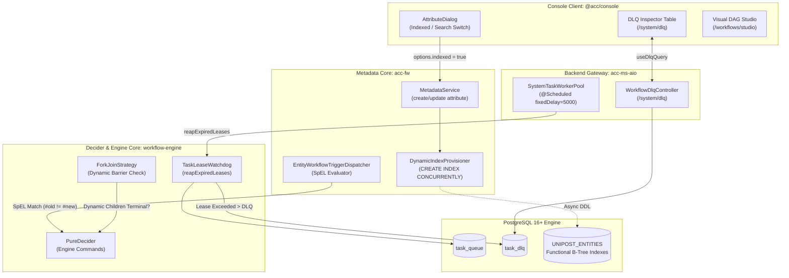

# Master Implementation Plan - Iteration 38: Full-Stack Metadata-Driven Database & Workflow Orchestration Engine Hardening

**Iteration:** 38  
**Target Systems:**  
- `@acc/backend` (`apps/backend/workflow-engine`, `apps/backend/acc-ms-aio`, `apps/backend/acc-fw`)
- `@acc/console` (`apps/console/src/features/workflows`, `apps/console/src/features/dlq`, `apps/console/src/features/metadata`)
**Companion Local Plans:**  
- Backend: [`apps/backend/doc/implementation_plan_49.md`](file:///c:/Users/Admin/workspace/git/acc/apps/backend/doc/implementation_plan_49.md)
- Console: [`apps/console/doc/implementation_plan_158.md`](file:///c:/Users/Admin/workspace/git/acc/apps/console/doc/implementation_plan_158.md)

---

## 1. Executive Summary & Architectural Directives
This consolidated master plan establishes end-to-end full-stack integration and production hardening across the **Dynamic Metadata Platform** and **Workflow Orchestration Engine**:
1. **Task Lease Watchdog & DLQ Integration**:
   - Resolves zombie worker locks by implementing a scheduled `TaskLeaseWatchdog` in the backend that re-enqueues timed-out task leases or quarantines them to `task_dlq`.
   - Surfaces lease-expired tasks in the Console UI's Dead-Letter Queue with dedicated `⚡ Lease Expired` badge telemetry and one-click replay/discard controls.
2. **Dynamic Fork Barrier Synchronization**:
   - Hardens `ForkJoinStrategy` in `workflow-engine` to dynamically verify terminal states across all dynamically spawned subtasks (`dynamicRefs`) before completing join barriers.
3. **Automated PostgreSQL JSONB Expression Indexing**:
   - Extends `DynamicIndexProvisioner` in `acc-fw` to asynchronously execute `CREATE INDEX CONCURRENTLY IF NOT EXISTS` for entity attributes marked for index acceleration.
   - Adds an "Accelerate Filters with PostgreSQL Functional Index" switch in `@acc/console` (`AttributeDialog`).
4. **SpEL Entity Mutation Filters**:
   - Replaces hardcoded event action checks with Spring Expression Language (SpEL) in `EntityWorkflowTriggerDispatcher` to prevent workflow trigger stampedes.

---

## 2. Architecture & Data Flow



---

## 3. Concrete Implementation Breakdown

### Part A: `@acc/backend` Workflow Engine (`workflow-engine`)
1. **[NEW] `com.acc.workflow.application.TaskLeaseWatchdog`**:
   - Queries `persistencePort.findExpiredLeaseTasks(nowEpochMs)`.
   - If `attempt >= maxAttempts`: Quarantines task to `task_dlq` (`TaskDlqRecord`) with reason `"TASK_LEASE_EXPIRED"`, and updates execution status to `TIMED_OUT`.
   - If `attempt < maxAttempts`: Re-enqueues task with attempt incremented and clears `lease_owner`.
2. **[MODIFY] `com.acc.workflow.application.WorkflowEngineService`**:
   - Exposes `reapExpiredLeases(long nowEpochMs)` calling `TaskLeaseWatchdog`.
   - Automatically invokes `decide(workflowId, nowEpochMs)` on workflows with timed-out tasks to unblock decision progression.
3. **[MODIFY] `com.acc.workflow.core.decider.strategy.ForkJoinStrategy`**:
   - Verifies whether prerequisite tasks in `joinOn` represent `DYNAMIC_FORK` nodes.
   - Validates that all dynamically generated subtask references have reached terminal status (`COMPLETED`, `FAILED`, `TERMINATED`).

### Part B: `@acc/backend` System Worker Fleet (`acc-ms-aio`)
1. **[MODIFY] `com.acc.aio.worker.SystemTaskWorkerPool`**:
   - Adds `@Scheduled(fixedDelay = 5000)` watchdog reaper loop executing `engineService.reapExpiredLeases(System.currentTimeMillis())`.

### Part C: `@acc/backend` Metadata Platform (`acc-fw`)
1. **[MODIFY] `com.acc.service.DynamicIndexProvisioner`**:
   - Adds `provisionAttributeIndexAsync(Long entityTypeId, String systemName, String dataType)`.
   - Asynchronously creates functional B-Tree index on `UNIPOST_ENTITIES (((attributes->>'systemName')::type))` via virtual threads.
2. **[MODIFY] `com.acc.service.MetadataService`**:
   - In `createAttributeDefinition` and `updateAttributeDefinition`, triggers async functional index generation when `options.indexed = true`.
3. **[MODIFY] `com.acc.service.workflow.EntityWorkflowTriggerDispatcher`**:
   - Evaluates SpEL conditions against `#old`, `#new`, and `#action` to eliminate trigger storms.

### Part D: `@acc/console` Full-Stack UI Integration (`apps/console`)
1. **[MODIFY] `src/features/metadata/components/schema-builder/attribute-dialog.tsx`**:
   - Adds **"PostgreSQL Functional Index"** switch in the *Validation & Options* tab.
   - Persists `options.indexed = true` to backend DTO on save.
2. **[MODIFY] `src/features/dlq/components/dlq-columns.tsx`**:
   - Adds custom badge rendering for `TASK_LEASE_EXPIRED` entries with elapsed duration and retry indicators.

---

## 4. Verification Plan

### Automated Verification
```bash
# 1. Console Vitest Suite
pnpm --filter @acc/console test -- schema-builder.test.tsx dlq-feature.test.tsx

# 2. Console TypeScript Strict Check
pnpm --filter @acc/console exec tsc --noEmit
```

### Manual Verification
1. Open Console Schema Builder, edit an attribute, toggle **"PostgreSQL Functional Index"**, and confirm `options.indexed: true` is saved.
2. Inspect `/system/dlq` table and verify expired task events render the `⚡ Lease Expired` badge.
