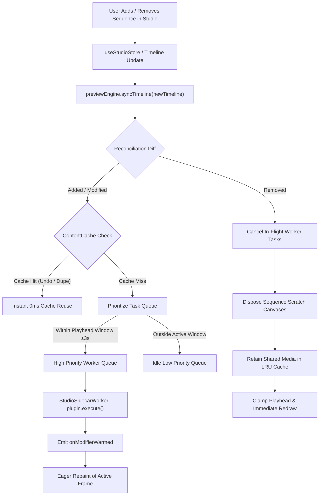
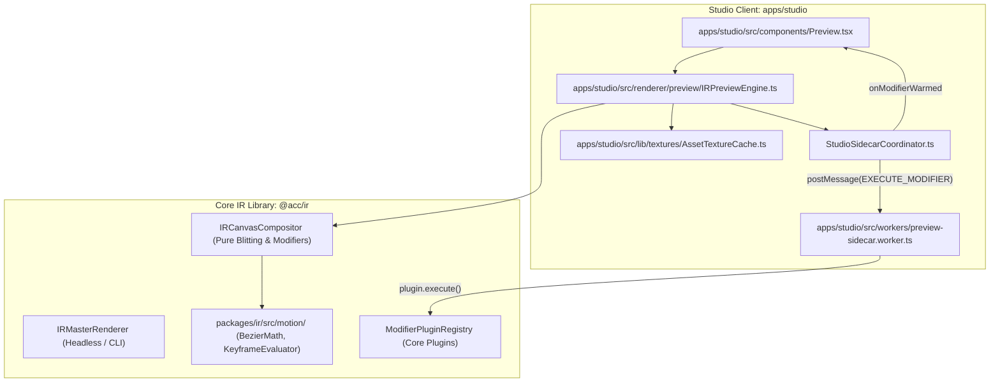

# Master Implementation Plan - Iteration 39: Relocate Preview Engine from @acc/ir to Studio & Universal Sidecar Worker Architecture

**Iteration:** 39  
**Target Systems:**  
- `@acc/ir` (`packages/ir`)
- `@acc/studio` (`apps/studio`)  
**Companion Local Plans:**  
- Studio: [`apps/studio/doc/implementation_plan_32.md`](file:///Users/anle/workspace/acc/apps/studio/doc/implementation_plan_32.md)

---

## 1. Executive Summary & Architectural Shift

Following comprehensive architectural review and system profile consolidation:
1. **Move Preview from `@acc/ir` to `apps/studio`**:
   - `IRPreviewEngine` belongs strictly to the client interactive editing environment (`apps/studio`), not the core IR definition library (`@acc/ir`).
   - `packages/ir` remains purely focused on canonical IR schemas, compiler DAGs, modifiers (`ModifierPluginRegistry`), master compositor (`IRCanvasCompositor`), and headless/batch rendering (`IRMasterRenderer`).
   - Pure mathematical keyframing and motion curve evaluators (`BezierMath`, `TemporalKeyframeEvaluator`, `DeterministicMotionEvaluator`) are relocated from `renderer/preview/` to `packages/ir/src/motion/`, as they are zero-alloc, deterministic algorithms shared across plugins.
   - `IRPreviewEngine` and its companion sidecar worker infrastructure reside in `apps/studio/src/renderer/preview/`.

2. **Universal Sidecar Coordination**:
   - `apps/studio/src/workers/visionWorker.ts` and `StudioVisionPipelineManager.ts` are deprecated and replaced by a universal, plugin-agnostic `StudioSidecarWorker` and `StudioSidecarCoordinator`.
   - Any modifier plugin (VFX/depth, audio, particle simulation, procedural shaders) that defines `execute(context, params)` can be pre-warmed off-thread without bespoke workers.

---

## 2. Handling Dynamic Sequence Modifications (Add, Remove, Reorder)

When a user adds, modifies, or deletes sequences on the timeline during editing, the engine handles state reconciliation through deterministic stages:

### Dynamic Operational Invariants:
1. **Sequence Addition & Modification**:
   - **Content Hash Verification**: Preflight outputs (e.g., depth cutouts, segment masks, surface normal maps) in `ContentCacheRegistry` are keyed by `fastChecksum(assetSrc, modifierParams)`. Cache hits are instantaneous ($0\text{ms}$).
   - **Proximity-Based Prioritization**: Sequences under the current playhead or within the immediate scrubbing window ($\pm 3$ seconds) are queued as **High Priority** (dispatched immediately to worker). Sequences further out are queued as **Low Priority** (idle-drained via `requestIdleCallback`).
   - **Non-Blocking Progressive Fallback**: The canvas frame loop never stalls. While preflight runs, `renderClipSpace` falls back to the clean 2D layer.
   - **Reactive Frame Refresh**: Upon completion, `onModifierWarmed({ targetId, modifierType })` triggers an eager frame redraw if the playhead currently sits on that sequence.

2. **Sequence Removal**:
   - **Task Abort & Worker Cancellation**: In-flight tasks matching the removed `targetId` are immediately aborted via `AbortController`.
   - **Scratch Buffer GC**: Sequence-specific scratch canvases or temporary WebGL render targets are disposed.
   - **Shared Asset Retention**: Raw media textures and ONNX model weights in `ContentCacheRegistry` and `AssetTextureCache` are retained under an LRU eviction policy.
   - **Playhead Clamping**: If removing the sequence reduces total timeline duration below the current playhead frame, `seek()` automatically clamps to `totalFrames` and triggers an immediate redraw.

---

## 3. Architecture & Data Flow

---

## 4. Work Breakdown & Implementation Steps

### Phase 1: Relocate Mathematical Motion Evaluators in `@acc/ir`
- Create `packages/ir/src/motion/`:
  - `BezierMath.ts`
  - `TemporalKeyframeEvaluator.ts`
  - `DeterministicMotionEvaluator.ts`
  - `index.ts`
- Update imports in:
  - `packages/ir/src/plugins/motion/GSAPMotionPlugin.ts`
  - `packages/ir/src/plugins/transform/TransformModifierPlugin.ts`
- Export motion utilities from `packages/ir/src/index.ts`.

### Phase 2: Relocate Preview Engine to `apps/studio`
- Create `apps/studio/src/renderer/preview/`:
  - `IRPreviewEngine.ts`
- Wire `IRPreviewEngine` to import shared motion utilities from `@acc/ir`.
- Update `IRPreviewEngine` to interface with Studio's `AssetTextureCache`.
- Remove `packages/ir/src/renderer/preview/` from `@acc/ir`.
- Update `packages/ir/src/renderer/index.ts` and `packages/ir/src/index.ts` to remove preview exports.
- Update consumers in `apps/studio`:
  - `apps/studio/src/App.tsx`
  - `apps/studio/src/components/Preview.tsx`
  - `apps/studio/src/lib/audio/WebAudioEngine.ts`
  - `apps/studio/src/workers/preview.worker.ts`

### Phase 3: Universal Sidecar Worker & Coordinator in `apps/studio`
- Create `apps/studio/src/renderer/preview/sidecar/SidecarTypes.ts`:
  - Type contracts for `WARMUP`, `EXECUTE_MODIFIER`, `CANCEL_TASK`, and `RESET`.
- Create `apps/studio/src/workers/preview-sidecar.worker.ts`:
  - Off-thread execution of `plugin.execute(context, params)` using native Vite worker bundling.
- Create `apps/studio/src/renderer/preview/sidecar/StudioSidecarCoordinator.ts`:
  - Worker lifecycle, priority queueing, task abort on sequence delete, in-process fallback for Node/Bun.
- Wire `StudioSidecarCoordinator` into `IRPreviewEngine.ts`.
- Decommission and remove `apps/studio/src/workers/visionWorker.ts` and `StudioVisionPipelineManager.ts`.

### Phase 4: Test Suite & Monorepo Verification
- Update test suites in `autogenerated-tests/`:
  - `autogenerated-tests/deterministic_bezier_evaluator.test.ts`
  - `autogenerated-tests/studio_ir_preview_engine_phase1.test.ts`
  - `autogenerated-tests/ir_preview_master_renderer_audio_parity.test.ts`
  - `autogenerated-tests/ir_renderer_web_server_parity.test.ts`
  - `autogenerated-tests/depth_diagnostic_preview.test.ts`
- Run test suites via `bun test`.
- Run import guardrail: `bun run scripts/check-native-imports.ts`.
