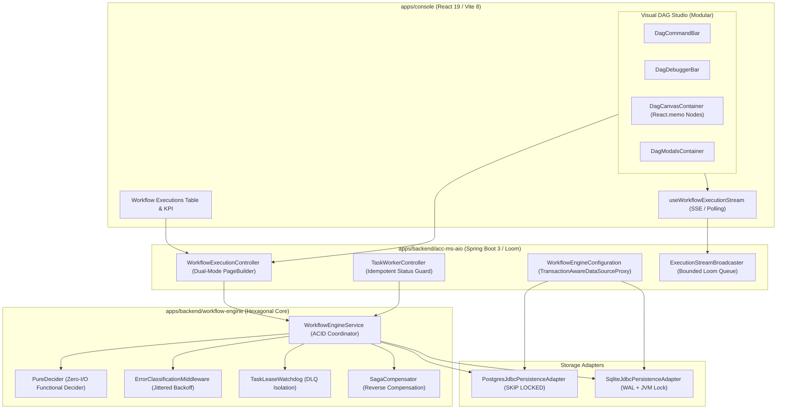

# Master Implementation Plan - Iteration 42: Enterprise Workflow Orchestration Engine Upgrade

## 1. Executive Summary & Context

Following comprehensive architectural analysis and design alignment via `/grill-me`, Iteration 42 upgrades the monorepo's distributed Workflow Orchestration Engine spanning `@acc/backend` (`apps/backend/workflow-engine` and `acc-ms-aio`) and `@acc/console` (`apps/console/src/features/workflows` and `workflow-executions`).

Key Pillars:
1. **Spring-Managed Transaction Integrity**: Wrap `DataSource` with `TransactionAwareDataSourceProxy` in `WorkflowEngineConfiguration` to bind all storage adapter JDBC calls into Spring's active `@Transactional` boundaries, maintaining zero-framework purity in core `workflow-engine`.
2. **Backend Repair & Dual-Mode Pagination**: Restore the truncated `simulateExecution` in `WorkflowEngineService.java`, fix lease reaping, and implement `GET /api/v1/workflow/executions` supporting both offset (`page`, `size`) and keyset (`limit`, `afterId`) pagination via PageBuilder.
3. **Resilience & Idempotency**: Add `RetryWithJitterPolicy` and `ErrorClassificationMiddleware` (RETRYABLE vs NON_RETRYABLE) with optimistic state checks in `reportTaskResult`.
4. **Visual DAG Studio 60 FPS Modular Decomposition**: Decompose the 1,038-line `visual-dag-studio.tsx` into modular subcomponents (`DagCanvasContainer`, `DagCommandBar`, `DagDebuggerBar`, `DagModalsContainer`) and isolate node re-renders with `React.memo` and shallow diffing.
5. **Contract Harmonization & WCAG 2.2 AA Accessibility**: Harmonize `/workflows` and `/workflow-executions` on the canonical `WorkflowExecutionSnapshot` contract, provide full edge-aware keyboard navigation on canvas nodes, and synchronize `packages/sandbox`.

---

## 2. Architecture & Subsystem Diagram

---

## 3. Subsystem Upgrade Tracks

### Track A: Backend Transactional Integrity & Core Engine Repair
- Wrap `DataSource` in `TransactionAwareDataSourceProxy` in `WorkflowEngineConfiguration`.
- Restore `simulateExecution` in `WorkflowEngineService.java` and clean lease reaping delegation.
- Implement `GET /api/v1/workflow/executions` in `WorkflowExecutionController` with dual-mode pagination (`page`/`size` and `limit`/`afterId`), status/key filters, and tenant partitioning.
- Enforce optimistic state check in `reportTaskResult` for idempotent completion.
- Add JVM reentrant lock for SQLite polling in `SqliteJdbcPersistenceAdapter`.

### Track B: Backend Streaming Broadcaster Resilience
- Enforce capacity ceiling (max 100 emitters per execution) on `ExecutionStreamBroadcaster`.
- Add periodic 15-second heartbeat ping and active cleanup of disconnected clients.

### Track C: Frontend Studio Modularization & Performance Tuning
- Decompose `visual-dag-studio.tsx` into `DagCanvasContainer`, `DagCommandBar`, `DagDebuggerBar`, `DagModalsContainer`.
- Wrap `DagWorkflowNodeComponent` with `React.memo` and shallow comparator to restrict re-renders to only nodes with state changes.
- Add WCAG 2.2 AA graph-aware keyboard navigation (Arrow keys along DAG edges, Enter to open Inspector) and status live announcements.
- Fix definition key resolution in `WorkflowExecutionStreamModal`.

### Track D: Sandbox Parity & Monorepo Testing
- Support both `/api/workflow/executions` and `/api/v1/workflow/executions` with pagination in `packages/sandbox/src/handlers/workflow-handler.ts`.
- Run full automated test suites across backend and frontend.
