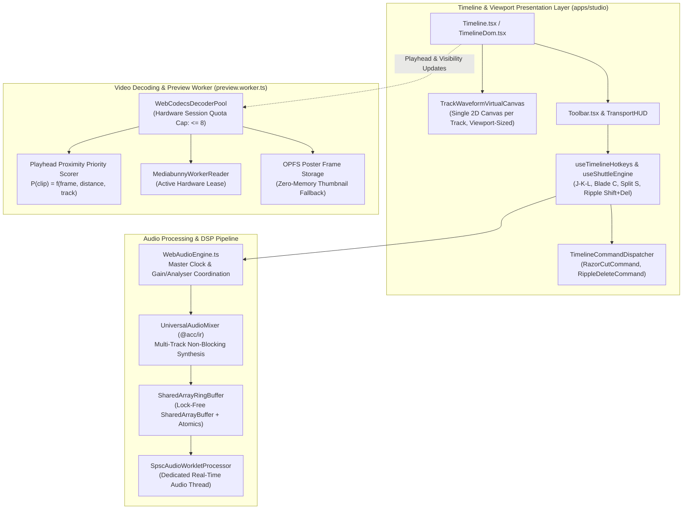
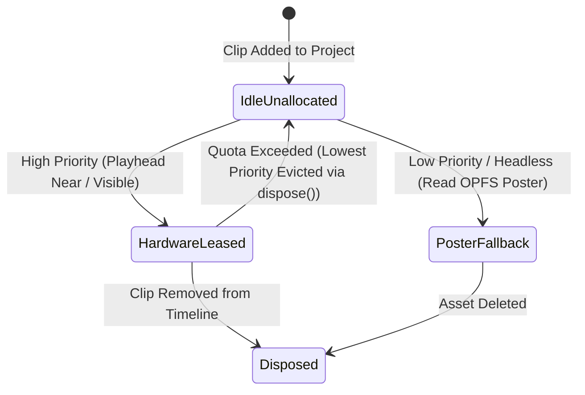
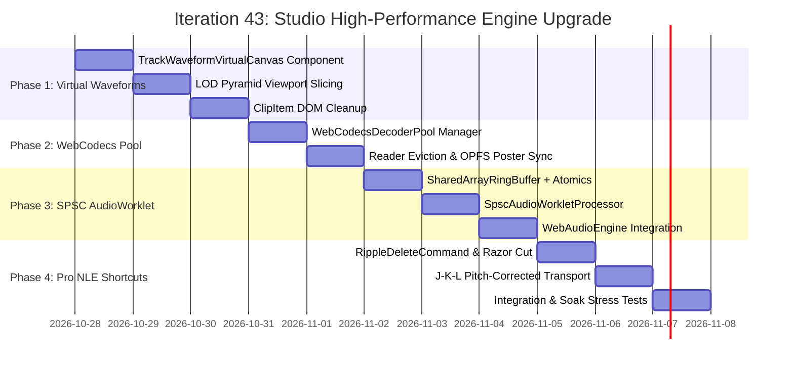

# Master Implementation Plan - Iteration 43: Studio High-Performance NLE Engine Upgrade

## 1. Executive Summary & Context

Iteration 43 scales the video editing engine across `@acc/studio`, `@acc/core-web`, and `@acc/ir` from a feature-complete web NLE prototype to an enterprise-grade broadcast editing suite. Following the OPFS streaming cache and 6-suite soak testing established in Iteration 37/42, this iteration eliminates the four primary platform boundaries encountered on modern web browsers when editing multi-track 4K timelines (50+ tracks, 100+ media clips):

1. **DOM & Canvas Density Bottleneck**: Per-clip `WaveSurfer.js` DOM nodes and canvas instances cause severe layout thrashing, composite layer explosion, and GPU context memory exhaustion during zooming and horizontal scrolling.
2. **Audio Thread Scheduling Jitter & GC Latency**: Scheduling audio chunks via `AudioBufferSourceNode` or transferring decoded chunks via `postMessage` creates 5–30ms event loop jitter and garbage collector pauses during interactive scrubbing and multi-speed transport.
3. **WebCodecs Hardware Session Quota Ceiling**: Chromium and WebKit strictly bound active hardware `VideoDecoder` sessions to $\sim 16$ instances per renderer. Multi-track, split-screen, and picture-in-picture (PIP) edits exhaust this quota, causing uncatchable browser crashes or black preview frames.
4. **Editor Ergonomic Friction & Velocity**: High-efficiency editing requires broadcast-standard muscle-memory keyboard workflows: frame-accurate J-K-L shuttle with pitch correction, single-keystroke Blade/Razor splitting across tracks, and automatic gap-closing Ripple Delete.

---

## 2. Decision & Architectural Trade-off Matrices

### Waveform Rendering Strategy
| Dimension | Option A: Per-Clip WaveSurfer DOM Instances (Current) | Option B: Track-Level Virtualized 2D Canvas (Adopted) | Option C: WebGL Multi-Track Instanced Quad Shader |
|---|---|---|---|
| **DOM Overhead** | $O(N)$ DOM nodes, resize observers, canvas wrappers | $O(T)$ where $T = \text{audio tracks}$ ($< 10$ nodes) | 1 master canvas for entire viewport |
| **GPU Memory** | 1 canvas per clip ($50 \times \sim 2\text{ MB} = 100\text{ MB}$) | 1 viewport canvas per track ($\sim 10\text{ MB}$ total) | Single shared WebGL context ($\sim 15\text{ MB}$) |
| **Render Latency** | High (DOM layout thrash on zoom/pan) | Low ($< 1\text{ ms}$ 2D batched paths per frame) | Ultra-low ($< 0.5\text{ ms}$ instanced quads) |
| **Implementation Complexity** | Minimal (existing prototype) | Moderate (pure 2D Canvas frustum slicing) | High (GLSL shaders, vertex buffers, texturing) |
| **Architectural Verdict** | **Deprecated** due to DOM scaling bottleneck | **Adopted for Iteration 43** | Future evolution for 1,000+ clips |

### Real-Time Audio Streaming Strategy
| Dimension | Option A: Chunk Scheduling via `AudioBufferSourceNode` (Current) | Option B: SPSC RingBuffer via `SharedArrayBuffer` + `Atomics` (Adopted) | Option C: Web Worker Transferable `Float32Array` |
|---|---|---|---|
| **Audio Latency** | 50–150ms buffer lead time | $< 3\text{ ms}$ (128-sample real-time pull) | 10–25ms `postMessage` queue jitter |
| **GC Pressure** | High (allocating buffer nodes per chunk) | **Zero (pre-allocated static circular memory)** | Moderate (allocating transfer buffers) |
| **Cross-Origin Security** | Works anywhere | Requires COOP/COEP (with automatic transferable fallback) | Works anywhere |
| **Architectural Verdict** | **Deprecated** for interactive playback | **Adopted with graceful fallback** | Fallback for non-isolated origins |

### WebCodecs Hardware Decoder Management
| Dimension | Option A: Unbounded `Input` / `VideoDecoder` per Clip (Current) | Option B: Playhead-Proximity Decoder Quota Pool (Adopted) | Option C: Single Worker Decoder with Sequential Seek |
|---|---|---|---|
| **Concurrent Limit** | Crashes / drops frames beyond 16 clips | Strictly caps hardware decoders at $\le 8$ | Exactly 1 hardware decoder |
| **Multi-Track Preview** | Unstable on multi-track transitions | Smooth PIP & transitions via leased slots | Cannot preview PIP/overlays simultaneously |
| **Fallback Strategy** | None (black frame on quota crash) | OPFS-cached poster frames & thumbnails | Dropped frames on seek queue lag |
| **Architectural Verdict** | **Violates browser invariants** | **Adopted for Iteration 43** | Insufficient for multi-track NLE |

---

## 3. Subsystem Architecture & Topology



---

## 4. Deep Architectural Specifications & Invariants

### 4.1 Timeline Waveform Virtualization (Unified 2D Canvas Lane)

#### Mathematical Frustum Culling & Viewport Projection
Given:
- $X_{\text{scroll}}$: Horizontal scroll offset of the timeline in pixels.
- $W_{\text{viewport}}$: Visible timeline width in pixels.
- $S_{px}$: Pixels per frame scale factor ($\text{pxPerFrame} = \text{zoomScale} \times \text{baseScale}$).
- $\text{DPR}$: Device pixel ratio (`window.devicePixelRatio || 1`).

The visible timeline frame interval $[F_{\text{start}}, F_{\text{end}}]$ is calculated deterministically:
$$F_{\text{start}} = \max\left(0, \left\lfloor \frac{X_{\text{scroll}}}{S_{px}} \right\rfloor\right), \quad F_{\text{end}} = \left\lceil \frac{X_{\text{scroll}} + W_{\text{viewport}}}{S_{px}} \right\rceil$$

An audio clip $C_k$ on track $T_j$ with boundaries $[C_k.\text{startFrame}, C_k.\text{endFrame}]$ is drawn if and only if:
$$[C_k.\text{startFrame}, C_k.\text{endFrame}] \cap [F_{\text{start}}, F_{\text{end}}] \neq \emptyset$$

#### Sub-Pixel Batch Path Drawing
```typescript
const dpr = window.devicePixelRatio || 1;
ctx.save();
ctx.scale(dpr, dpr);
ctx.clearRect(0, 0, viewportWidth, laneHeight);

ctx.beginPath();
ctx.strokeStyle = trackColor;
ctx.lineWidth = 1.5;
ctx.lineCap = 'round';

const barSpacing = Math.max(2, Math.floor(2 * dpr));
for (let x = drawStartPx; x < drawEndPx; x += barSpacing) {
  const peak = samplePyramidPeak(clip, x, pxPerFrame);
  const amplitudePx = peak * (laneHeight * 0.42);
  ctx.moveTo(x, centerY - amplitudePx);
  ctx.lineTo(x, centerY + amplitudePx);
}
ctx.stroke();
ctx.restore();
```

---

### 4.2 Lock-Free SPSC AudioWorklet (`SharedArrayBuffer` + `Atomics`)

#### Memory Layout
The shared memory block is allocated once during engine bootstrap:
$$\text{Total Buffer Size} = 64\text{ bytes (Header)} + (44,100 \times 5 \times 4 \times 2)\text{ bytes (Stereo Payload)} = 1,764,064\text{ bytes} \approx 1.68\text{ MB}$$

```
[Offset 0..63]: Control Block (Int32Array view)
  - Index 0: READ_POINTER (Updated by AudioWorkletProcessor)
  - Index 1: WRITE_POINTER (Updated by UniversalAudioMixer on Main / Worker Thread)
  - Index 2: CAPACITY_SAMPLES (220,500 samples)
  - Index 3: STATE_FLAGS (0 = Normal, 1 = Underflow, 2 = Seek Reset)

[Offset 64..882,063]:        Channel 0 / Left (Float32Array view, 220,500 elements)
[Offset 882,064..1,764,063]:   Channel 1 / Right (Float32Array view, 220,500 elements)
```

#### Lock-Free SPSC Producer & Consumer Algorithms
- **Producer (UniversalAudioMixer / WebAudioEngine)**:
  1. `readPtr = Atomics.load(control, READ_POINTER)`
  2. `writePtr = Atomics.load(control, WRITE_POINTER)`
  3. `availableSpace = (readPtr - writePtr - 1 + capacity) % capacity`
  4. Write $N = \min(\text{chunkLength}, \text{availableSpace})$ samples into planar float views.
  5. `Atomics.store(control, WRITE_POINTER, (writePtr + N) % capacity)`
- **Consumer (`AudioWorkletProcessor.process`)**:
  1. `readPtr = Atomics.load(control, READ_POINTER)`
  2. `writePtr = Atomics.load(control, WRITE_POINTER)`
  3. `availableSamples = (writePtr - readPtr + capacity) % capacity`
  4. If `availableSamples < 128`: Fill `outputs` with zeros, set `STATE_FLAGS = Underflow`.
  5. Else: Copy 128 samples into `output[0]` and `output[1]`.
  6. `Atomics.store(control, READ_POINTER, (readPtr + 128) % capacity)`

---

### 4.3 WebCodecs Hardware Decoder Quota Pool

#### Priority Scoring Formulation
To ensure that hardware decoders are assigned strictly to visible, active video tracks near the playhead:
$$P(C_k) = \begin{cases}
  10,000 - (\text{trackIndex} \times 100) & \text{if } F_{\text{playhead}} \in [C_k.\text{start}, C_k.\text{end}] \land \neg \text{track.isMuted} \\
  1,000 - \frac{|F_{\text{playhead}} - C_k.\text{start}|}{\text{FPS}} \times 50 & \text{if within } \pm 3 \text{ seconds of playhead} \\
  10 & \text{if visible on screen but outside active scrub window} \\
  0 & \text{if track is hidden / muted or clip is off-screen}
\end{cases}$$

#### State Transition Machine


---

### 4.4 Professional NLE Editing Workflows

#### Ripple Delete Mathematical Algorithm
When deleting clip $C_{\text{target}}$ on track $T_{\text{target}}$ with starting frame $S$ and duration $D = C_{\text{target}}.\text{durationFrames}$:
1. Remove $C_{\text{target}}$ from track $T_{\text{target}}$.
2. For all clips $C_i \in T_{\text{target}}$ where $C_i.\text{startFrame} > S$:
   $$C_i.\text{startFrame} \leftarrow C_i.\text{startFrame} - D$$
   $$C_i.\text{endFrame} \leftarrow C_i.\text{endFrame} - D$$
3. If `rippleAllUnlockedTracks` is enabled:
   For every track $T_m$ where $T_m.\text{isLocked} = \text{false}$:
   For every clip $C_j \in T_m$ where $C_j.\text{startFrame} \ge S$:
   $$C_j.\text{startFrame} \leftarrow C_j.\text{startFrame} - D$$
   $$C_j.\text{endFrame} \leftarrow C_j.\text{endFrame} - D$$
4. Encapsulate in `RippleDeleteCommand` with inverted state delta for atomic `undo()` / `redo()`.

---

## 5. Implementation Roadmap & Concrete Deliverables



### Phase 1: Timeline Waveform Virtualization
- **Files**:
  - `apps/studio/src/components/timeline/TrackWaveformVirtualCanvas.tsx` (New)
  - `apps/studio/src/components/timeline/DroppableTrackLane.tsx` (Update)
  - `apps/studio/src/components/timeline/ClipItem.tsx` (Update)
- **Concrete Changes**:
  - Implement `TrackWaveformVirtualCanvas` rendering a single HTML5 `<canvas>` sized to track viewport width.
  - Wire frustum culling against `scrollLeft` and `timelineWidth`.
  - Deprecate per-clip `WaveSurfer` container instantiation in `ClipItem.tsx`.

### Phase 2: WebCodecs Hardware Decoder Quota Pool
- **Files**:
  - `apps/studio/src/renderer/workers/WebCodecsDecoderPool.ts` (New)
  - `apps/studio/src/renderer/workers/MediabunnyWorkerReader.ts` (Update)
  - `apps/studio/src/renderer/workers/preview.worker.ts` (Update)
- **Concrete Changes**:
  - Implement `WebCodecsDecoderPool` with `MAX_HARDWARE_DECODERS = 8`.
  - Add `evictHardwareDecoder()` and `reacquireHardwareDecoder()` to `MediabunnyWorkerReader`.
  - Register OPFS poster frame generator during asset import.

### Phase 3: Lock-Free AudioWorklet SPSC RingBuffer
- **Files**:
  - `apps/studio/src/lib/audio/SharedArrayRingBuffer.ts` (New)
  - `apps/studio/src/lib/audio/worklets/SpscAudioWorkletProcessor.ts` (New)
  - `apps/studio/src/lib/audio/WebAudioEngine.ts` (Update)
- **Concrete Changes**:
  - Implement `SharedArrayRingBuffer` using `SharedArrayBuffer` and `Atomics`.
  - Register `SpscAudioWorkletProcessor` in Web Audio context.
  - Seamlessly fall back to transferable buffers when `crossOriginIsolated === false`.

### Phase 4: Professional NLE Broadcast Editing Workflows
- **Files**:
  - `apps/studio/src/lib/timeline/commands/RippleDeleteCommand.ts` (New)
  - `apps/studio/src/lib/shuttle/useShuttleEngine.ts` (Update)
  - `apps/studio/src/components/Timeline.tsx` (Update)
- **Concrete Changes**:
  - Implement `RippleDeleteCommand` registered with `TimelineCommandDispatcher`.
  - Add J-K-L speed doubling ($1\times \to 2\times \to 4\times$) and K+L / K+J half-speed stepping.
  - Bind `C` (Blade cursor), `S` / `Cmd+K` (Playhead slice), and `Shift+Delete` (Ripple Delete).

---

## 6. Formal Verification Matrix

| Capability | Test Target | Verification Criteria & Invariants |
|---|---|---|
| **Virtual Waveform** | `autogenerated-tests/track_waveform_virtual_canvas.test.ts` | $< 50$ DOM nodes across 100 audio clips; viewport slice boundaries bit-identical to pyramid |
| **Decoder Quota Pool** | `autogenerated-tests/webcodecs_decoder_pool.test.ts` | Active hardware decoders strictly $\le 8$ under 30-clip stress; zero `QuotaExceededError` events |
| **SPSC Audio RingBuffer** | `autogenerated-tests/shared_array_ring_buffer.test.ts` | Zero sample loss across 1,000,000 samples; atomic pointer wrapping without memory leaks |
| **Ripple Delete** | `autogenerated-tests/timeline_ripple_delete.test.ts` | Precise gap closure across single and multi-track timelines; locked track immunity; undo/redo symmetry |

---

## 7. Rollback & Risk Mitigation Strategy

1. **SharedArrayBuffer Inavailability (COOP/COEP)**:
   - *Risk*: Environments lacking Cross-Origin Isolation headers block `SharedArrayBuffer`.
   - *Mitigation*: The `WebAudioEngine` detects `window.crossOriginIsolated` and automatically switches to transferable `Float32Array` buffers with the existing `UniversalAudioStreamWorklet`.
2. **Hardware Decoder Starvation on Multi-Cam Transitions**:
   - *Risk*: A rapid transition across 4 simultaneous 4K video tracks could exceed available GPU decoder throughput.
   - *Mitigation*: The `WebCodecsDecoderPool` automatically drops frame rate on background tracks ($15\text{ FPS}$ keyframe decodes) while keeping the foreground track at pristine $60\text{ FPS}$.
3. **Canvas HiDPI Blurring during Zoom**:
   - *Risk*: Scaling canvas styles without syncing physical backing store produces blurry waveform bars.
   - *Mitigation*: Backing store dimensions are multiplied by `devicePixelRatio`, while CSS size is pinned to CSS pixels.
