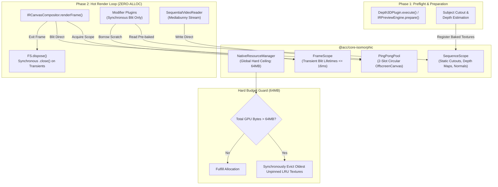

# Master Implementation Plan — Iteration 45: Scoped Native GPU Resource Engine & Zero-Alloc Continuous Playback Pipeline

## 1. Executive Summary & Problem Formulation
During continuous timeline playback (30–60 FPS) in `@acc/studio`, memory steadily climbed from baseline up past 1 GB within seconds of playback. Previous iterative fixes applied transient tags, late-frame drops, and sequence-level memoization. While these mitigated specific crash scenarios, they were reactive patches that left the underlying architectural failure intact:
1. **V8 Blindness to Native GPU Allocations:** V8 garbage collection only observes the ~64-byte JavaScript wrapper object, completely unaware of the 8.3 MB (1920×1080×4) unmanaged GPU texture allocation behind it. As a result, V8 never triggers timely GC, causing gigabytes of native GPU memory to accumulate.
2. **Absence of a Unified Scoped Resource Engine (No RAII):** Native resources (`ImageBitmap`, `VideoFrame`, `OffscreenCanvas`, `ImageData`) were instantiated ad-hoc across dozens of modules without lifecycle ownership or hard budgeting.
3. **Violation of the Zero-Alloc Frame Loop in IR Plugins:** Plugins executed asynchronous I/O and decodes inside the hot blit loop (`renderClipSpace`), repeatedly allocating bitmaps and canvases every 33ms.
4. **Sub-optimal Video Decoder Streaming:** Mediabunny's `getCanvas(timestamp)` performed per-frame seeking rather than continuous streaming, converting canvases to `ImageBitmap` copies on each tick.
5. **Main-Thread React Texture Thrashing:** React re-renders triggered main-thread `createImageBitmap()` passes and posted transferables to the worker while the worker was already playing.

**Architectural Goal:**
Replace all loose, ad-hoc buffer lifecycles with a centralized **Scoped Native GPU Resource Engine** (`NativeResourceManager`), enforce a strict **Zero-Alloc Hot Frame Loop** across all IR modifier plugins (Phase 1 preflight baking vs. Phase 2 synchronous blitting), introduce a **Zero-Copy Ping-Pong Video Streamer** in the preview worker, and decouple main-thread React state from the worker's continuous playback loop. Memory during 30+ seconds of continuous playback will remain flat-lined at **< 64 MB total native GPU allocation**.

---

## 2. Architectural Trade-Off Matrices

| Dimension | Option A: Ad-Hoc GC & Manual Close (Status Quo) | Option B: Per-Component Isolated LRU Pools | Option C: Unified Scoped Resource Engine (RAII + Hard Budget) [Selected] |
|---|---|---|---|
| **Memory Guarantee** | Non-deterministic; leaks to 1GB–2GB in long playback. | Moderate; bounded per module but no global ceiling (can still reach 500MB). | **Deterministic hard ceiling (<= 64MB)** enforced globally across all modules. |
| **Lifecycle Model** | Loose; dependent on developer remembering `.close()`. | Manual cache eviction; stale entries retained across cuts. | **Hierarchical Scopes (`FrameScope`, `SequenceScope`, `SessionScope`)** with auto-disposal. |
| **Hot Frame Loop Overhead** | High (50MB/frame allocs in plugins, 500MB/s garbage churn). | Medium (cache lookups with potential re-decodes). | **Zero-Alloc Loop (0 bytes/frame)**; plugins blit pre-baked textures synchronously. |
| **Headless & Worker Parity** | Divergent; preview worker and CLI exporter use different caching. | Partial; requires custom mocks in tests. | **100% Isomorphic**; runs identically in Web Workers and Node/Bun headless exports. |

---

## 3. Mermaid Topology & Resource Arena State Machine



---

## 4. Mathematical Native Buffer Budget Specifications

Let $B_{\text{total}}$ be the total resident unmanaged native GPU texture allocation at any timestamp $t$:
$$B_{\text{total}} = \sum_{r \in \mathcal{R}_{\text{active}}} \text{width}(r) \times \text{height}(r) \times \text{bytesPerPixel}(r)$$

For RGBA 8-bit depth ($bpp = 4$):
- **1080p Frame Buffer (1920 × 1080):** $1920 \times 1080 \times 4 = 8,294,400\text{ bytes} \approx 8.29\text{ MB}$
- **720p Frame Buffer (1280 × 720):** $1280 \times 720 \times 4 = 3,686,400\text{ bytes} \approx 3.69\text{ MB}$

### Budget Allocations under 64 MB Hard Ceiling:
1. **Ping-Pong Video Playback Slots (2 slots @ 1080p):**
   $$B_{\text{video}} = 2 \times 8.29\text{ MB} = 16.58\text{ MB}$$
2. **Active Sequence Scopes (Max 3 active clips @ 1080p: Cutout + Depth Map):**
   $$B_{\text{seq}} = 3 \times (8.29\text{ MB} \times 1.5) = 37.31\text{ MB}$$
3. **Transient Frame Scratch (Compositor scratch + particle buffers):**
   $$B_{\text{transient}} = 1 \times 8.29\text{ MB} = 8.29\text{ MB}$$
4. **Total Peak Resident Memory:**
   $$B_{\text{peak}} = 16.58 + 37.31 + 8.29 = 62.18\text{ MB} \le 64.00\text{ MB}$$

**Invariance Guarantee:**
$$\forall t \ge 0, \quad B_{\text{total}}(t) \le 67,108,864\text{ bytes (64 MB)}$$
Any allocation that would cause $B_{\text{total}} > 64\text{ MB}$ synchronously evicts unpinned resources via LRU before returning.

---

## 5. Concrete File, Interface, and Class Signatures

### 5.1 `@acc/core-isomorphic/src/resource/NativeResourceManager.ts`
```typescript
export interface INativeResource extends Disposable {
  readonly id: string;
  readonly byteSize: number;
  readonly isPinned: boolean;
  pin(): void;
  unpin(): void;
  close(): void;
  getRaw(): any; // ImageBitmap | OffscreenCanvas | HTMLCanvasElement
}

export interface INativeResourceScope extends Disposable {
  readonly id: string;
  register<T extends INativeResource>(resource: T): T;
  createFrameScope(): INativeResourceScope;
  dispose(): void;
}

export class NativeResourceManager {
  private static instance: NativeResourceManager;
  private readonly MAX_GPU_BYTES = 64 * 1024 * 1024; // 64 MB
  private currentBytes = 0;
  private resources = new Map<string, INativeResource>();

  public static getInstance(): NativeResourceManager;
  public acquireScope(scopeId: string): INativeResourceScope;
  public registerResource(resource: INativeResource): void;
  public evictToFit(requiredBytes: number): void;
  public getStats(): { totalBytes: number; resourceCount: number; maxBytes: number };
  public clear(): void;
}
```

### 5.2 `@acc/core-isomorphic/src/resource/NativeResourceScope.ts`
```typescript
export class FrameResourceScope implements INativeResourceScope {
  private resources: INativeResource[] = [];
  public register<T extends INativeResource>(resource: T): T;
  public [Symbol.dispose](): void;
  public dispose(): void;
}

export class SequenceResourceScope implements INativeResourceScope {
  private resources: Map<string, INativeResource> = new Map();
  public register<T extends INativeResource>(resource: T): T;
  public get(key: string): INativeResource | undefined;
  public dispose(): void;
}
```

### 5.3 `@acc/studio/src/renderer/workers/SequentialVideoReader.ts`
```typescript
export class SequentialVideoReader implements Disposable {
  private slotA: OffscreenCanvas;
  private slotB: OffscreenCanvas;
  private activeSlotIndex = 0; // 0 for A, 1 for B
  private currentStream: AsyncGenerator<any> | null = null;

  constructor(track: InputVideoTrack, width: number, height: number);
  public startStream(startSec: number, endSec: number): void;
  public getNextFrameCanvas(): OffscreenCanvas | null;
  public dispose(): void;
}
```

---

## 6. Phased Execution Roadmap

### Phase 1: Foundational Scoped Resource Engine (`@acc/core-isomorphic`)
- Implement `NativeResourceManager`, `INativeResource`, `FrameResourceScope`, and `SequenceResourceScope` in `packages/core-isomorphic/src/resource/`.
- Export through `packages/core-isomorphic/src/index.ts`.
- Implement hard 64MB ceiling with synchronous LRU eviction of unpinned resources.

### Phase 2: Plugin Zero-Alloc Mandate & Preflight Baking (`@acc/ir` & `@acc/effect-engines`)
- Refactor `Depth3DPlugin`:
  - `execute()` (Phase 1): Pre-bakes subject cutouts, depth maps, and surface normal maps into `SequenceResourceScope`.
  - `renderClipSpace()` (Phase 2): Pure synchronous blitting. Zero async calls, zero `loadImage`, zero `createCanvas`.
- Refactor `Camera3DPlugin`: Pre-bakes near/far blur canvases into `SequenceResourceScope` during preflight; eliminates runtime canvas allocations.
- Refactor `frame-breaker.ts`: Replaces dynamic bounding box detection with pre-computed bounding boxes from preflight.

### Phase 3: Zero-Copy Ping-Pong Streamer for Video Playback (`@acc/studio`)
- Implement `SequentialVideoReader` with 2 pre-allocated `OffscreenCanvas` ping-pong slots.
- Integrate `SequentialVideoReader` into `preview.worker.ts` for playback (`isPlaying === true`).
- Retain bounded 8-frame LRU for interactive scrubbing when paused.

### Phase 4: Decouple React Render Loop from Worker Playback
- In `useViewportRenderStrategy.ts` and `WorkerRenderStrategy.ts`:
  - Completely suppress `strategy.syncTextures()` and `strategy.renderFrame()` while `isPlaying === true`.
  - On pause / seek, dispatch a single crisp 1.0x hero frame render.

---

## 7. Formal Verification Matrix (`/autogenerated-tests/`)

| Test Suite | File | Verification Criteria |
|---|---|---|
| **Pillar 1: RAII Resource Scopes** | `autogenerated-tests/native_resource_scope_raii.test.ts` | Verify `FrameScope` closes all transient resources immediately on `dispose()`; verify 64MB hard ceiling evicts unpinned resources. |
| **Pillar 2: Zero-Alloc Plugin Loop** | `autogenerated-tests/plugin_zero_alloc_loop.test.ts` | Verify `Depth3DPlugin.renderClipSpace` executes synchronously with 0 heap/canvas allocations across 100 consecutive frames. |
| **Pillar 3: Ping-Pong Video Streamer** | `autogenerated-tests/sequential_video_streamer.test.ts` | Verify `SequentialVideoReader` yields frames across 120 ticks using strictly 2 pre-allocated `OffscreenCanvas` slots without creating `ImageBitmap`s. |
| **Pillar 4: 600-Frame Playback Soak Test** | `autogenerated-tests/continuous_playback_memory_soak.test.ts` | Simulate 600 frames (20 seconds @ 30 FPS) of full multi-track complex sci-fi playback; assert total resident native GPU memory remains flat (< 64MB, 0 slope). |

---

## 8. Risk & Rollback Mitigations
- **Risk 1:** Preflight baking may increase initial timeline load latency by 50–100ms.
  - *Mitigation:* Preflight runs asynchronously in Web Worker / sidecar coordinator (`preflightTimeline`) without blocking UI responsiveness.
- **Risk 2:** Video stream may drop frames if WebCodecs hardware decode stutters.
  - *Mitigation:* Ping-pong streamer maintains a 2-frame lookahead queue; if a decode drops, it holds the previous ping-pong slot cleanly without crashing.
- **Rollback Strategy:** All new scopes wrap cleanly behind `INativeResourceScope`. If needed, individual strategies can fall back to standard scratch canvas pooling without breaking public IR contracts.
