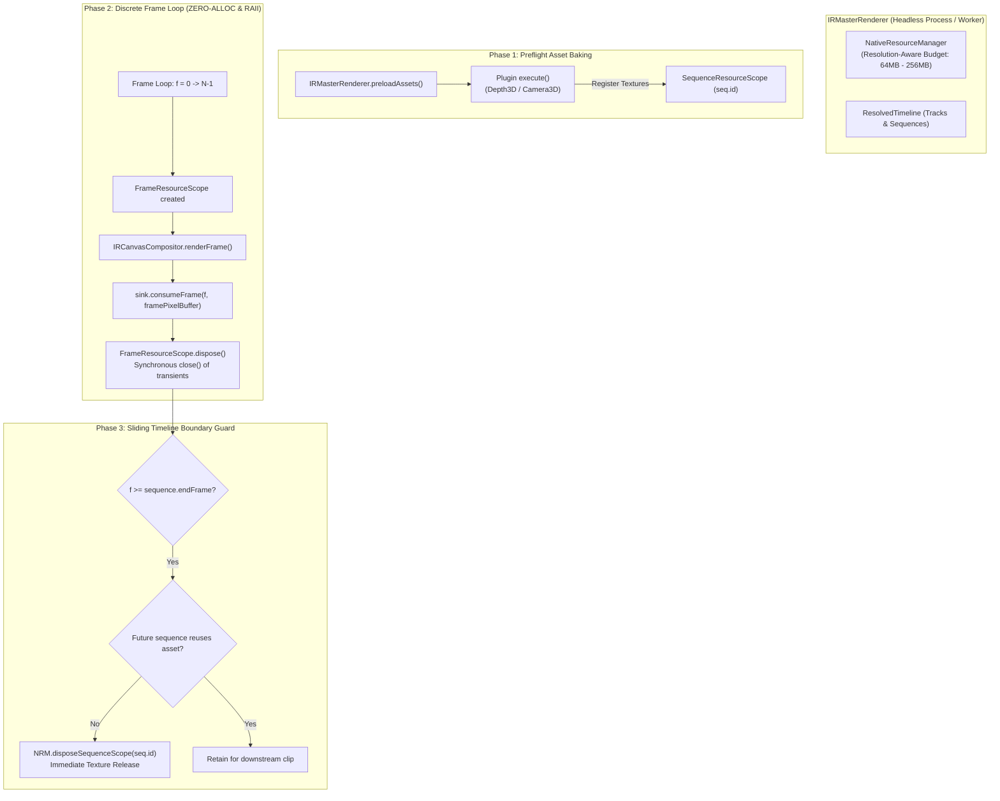

# Master Implementation Plan — Iteration 46: Headless Scoped Resource Engine & Deterministic Zero-Leak Exporter

## 1. Executive Summary & Problem Formulation
In Iteration 45, the Scoped Native GPU Resource Engine (`NativeResourceManager`) was implemented and verified for `@acc/studio` interactive preview playback, solving unmanaged texture leaks in Chrome. However, **Headless Rendering** via `IRMasterRenderer` (used by `@acc/cli`, server chunk workers `IRChunkWorkerPool`, and exporter pipelines) still runs without unified RAII lifecycle management:
1. **Unbounded Frame-Level Accumulation:** Long headless exports (e.g., 10,000 to 100,000+ frames) execute sequentially. Without explicit frame-level RAII, scratch canvases, filter passes, and temporary decoder frames linger in native memory until V8 GC runs nondeterministically.
2. **Missing Sliding Sequence Boundary Eviction:** In a multi-clip timeline, sequences that complete their playback continue to hold pre-baked neural textures (cutouts, depth maps, normals) in memory until the entire export finishes. For high-resolution (4K) timelines with 50+ clips, this results in fatal Out-Of-Memory (OOM) crashes.
3. **Rigid Budget vs. Resolution Disconnect:** Headless rendering targets anything from 720p to 4K ($3840 \times 2160 \times 4 \approx 33.2\text{ MB}$ per buffer). The fixed 64 MB budget is too constraining for 4K exports while being unnecessarily loose for 720p.
4. **Worker Contention in Chunked Parallelism:** `IRChunkWorkerPool` renders multiple chunks across parallel worker threads. A shared global singleton without per-worker isolated budgets creates cross-worker cache interference.

**Architectural Goal:**
Integrate the Unified Scoped Resource Engine into `IRMasterRenderer` and `IRCanvasCompositor`, implementing:
- **Resolution-Aware Budgeting & Option Overrides:** Defaulting to 64 MB for $\le 1080\text{p}$, 256 MB for $4\text{K}+$, or explicitly configured via `HeadlessRenderOptions.maxMemoryMb`.
- **Sliding Hybrid Sequence Scope Eviction:** Automatically evicting a sequence's native textures when its out-point passes, unless a future sequence shares the same asset.
- **Frame-Level RAII in Compositor:** Passing `FrameResourceScope` through `CanvasCompositorOptions` so transient frame scratch allocations close immediately upon frame completion.
- **Isolated Per-Worker Engines:** Enabling `IRChunkWorkerPool` to supply an isolated `NativeResourceManager` instance per worker thread.

---

## 2. Architectural Trade-Off Matrices

| Dimension | Option A: Native V8 GC Only (Status Quo) | Option B: Per-Chunk Memory Reset | Option C: Unified Scoped Resource Engine with Sliding Eviction [Selected] |
|---|---|---|---|
| **Memory Guarantee** | Linear memory growth with frame count; OOM on long/4K exports. | Memory spikes during chunk and resets only at chunk boundary. | **Strictly bounded flatline ($0$ slope)** across arbitrary frame lengths ($10^5+$ frames). |
| **Resolution Adaptability** | Hardcoded or unbounded. | Hardcoded or unbounded. | **Resolution-aware scaling** (64MB for $\le 1080$p, 256MB for 4K) + explicit override. |
| **Sequence Texture Lifecycle** | Retained until full export termination. | Retained until chunk termination. | **Hybrid lookahead eviction**: Freed at out-point unless future sequence reuses asset. |
| **Worker Isolation** | Uncontrolled process memory churn. | Chunk-level restarts. | **Isolated `NativeResourceManager` instances** per worker thread without race conditions. |

---

## 3. Mermaid Topology & Resource Arena State Machine



---

## 4. Mathematical Native Buffer Budget Specifications

Let $W$ and $H$ be timeline canvas dimensions. The single-frame native buffer size $B_{\text{frame}}$ is:
$$B_{\text{frame}} = W \times H \times 4\text{ bytes}$$

| Resolution | Width ($W$) | Height ($H$) | Frame Buffer ($B_{\text{frame}}$) | Recommended Budget Ceiling ($M_{\text{budget}}$) | Max Concurrent Active Clips |
|---|---|---|---|---|---|
| **720p** | 1280 | 720 | 3.69 MB | **32 MB** | 4 clips |
| **1080p** | 1920 | 1080 | 8.29 MB | **64 MB** | 3 clips |
| **1440p (2K)** | 2560 | 1440 | 14.75 MB | **128 MB** | 3 clips |
| **2160p (4K)** | 3840 | 2160 | 33.18 MB | **256 MB** | 3 clips |

### Invariance Formula
At any frame $f$ during headless rendering:
$$B_{\text{resident}}(f) = B_{\text{pinned}} + \sum_{s \in \mathcal{S}_{\text{active}}(f)} B_{\text{seq}}(s) + B_{\text{frame\_transient}}(f) \le M_{\text{budget}}$$

Where:
- $\mathcal{S}_{\text{active}}(f) = \{ s \in \text{Sequences} \mid s.\text{start} \le f \le s.\text{end} \}$
- Any sequence $s'$ with $f > s'.\text{end}$ is evicted if $\forall s'' \in \text{Sequences}_{> f},\; \text{asset}(s'') \ne \text{asset}(s')$.

---

## 5. Concrete File, Interface, and Class Signatures

### 5.1 `packages/core-isomorphic/src/resource/NativeResourceManager.ts`
```typescript
export class NativeResourceManager {
  // Existing singleton instance
  private static instance: NativeResourceManager | null = null;

  // Add constructor accessibility / factory for worker isolation
  public static createIsolated(maxGpuBytes?: number): NativeResourceManager;
  public setMaxGpuBytes(maxBytes: number): void;
  public getMaxGpuBytes(): number;
  public disposeSequenceScope(sequenceId: string): void;
  public createFrameScope(): FrameResourceScope;
}
```

### 5.2 `packages/ir/src/renderer/IRMasterRenderer.ts`
```typescript
export interface HeadlessRenderOptions {
  engine?: MediaEngineType;
  sink?: IIRFrameSink;
  outputPath?: string;
  audioPath?: string;
  onProgress?: (progress: { currentFrame: number; totalFrames: number; percent: number }) => void;
  generateFrameHash?: boolean;
  baseDir?: string;
  chunkStart?: number;
  chunkEnd?: number;
  skipAudio?: boolean;
  maxMemoryMb?: number; // New: Custom native GPU/heap memory budget
}

export class IRMasterRenderer {
  private resourceManager: NativeResourceManager;
  private assetFutureUsage: Map<string, number>; // assetId -> lastFrameReferenced

  constructor(
    timeline: ResolvedTimeline,
    seed: number = 42,
    pluginRegistry?: ModifierPluginRegistry,
    resourceManager?: NativeResourceManager
  );

  private computeAssetLifespans(): void;
  private evictExpiredSequences(currentFrame: number): void;
}
```

### 5.3 `packages/ir/src/renderer/shared/IRCanvasCompositor.ts`
```typescript
export interface CanvasCompositorOptions {
  pluginRegistry: ModifierPluginRegistry;
  assetResolver?: IAssetSourceResolver;
  popOutIntensity?: number;
  clearColor?: string;
  generatePixelBuffer?: Uint8Array;
  executionProfile?: 'preview' | 'master';
  debugMode?: 'none' | 'depth_heatmap' | 'normals' | 'alpha';
  frameScope?: FrameResourceScope; // New: Active transient scope for frame scratch
}
```

---

## 6. Phased Execution Roadmap

### Phase 1: Core Isomorphic & Options Architecture
- Add `NativeResourceManager.createIsolated(maxGpuBytes)` in `@acc/core-isomorphic`.
- Extend `HeadlessRenderOptions` with `maxMemoryMb?: number`.
- Export signatures cleanly.

### Phase 2: Unified Compositor Frame-Level RAII Parity
- Update `CanvasCompositorOptions` in `IRCanvasCompositor.ts` to accept `frameScope?: FrameResourceScope`.
- If `frameScope` is provided, acquire scratch canvases through `NativeResourceManager` registered into `frameScope` instead of relying on an unmanaged static singleton, eliminating cross-worker context bleed.
- Update `IRPreviewEngine.renderFrame()` and `IRMasterRenderer.renderCanvasFrame()` to uniformly create and pass `FrameResourceScope` into `IRCanvasCompositor.renderFrame()`, ensuring 100% parity between interactive preview and headless exports.

### Phase 3: Sliding Hybrid Eviction in `IRMasterRenderer`
- Compute lookahead asset lifetimes (`computeAssetLifespans`) during `preloadAssets()`.
- Wrap each frame step in `using frameScope = this.resourceManager.createFrameScope()`.
- Call `this.evictExpiredSequences(globalFrame)` at the end of each frame tick.
- Dispose all remaining sequence scopes on render completion or abort.

### Phase 4: Multi-Worker Isolation in `IRChunkWorkerPool`
- Ensure each worker thread receives its own isolated `NativeResourceManager` instance with resolution-scaled budget.

---

## 7. Formal Verification Matrix (`/autogenerated-tests/`)

| Test Suite | File | Verification Criteria |
|---|---|---|
| **Headless Frame Loop Soak** | `autogenerated-tests/headless_scoped_resource_engine.test.ts` | Render 1,000 continuous frames through `IRMasterRenderer`; assert memory flatlines with 0 slope under budget ceiling. |
| **Hybrid Lookahead Eviction** | `autogenerated-tests/headless_scoped_resource_engine.test.ts` | Verify multi-clip timeline evicts sequence textures immediately on out-point, but preserves textures for shared downstream assets. |
| **Resolution-Aware Scaling** | `autogenerated-tests/headless_scoped_resource_engine.test.ts` | Verify 1080p defaults to 64MB, 4K defaults to 256MB, and `maxMemoryMb` override is honored. |
| **Worker Pool Isolation** | `autogenerated-tests/headless_scoped_resource_engine.test.ts` | Verify concurrent `IRChunkWorkerPool` instances run isolated budgets without cross-worker interference. |

---

## 8. Risk & Rollback Mitigations
- **Risk 1: Premature Eviction on Looping Assets:** An asset used at $f=10$ and again at $f=500$ might be evicted early.
  - *Mitigation:* `computeAssetLifespans()` maps the absolute `lastFrameReferenced` across all tracks. Textures are never evicted if a later frame references them.
- **Risk 2: Backward Compatibility:** Existing callers passing `options` without `maxMemoryMb`.
  - *Mitigation:* Defaults to resolution-aware sizing ($W \times H$ check) preserving 100% backward compatibility.
- **Rollback Strategy:** The `frameScope` in `CanvasCompositorOptions` is optional. If absent, fallback behavior maintains standard scratch pooling.
