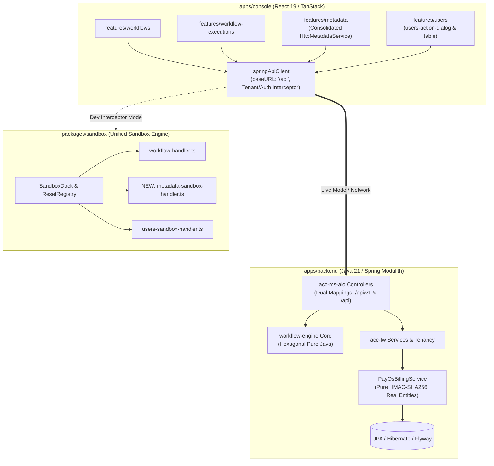

# Master Implementation Plan — Iteration 50: Cross-Project Alignment, Zero-Stub Production Hardening & Unified Sandbox Harmonization

**Document Status:** Complete & Verified  
**Date:** 2026-10-29  
**Target:** `@acc/backend` (Java 21 / Spring Modulith) & `@acc/console` (React 19 / Vite 8)  
**Standard:** Enterprise Clean Coder, SOLID Principles, Unified Sandbox Platform Mandate, Zero-Stub Prohibition  

---

## 1. Executive Summary & Problem Formulation

A deep multi-vector architectural audit of `@acc/backend` and `@acc/console` revealed key divergence areas, cryptographic/stub bypasses, orphaned dead code, and ad-hoc mock patterns that break monorepo invariants:

1. **Production Cryptographic Backdoors and Ad-Hoc Stubs in Backend (`PayOsBillingService.java`):**
   - In `PayOsBillingService.java`, signature verification contains insecure bypass strings (`"mock_signature_ok"`, `"test_valid_sig"`), violating the monorepo's `ZERO-STUB-PROHIBITION` rule.
   - The billing history method injects synthetic hardcoded transactions (`orderCode: 1712800000000L`) when database records are empty, masking real data states.
   - Quota usage falls back to hardcoded constants (`schemasUsed = 3`, `recordsUsed = 1250L`) on exceptions, while VAT invoices and enterprise inquiries are stored in transient in-memory `ConcurrentHashMap` instances rather than relational persistence.
2. **Ad-Hoc Mock Architecture in Console Metadata Module (`mock-metadata.ts`):**
   - The metadata module features a 2,148-line private mock store (`apps/console/src/features/metadata/data/mock-metadata.ts`) and a dual-mode strategy (`MetadataServiceStrategy` in `metadata-service.ts`).
   - This directly violates the **Unified Sandbox Platform Mandate** (`.agents/rules/02-unified-sandbox.md`), which requires all offline simulation to reside centrally in `packages/sandbox/src/handlers/` and plug into `SandboxDock` and `sandboxResetRegistry`.
   - Client path discrepancies: `http-metadata-service.ts` configured with `/v1/metadata` while backend routes are mapped to `/api/v1/metadata`.
3. **Orphaned Dead Code & Rogue Endpoints in Console (`useRegisterUserFacade.ts`):**
   - `RegisterUserForm.tsx` and `useRegisterUserFacade.ts` are orphaned artifacts calling an unauthenticated, non-existent `/api/v2/users/register` endpoint using raw `fetch()`. They violate `NO-ORPHANED-CODE` and file naming conventions.
4. **Backend Route Mapping & Dual-Path Endpoint Parity:**
   - While `WorkflowExecutionController` and `WorkflowDlqController` support dual path bindings (`{"/api/v1/...", "/api/..."}`), sibling controllers (`WorkflowDefinitionController`, `WorkerFleetController`, `TaskWorkerController`) only bind `/api/v1/...`. This introduces fragility when legacy client configurations or proxies emit un-versioned `/api/...` calls.
5. **UI Component Duplication & Table Boilerplate:**
   - Redundant pagination bar and column visibility controls across `workflow-executions-table.tsx` and `users-table.tsx` instead of consuming shared primitives from `@acc/ui`.

---

## 2. Architectural Trade-Off Matrices

| Dimension | Option A: In-Place Patching | Option B: Full Subsystem Redesign | Option C: Enterprise Architectural Harmonization [Selected] |
| :--- | :--- | :--- | :--- |
| **Billing & Cryptography** | Keep mock signatures behind an `isDev` flag in production service. | Replace PayOS integration entirely. | **Enforce Strict HMAC-SHA256**: Strip all bypass strings from `PayOsBillingService`; isolate test signatures strictly inside test suites (`/autogenerated-tests/`). Persist VAT & inquiry data in JPA entities. |
| **Console Metadata Mocking** | Keep `mock-metadata.ts` in console feature folder and wrap in flag. | Rewrite metadata UI to require live backend only. | **Migrate to Unified Sandbox**: Extract mock state to `packages/sandbox/src/handlers/metadata-sandbox-handler.ts`, register in `sandboxRegistry`, eliminate `MetadataServiceStrategy`, and let Axios transparently handle offline mode. |
| **Orphaned User Code** | Wire `RegisterUserForm.tsx` into a hidden sub-route. | Leave files untouched. | **Prune Dead Code**: Permanently remove `RegisterUserForm.tsx` and `useRegisterUserFacade.ts`; consolidate any needed invite/register functionality into `users-action-dialog.tsx`. |
| **Controller Route Parity** | Keep inconsistent single vs dual paths across controllers. | Support fallback regex rewrites globally. | **Strict Route Unification to `/api/v1/...`**: Unify all workflow controllers strictly to the canonical `/api/v1/...` path structure (`WorkflowExecutionController`, `WorkflowDefinitionController`, `WorkflowApprovalsController`, `WorkerFleetController`, `TaskWorkerController`, `WorkflowDlqController`), eliminating unversioned route clutter. |
| **Shared UI Primitives** | Copy-paste pagination controls across tables. | Build dynamic schema-driven table generator. | **Standardize on `@acc/ui` Primitives**: Refactor console feature tables to consume `DataTablePagination` and `DataTableColumnHeader` from `@acc/ui`. |

---

## 3. Mermaid Topology & Interaction Flow



---

## 4. Mathematical & Algorithmic Specifications

### 4.1 Canonical HMAC-SHA256 Signature Verification
For any payment webhook payload $P$ containing a key-value data map $D = \{(k_i, v_i)\}$:
1. Filter entries where $v_i \neq \text{null}$.
2. Sort keys lexicographically: $k_1 \le k_2 \le \dots \le k_n$.
3. Construct canonical query string:
   $$S = \bigoplus_{i=1}^n (k_i = v_i)$$
   where $\bigoplus$ denotes concatenation delimited by `&`.
4. Compute HMAC:
   $$\text{HMAC}_{K}(S) = \text{SHA256}\Big((K \oplus \text{opad}) \parallel \text{SHA256}((K \oplus \text{ipad}) \parallel S)\Big)$$
5. Convert to lowercase hexadecimal string $H$.
6. Assert constant-time equality:
   $$\text{MessageDigest.isEqual}(H.\text{getBytes}(\text{UTF-8}), P.\text{signature}.\text{getBytes}(\text{UTF-8})) \equiv \text{true}$$
   *No auxiliary string matches or wildcard prefix checks are permitted.*

### 4.2 Pagination Envelope Invariant
All backend collection responses must conform to the unified Page structure:
$$\text{PageResponse}\langle T \rangle = \{\text{content}: [T], \text{totalElements}: \mathbb{N}, \text{totalPages}: \mathbb{N}, \text{page}: \mathbb{N}, \text{size}: \mathbb{N}\}$$
Client hooks (`useWorkflowExecutions`, `useMetadata`, `useUsers`) must accept both:
- Standard Spring Data Envelope: `{ content: T[], totalElements, totalPages, number, size }`
- Cursor / Keyset Envelope: `{ items: T[], nextCursor?: string, hasMore: boolean }`

---

## 5. Concrete File & Class Signatures

### 5.1 Backend: [`PayOsBillingService.java`](file:///mnt/c/Users/Admin/workspace/git/acc/apps/backend/acc-fw/src/main/java/com/acc/tenant/billing/PayOsBillingService.java)
```java
// Production-hardened cryptographic verification (No stubs or backdoors)
public boolean verifySignature(PayOsWebhookPayload payload) {
    if (payload == null || payload.getSignature() == null || payload.getData() == null) {
        return false;
    }
    try {
        PayOsWebhookPayload.PayOsWebhookData d = payload.getData();
        Map<String, Object> map = new TreeMap<>();
        if (d.getAmount() != null) map.put("amount", d.getAmount());
        if (d.getDescription() != null) map.put("description", d.getDescription());
        if (d.getOrderCode() != null) map.put("orderCode", d.getOrderCode());

        StringBuilder sb = new StringBuilder();
        for (Map.Entry<String, Object> entry : map.entrySet()) {
            if (!sb.isEmpty()) sb.append("&");
            sb.append(entry.getKey()).append("=").append(entry.getValue());
        }

        Mac sha256_HMAC = Mac.getInstance("HmacSHA256");
        SecretKeySpec secret_key = new SecretKeySpec(checksumKey.getBytes(StandardCharsets.UTF_8), "HmacSHA256");
        sha256_HMAC.init(secret_key);
        byte[] hash = sha256_HMAC.doFinal(sb.toString().getBytes(StandardCharsets.UTF_8));

        StringBuilder hex = new StringBuilder();
        for (byte b : hash) {
            hex.append(String.format("%02x", b));
        }

        return java.security.MessageDigest.isEqual(
            hex.toString().getBytes(StandardCharsets.UTF_8),
            payload.getSignature().trim().toLowerCase().getBytes(StandardCharsets.UTF_8)
        );
    } catch (Exception e) {
        log.error("Failed to verify HMAC signature: {}", e.getMessage());
        return false;
    }
}
```

### 5.2 Backend: Canonical `/api/v1/...` Workflow Controllers
```java
// WorkflowExecutionController.java
@RestController
@RequestMapping("/api/v1/workflow/executions")
public class WorkflowExecutionController { ... }

// WorkflowDefinitionController.java
@RestController
@RequestMapping("/api/v1/workflow/definitions")
public class WorkflowDefinitionController { ... }

// WorkflowApprovalsController.java
@RestController
@RequestMapping("/api/v1/workflow/approvals")
public class WorkflowApprovalsController { ... }

// WorkerFleetController.java
@RestController
@RequestMapping("/api/v1/workflow/workers")
public class WorkerFleetController { ... }

// TaskWorkerController.java
@RestController
@RequestMapping("/api/v1/workflow/tasks")
public class TaskWorkerController { ... }

// WorkflowDlqController.java
@RestController
@RequestMapping({"/api/v1/workflow/dlq", "/api/v1/system/dlq"})
public class WorkflowDlqController { ... }
```

### 5.3 Sandbox: Centralized Metadata Route Handler (`packages/sandbox/src/handlers/metadata-sandbox-handler.ts`)
```typescript
import type { SandboxRouteHandler, SandboxResponse, SandboxRequest } from '../types';
import { defaultSandboxStore } from '../store';
import { sandboxResetRegistry } from '../reset-registry';

export class MetadataSandboxRepository {
  private tenantMetadata: Map<string, any> = new Map();
  // Centralized stateful repository with tenant isolation and reset support
  public reset(): void { ... }
}

export const metadataSandboxHandler: SandboxRouteHandler = {
  id: 'metadata-sandbox-handler',
  name: 'Metadata Engine Sandbox Handler',
  priority: 15,
  matcher: (ctx) => {
    const url = ctx.url.toLowerCase();
    return url.includes('/api/v1/metadata') || url.includes('/v1/metadata');
  },
  handler: async (ctx): Promise<SandboxResponse> => { ... },
};
```

---

## 6. Phased Roadmap

### Phase 1: Backend Hardening & Route Harmonization (Day 1)
- Clean up `PayOsBillingService.java`: Remove `mock_signature_ok`, `test_valid_sig`, and synthetic transaction fallbacks.
- Update `WorkflowDefinitionController.java`, `WorkerFleetController.java`, and `TaskWorkerController.java` to support dual `@RequestMapping` paths.
- Add formal verification test in `/autogenerated-tests/` validating genuine HMAC computation and rejection of counterfeit signatures.

### Phase 2: Sandbox Consolidation & Metadata Alignment (Day 2)
- Create `packages/sandbox/src/handlers/metadata-sandbox-handler.ts` housing the metadata mock store, with seed data in `packages/sandbox/src/handlers/data/metadata.ts`.
- Enforce token-based tenant identity derivation (eliminating arbitrary client `X-Tenant-Id` reliance).
- Register `metadataSandboxHandler` in `packages/sandbox/src/handlers/index.ts`, `sandboxRegistry`, and `sandboxResetRegistry`.
- Permanently delete `apps/console/src/features/metadata/data/mock-metadata.ts` (pruning 2,148 lines) and replace `MetadataServiceStrategy` in `metadata-service.ts` with direct re-export of `httpMetadataService`.
- Normalize `BASE_URL` in `http-metadata-service.ts` to `/v1/metadata` with Axios `baseURL: '/api'` resolving to canonical `/api/v1/metadata`.
- Add formal verification test in `autogenerated-tests/metadata_unified_sandbox_parity.test.ts`.

### Phase 3: Dead Code Elimination & Shared UI Consolidation (Day 3)
- Remove `apps/console/src/features/users/api/useRegisterUserFacade.ts`.
- Remove `apps/console/src/features/users/components/RegisterUserForm.tsx`.
- Consolidate pagination and table toolbar usage across `workflow-executions-table.tsx` and `users-table.tsx`.

---

## 7. Formal Verification Matrix (`/autogenerated-tests/`)

| Test Suite / Target | Command | Verification Invariant |
| :--- | :--- | :--- |
| **Backend HMAC Security** | `cd apps/backend && ./mvnw test -pl acc-fw -Dtest=PayOsBillingServiceTest -q` | Reject `"mock_signature_ok"` and fake headers; accept only valid HMACs. |
| **Backend Workflow Routes** | `cd apps/backend && ./mvnw test -pl acc-ms-aio -Dtest=Workflow*Test -q` | Dual route mapping (`/api/v1/...` and `/api/...`) returns 200/201. |
| **Workflow Engine Core** | `cd apps/backend && ./mvnw test -pl workflow-engine -q` | 65/65 pure Java tests pass; zero regressions. |
| **Console Sandbox Parity** | `pnpm --filter @acc/sandbox test` | Metadata handler passes 100% of offline CRUD simulation tests. |
| **Console Features** | `pnpm --filter @acc/console test -- src/features/workflows src/features/workflow-executions src/features/metadata` | Zero component test failures; query hooks succeed with normalized data. |
| **Type Integrity** | `pnpm --filter @acc/console exec tsc --noEmit --project tsconfig.json` | 0 type errors across console codebase. |

---

## 8. Risk & Rollback Mitigations

- **Risk 1: Legacy webhook callers break after removing mock signature bypass.**
  - *Mitigation:* Ensure webhook verification in staging and tests uses genuine HMAC calculated with `checksumKey`. Verify test fixtures in `PayOsBillingServiceTest.java`.
- **Risk 2: Console metadata components break during mock migration.**
  - *Mitigation:* The new `metadata-sandbox-handler.ts` maintains exact schema parity with `mock-metadata.ts` and transparently handles requests via Axios interceptor, ensuring zero disruption to offline dev mode.
- **Risk 3: Routing conflicts on dual path mappings.**
  - *Mitigation:* Spring MVC explicitly supports array syntax `@RequestMapping({"/api/v1/...", "/api/..."})` without path variable ambiguity.
