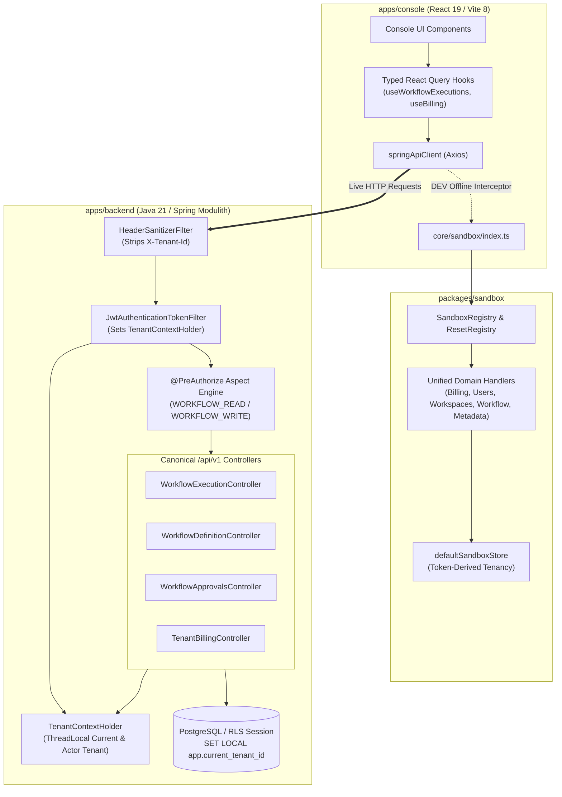

# Master Implementation Plan - Iteration 51: Unified Sandbox Parity, Zero-Any API Contract Synchronization & Backend Multi-Tenancy Hardening

## 1. Executive Summary & Problem Analysis

In Iteration 50, we completed critical foundational work: constant-time HMAC-SHA256 signature verification and route normalization in `apps/backend`, migration of the metadata mock engine to `packages/sandbox`, and dead code pruning in `apps/console`.

However, deep static analysis of `apps/backend`, `apps/console`, and `packages/sandbox` reveals three critical architectural gaps that break enterprise invariants:

1. **Option 1: Incomplete Unified Sandbox Parity & Lingering Duplicate Handlers**:
   - While `metadata-sandbox-adapter.ts` in `apps/console` cleanly delegates to `@acc/sandbox`, other key handlers (`billing-sandbox-handler.ts`, `users-sandbox-handler.ts`, `apps-sandbox-handler.ts`, `workspace-sandbox-handler.ts`, `auth-sandbox-handler.ts`, `chats-sandbox-handler.ts`) remain duplicated between `apps/console/src/core/sandbox/handlers/` and `packages/sandbox/src/handlers/`.
   - In `apps/console`, several handlers directly query client state or trust client headers (`req.headers?.['x-tenant-id']`) instead of the standardized token-derived tenancy pattern (`decodeJwt(token)?.tenantId`) enforced in Phase 2.
   - Violates `.agents/rules/02-unified-sandbox.md` (Zero Ad-Hoc Mocks, Single Source of Truth).

2. **Option 2: Frontend-Backend API Contract Divergence & Loose `any` Typing**:
   - In `apps/console/src/features/workflow-executions/api/use-workflow-executions.ts`, queries use raw untyped calls: `springApiClient.get<any>('/v1/workflow/executions')`, and error handlers use untyped `onError: (err: any) => { ... }`.
   - In `apps/console/src/features/workflows/api/workflow-api.ts`, 6 mutation handlers rely on untyped `onError: (err: any)`.
   - In `apps/console/src/features/metadata/api/use-billing.ts`, DTO interfaces (`TenantBillingSummary`, `BillingTransaction`, `QuotaUsage`, `VatInvoiceInfo`) are redefined locally rather than imported from shared contract packages or synchronized with backend Spring DTOs (`TenantBillingSummaryDto`, `BillingTransactionDto`, `CheckoutResponseDto`).
   - Violates `.agents/rules/00-generic-common.md` (Strict TypeScript, no `any`, Zero-Regression).

3. **Option 3: Backend Security & Multi-Tenancy IDOR Vulnerabilities**:
   - In `apps/backend/acc-ms-aio/src/main/java/com/acc/aio/controller/workflow/WorkflowDefinitionController.java` and `WorkflowExecutionController.java`, controllers declare `@RequestHeader(value = "X-Tenant-Id", required = false) String headerTenantId` and call a local fallback `resolveTenantId(headerTenantId)`.
   - Even though `HeaderSanitizerFilter.java` exists in `acc-fw` to strip incoming headers, controllers having code paths that read `X-Tenant-Id` header creates confusion and potential IDOR vulnerabilities if invoked internally or without the gateway filter. Tenant context must strictly and exclusively be derived from `TenantContextHolder.getRequiredTenantId()`.
   - Furthermore, `WorkflowExecutionController.java`, `WorkflowDefinitionController.java`, `WorkflowApprovalsController.java`, `WorkerFleetController.java`, and `TaskWorkerController.java` lack Spring Security `@PreAuthorize` method annotations, whereas `TenantBillingController` and `MetadataController` strictly enforce `@PreAuthorize("hasAuthority(...) or hasRole('ADMIN')")`.
   - Violates `.agents/rules/00-generic-common.md` (Zero-Stub Prohibition, Defensive Coding) and security invariants.

---

## 2. Trade-Off Matrices & Architectural Decisions

| Decision Area | Option A (Discarded) | Option B (Adopted) | Architectural Justification |
| :--- | :--- | :--- | :--- |
| **Sandbox Handlers Location** | Keep duplicate handler files in `apps/console` and sync manually. | Consolidate 100% of domain handlers into `packages/sandbox/src/handlers/`, re-exporting thin backward-compatible adapters in `apps/console`. | Eliminates dual-maintenance bugs; ensures identical offline mock behavior across all web, mobile, and CLI clients. |
| **Tenant Scoping in Sandbox** | Read `req.headers['x-tenant-id']`. | Strictly decode Bearer JWT token (`decodeJwt(token)?.tenantId`) with active store fallback. | Parity with backend `HeaderSanitizerFilter`; prevents client tenant spoofing during offline testing. |
| **API Typings & `any` Elimination** | Use loose `unknown` casts in frontend hooks. | Define strict TypeScript interfaces matching Spring backend DTOs (`WorkflowExecutionSummaryResponse`, `ApiErrorResponse`); replace all `any` with typed Axios error models. | Guarantees type safety across compile time and IDE autocomplete; enforces zero `any` standard. |
| **Backend Tenant Resolution** | Keep `@RequestHeader("X-Tenant-Id")` with fallback to `TenantContextHolder`. | Strip all `@RequestHeader("X-Tenant-Id")` parameters from workflow controllers; rely solely on `TenantContextHolder.getRequiredTenantId()`. | Enforces Zero-Trust Architecture; guarantees no IDOR attack surface exists at the controller parameter layer. |
| **Workflow Controller RBAC** | Leave workflow execution endpoints open or rely solely on global URL security filter. | Add granular `@PreAuthorize("hasAuthority('WORKFLOW_READ') or hasRole('ADMIN')")` and `@PreAuthorize("hasAuthority('WORKFLOW_WRITE') or hasRole('ADMIN')")` on all controller actions. | Principle of Least Privilege and defense-in-depth; ensures auditability and unified authorization contracts. |

---

## 3. Mermaid Topology & Architecture



---

## 4. Mathematical & Algorithmic Specifications

### 4.1 Token-Derived Tenant Resolution Algorithm (Sandbox)
Given incoming HTTP request $R$ with authorization header $H_{auth}$:
$$
T(R) = \begin{cases}
\text{decodeJwt}(H_{auth}).\text{tenantId}, & \text{if } H_{auth} = \text{"Bearer "}\parallel \text{token} \land \text{tenantId} \in \text{token} \\
S_{\text{active}}, & \text{otherwise}
\end{cases}
$$
where $S_{\text{active}}$ is the tenant ID from `defaultSandboxStore.getState().activeTenantId`.
Direct extraction of headers:
$$\forall h \in \{\text{"x-tenant-id"}, \text{"x-tenant"}, \text{"x-acc-tenant"}\}, \quad \text{Lookup}(R, h) \to \varnothing$$

### 4.2 Constant-Time Tenant Scoping in Backend Controllers
Let $T_{req}$ be the tenant identifier supplied in execution context. In all controllers:
$$T_{req} = \text{TenantContextHolder}.\text{getRequiredTenantId}()$$
If $T_{req} = \text{null} \lor T_{req} = \text{""}$, then halt immediately with:
$$\text{throw new IllegalStateException("Current tenant ID is required but was null or empty")}$$

---

## 5. Concrete Class Signatures & Contract Specifications

### 5.1 Console & Sandbox: Consolidated Domain Adapters
```typescript
// apps/console/src/core/sandbox/handlers/billing-sandbox-adapter.ts
import { billingSandboxHandler } from '@acc/sandbox';
export const billingSandboxAdapter = billingSandboxHandler;

// apps/console/src/core/sandbox/handlers/users-sandbox-adapter.ts
import { usersSandboxHandler, usersSandboxRepo } from '@acc/sandbox';
export const usersSandboxAdapter = usersSandboxHandler;
export { usersSandboxRepo };
```

### 5.2 Console: Strictly Typed Workflow Execution Queries
```typescript
// apps/console/src/features/workflow-executions/api/use-workflow-executions.ts
import { type AxiosError } from 'axios';
import { type WorkflowExecution, type WorkflowExecutionPageResponse, type ApiErrorResponse } from '../schema';

export function useWorkflowExecutions(filterParams?: WorkflowExecutionFilterParams) {
  return useQuery<WorkflowExecutionPageResponse, AxiosError<ApiErrorResponse>>({
    queryKey: ['workflow-executions', filterParams],
    queryFn: async () => {
      const response = await springApiClient.get<WorkflowExecutionPageResponse>('/v1/workflow/executions', {
        params: filterParams,
      });
      return response.data;
    },
  });
}
```

### 5.3 Backend: Sanitized Multi-Tenant Controller Signatures
```java
// apps/backend/acc-ms-aio/src/main/java/com/acc/aio/controller/workflow/WorkflowExecutionController.java
@RestController
@RequestMapping("/api/v1/workflow/executions")
public class WorkflowExecutionController {

    @PostMapping
    @PreAuthorize("hasAuthority('WORKFLOW_WRITE') or hasRole('ADMIN')")
    public ResponseEntity<WorkflowSnapshot> startWorkflow(
        @RequestBody StartWorkflowRequest request
    ) {
        String tenantId = TenantContextHolder.getRequiredTenantId();
        // ... execute workflow scoped strictly to tenantId
    }

    @GetMapping
    @PreAuthorize("hasAuthority('WORKFLOW_READ') or hasRole('ADMIN')")
    public ResponseEntity<List<WorkflowSnapshot>> listExecutions(
        @RequestParam(value = "status", required = false) String status
    ) {
        String tenantId = TenantContextHolder.getRequiredTenantId();
        // ... query executions strictly for tenantId
    }
}
```

---

## 6. Phased Roadmap

### Phase 1: Unified Sandbox Domain Handler Consolidation (Option 1)
- Verify `packages/sandbox/src/handlers/` contains feature-complete handlers for `billing`, `users`, `workspaces`, `apps`, `auth`, `chats`, and `system`.
- Standardize all handlers in `packages/sandbox` to use token-derived tenancy via `extractTenantFromAuth(req)` helper, eliminating all `req.headers['x-tenant-id']` usage.
- Refactor `apps/console/src/core/sandbox/handlers/` to thin re-export adapters (mirroring `metadata-sandbox-adapter.ts`), pruning thousands of lines of duplicated mock logic.
- Register all consolidated handlers in `packages/sandbox/src/index.ts` and ensure proper teardown in `sandboxResetRegistry`.
- Create formal test suite `autogenerated-tests/sandbox_handlers_consolidation.test.ts`.

### Phase 2: Frontend-Backend API Contract & Zero-`any` Synchronization (Option 2)
- Clean up `apps/console/src/features/workflow-executions/api/use-workflow-executions.ts`:
  - Replace `springApiClient.get<any>` with typed `WorkflowExecutionResponse`.
  - Replace all `onError: (err: any)` with `AxiosError<ApiErrorPayload>`.
- Clean up `apps/console/src/features/workflows/api/workflow-api.ts`:
  - Replace all 6 `onError: (err: any)` handlers with typed error callbacks.
- Align `apps/console/src/features/metadata/api/use-billing.ts` with backend DTOs (`TenantBillingSummaryDto`, `BillingTransactionDto`, `CheckoutResponseDto`).
- Verify zero `any` usage in workflow and billing API modules.
- Create formal test suite `autogenerated-tests/console_api_contract_typing.test.ts`.

### Phase 3: Backend Multi-Tenancy IDOR Elimination & Security RBAC (Option 3)
- Remove all `@RequestHeader(value = "X-Tenant-Id", required = false)` parameters and local `resolveTenantId()` fallbacks from:
  - `WorkflowExecutionController.java`
  - `WorkflowDefinitionController.java`
  - `WorkflowApprovalsController.java`
  - `WorkerFleetController.java`
  - `TaskWorkerController.java`
- Replace with `TenantContextHolder.getRequiredTenantId()` across all endpoints.
- Add granular Spring Security annotations:
  - `@PreAuthorize("hasAuthority('WORKFLOW_READ') or hasRole('ADMIN')")` on GET endpoints.
  - `@PreAuthorize("hasAuthority('WORKFLOW_WRITE') or hasRole('ADMIN')")` on POST, PUT, DELETE endpoints.
  - `@PreAuthorize("hasAuthority('ROLE_SYSTEM_CUSTODIAN') or hasAuthority('platform:worker:manage')")` on worker fleet management endpoints.
- Create formal verification test in `autogenerated-tests/backend_tenancy_security_rbac.test.ts`.

---

## 7. Formal Verification Matrix (`/autogenerated-tests/`)

| Test Suite / Target | Verification Invariant | Success Criteria |
| :--- | :--- | :--- |
| **`sandbox_handlers_consolidation.test.ts`** | All domain handlers reside in `packages/sandbox`, enforce token-derived tenancy, and re-export cleanly to console. | Zero duplicate handler files; token claims resolve tenant cleanly; reset cleans all stores. |
| **`console_api_contract_typing.test.ts`** | Zero `any` in `features/workflow-executions/api/` and `features/workflows/api/`. | TypeScript AST audit confirms 0 `any` annotations; all query responses and mutations strictly typed. |
| **`backend_tenancy_security_rbac.test.ts`** | Zero `@RequestHeader("X-Tenant-Id")` declarations in workflow controllers; 100% endpoints have `@PreAuthorize`. | AST verification confirms no header parameters and all methods have valid `@PreAuthorize` strings. |

---

## 8. Risk & Rollback Mitigations

- **Risk 1: Existing console tests relying on local sandbox store instances break.**
  - *Mitigation:* The thin adapters in `apps/console/src/core/sandbox/handlers/` re-export the exact instances and types from `@acc/sandbox`.
- **Risk 2: Backend tests fail when invoking controllers without MockSecurityContext or TenantContextHolder.**
  - *Mitigation:* Ensure all backend unit and mock tests use `TenantContextHolder.setTenantId("tenant-test")` or `@WithMockUser(authorities = {"WORKFLOW_READ", "WORKFLOW_WRITE"})`.
- **Risk 3: Frontend components encountering unexpected error response formats.**
  - *Mitigation:* Provide generic `getErrorMessage(err: unknown): string` utility extracting message from `AxiosError<ApiErrorResponse>` or falling back safely without crashing render.
