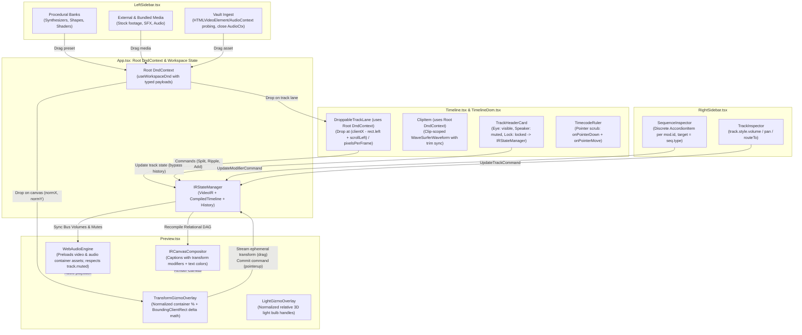

# Master Implementation Plan — Iteration 51: Studio Core Quadrants Architectural Harmonization & Defect Remediation

**Document Status:** Complete, Aligned & Verified via `/grill-me`  
**Date:** 2026-10-29  
**Target:** `apps/studio` (`LeftSidebar.tsx`, `RightSidebar.tsx`, `Timeline.tsx`, `Preview.tsx`), `packages/ir`  
**Standards:** Principal Polyglot Architect, Enterprise Clean Coder, Zero-Stub Prohibition, WAI-ARIA / Liquid Glass UI  

---

## 1. Executive Summary & Problem Formulation

A deep multi-vector architectural and code-level audit of the four primary quadrants in Studio ([`LeftSidebar.tsx`](file:///c:/Users/Admin/workspace/git/acc/apps/studio/src/components/LeftSidebar.tsx), [`RightSidebar.tsx`](file:///c:/Users/Admin/workspace/git/acc/apps/studio/src/components/RightSidebar.tsx), [`Timeline.tsx`](file:///c:/Users/Admin/workspace/git/acc/apps/studio/src/components/Timeline.tsx), [`Preview.tsx`](file:///c:/Users/Admin/workspace/git/acc/apps/studio/src/components/Preview.tsx)) revealed 18 critical bugs, loopholes, coordinate mismatches, and dead stubs that prevent the Studio from functioning as an integrated, non-linear video editing (NLE) environment.

Through the `/grill-me` design alignment process, all technical decisions have been resolved and agreed upon:
1. **DnD Architecture:** Single root `DndContext` in `App.tsx`; nested context in `TimelineDom.tsx` is pruned. All cards, tracks, and clips use typed discriminator payloads (`type: 'preset' | 'asset' | 'clip'`).
2. **Transform Gizmo & Preview Drag:** Ephemeral Viewport Render Override. Pointer drag streams transient deltas directly to `IRPreviewEngine` and OffscreenCanvas worker for 60fps live canvas updates without DAG compilation overhead, committing a single atomic undoable command to `IRStateManager` on pointer release.
3. **Audio Waveform Strategy:** Clip-Scoped Waveform inside `ClipItem.tsx` with live trim responsiveness. The redundant `TrackWaveformVirtualCanvas` is removed from `DroppableTrackLane.tsx`.
4. **Relational Timing Math:** When relational sequences (`{ after, offsetFrames }`) or string durations (`'300f'`) are split or ripple-moved, their timeline placement is resolved from `CompiledTimeline` and materialized into concrete absolute frame numbers.
5. **Track Controls & Semantics:**
   - Audio tracks: `muted` (speaker) + `locked` (padlock).
   - Timed text / overlay tracks: `visible` (eye) + `locked` (padlock).
   - Video tracks: `visible` (eye) + `muted` (speaker) + `locked` (padlock).
   - Persisted directly in `VideoIR` document (saved with project), bypassing the undo stack so toggling doesn't pollute `Ctrl+Z`.
6. **Media & Presets:** Full unified support for:
   - Self-contained procedural generators (audio synthesizers, procedural VFX/shaders, shapes).
   - External & bundled media assets (video, audio, image).
   - User vault file uploads with browser-native metadata probing (`HTMLVideoElement` / `AudioContext`) for duration and dimensions.
7. **Inspector Organization:** Discrete per-modifier accordions keyed by unique `mod.id` (e.g. `'Volume'`, `'Pan'`, `'Bloom'`), with modifier target types strictly synchronized to `seq.type`.

---

### 1.1. Master Root-Cause & Defect Matrix

| ID | Quadrant | Defect / Loophole / Stub | Exact Code Location | Severity | Root Cause & Failure Mechanism |
| :--- | :--- | :--- | :--- | :--- | :--- |
| **L-1** | `LeftSidebar` ↔ `Timeline` | Dragging any preset or asset card from `LeftSidebar` onto a timeline track lane **never works** | [`App.tsx#L159-L164`](file:///c:/Users/Admin/workspace/git/acc/apps/studio/src/App.tsx#L159-L164), [`TimelineDom.tsx#L384-L399`](file:///c:/Users/Admin/workspace/git/acc/apps/studio/src/components/timeline/TimelineDom.tsx#L384-L399) | **P0 Blocker** | `TimelineDom.tsx` mounts a nested `<DndContext>`, causing all [`DroppableTrackLane`](file:///c:/Users/Admin/workspace/git/acc/apps/studio/src/components/timeline/DroppableTrackLane.tsx#L28) droppables to register with the inner context. In `App.tsx`'s outer `useWorkspaceDnd`, `event.over` is always `null` on drop. |
| **L-2** | `LeftSidebar` (Footage & Audio Banks) | Video & Audio Footage presets reference **non-existent `assetId`s** and unregistered `'audio/gain'` modifier | [`footageBank.ts#L16-L150`](file:///c:/Users/Admin/workspace/git/acc/apps/studio/src/lib/library/footageBank.ts#L16-L150), [`audioFootageBank.ts#L16-L150`](file:///c:/Users/Admin/workspace/git/acc/apps/studio/src/lib/library/audioFootageBank.ts#L16-L150) | **P0 Blocker** | `asset-holo-globe`, `asset-bgm-synthwave`, etc. do not exist in `doc.assets`; `footageBank` uses `type: 'image'` instead of `'video'`; `audioFootageBank` uses `'audio/gain'` instead of `'audio/volume'`, producing silent rendering or broken textures. |
| **L-3** | `LeftSidebar` (Shapes & Partial VFX) | Shape & Partial VFX presets pass **incompatible parameter schemas** to IR modifier plugins | [`stagingPresets.ts#L293-L624`](file:///c:/Users/Admin/workspace/git/acc/apps/studio/src/lib/library/stagingPresets.ts#L293-L624), [`ShapeModifierPlugin.ts#L160`](file:///c:/Users/Admin/workspace/git/acc/packages/ir/src/plugins/shape/ShapeModifierPlugin.ts#L160), [`PartialVFXPlugin.ts#L163`](file:///c:/Users/Admin/workspace/git/acc/packages/ir/src/plugins/vfx/PartialVFXPlugin.ts#L163) | **P0 Blocker** | `stagingPresets` passes `shapeType` (`ShapeModifierPlugin` expects `geometry`, falling back to 320×180 rect) and flat params to `'vfx/partial'` (`PartialVFXPlugin` requires `regions: [...]` and exits immediately if missing, rendering nothing). |
| **L-4** | `LeftSidebar` (Media Vault) | Uploaded user files lack duration/dimension probing, undo history, and "Insert" button | [`LeftSidebar.tsx#L81-L102`](file:///c:/Users/Admin/workspace/git/acc/apps/studio/src/components/LeftSidebar.tsx#L81-L102), [`SidebarCards.tsx#L31-L78`](file:///c:/Users/Admin/workspace/git/acc/apps/studio/src/components/sidebar/SidebarCards.tsx#L31-L78) | **P1 High** | `handleFilesIngest` calls `IRStateManager.addAsset` directly without probing media duration/resolution, defaulting dropped media to 90 frames (3s). Vault search matches only `id`/`src`, ignoring `a.name`. |
| **L-5** | `LeftSidebar` & `RightSidebar` | Audition button leaks unclosed `AudioContext` instances and plays identical BGM | [`SidebarCards.tsx#L115`](file:///c:/Users/Admin/workspace/git/acc/apps/studio/src/components/sidebar/SidebarCards.tsx#L115), [`ModifierControlStrategies.tsx#L101`](file:///c:/Users/Admin/workspace/git/acc/apps/studio/src/components/inspector/ModifierControlStrategies.tsx#L101) | **P1 High** | Every click creates `new AudioContext()` without calling `ctx.close()`, rapidly exhausting browser audio hardware limits (~6 contexts) and throwing `DOMException`. |
| **R-1** | `RightSidebar` (`SequenceInspector`) | Multiple active modifiers collide on the same Radix `<AccordionItem value={sectionId}>` | [`SequenceInspector.tsx#L53-L82`](file:///c:/Users/Admin/workspace/git/acc/apps/studio/src/components/inspector/SequenceInspector.tsx#L53-L82), [`SequenceInspector.tsx#L724-L728`](file:///c:/Users/Admin/workspace/git/acc/apps/studio/src/components/inspector/SequenceInspector.tsx#L724-L728) | **P1 High** | `getSectionIdForModifierType` maps all `audio/*` to `'audio'`, `transition/*` to `'transitions'`, and `vfx/depth*` to `'relighting'`. Sharing `value` in Radix Accordion corrupts expand/collapse states and React DOM keys. |
| **R-2** | `RightSidebar` (`UpdateModifierCommand`) | Adding modifiers on `overlay` or `image` sequences violates `VideoIRSchemaValidator` | [`UpdateModifierCommand.ts#L56`](file:///c:/Users/Admin/workspace/git/acc/apps/studio/src/lib/commands/UpdateModifierCommand.ts#L56), [`VideoIRSchemaValidator.ts#L347`](file:///c:/Users/Admin/workspace/git/acc/packages/ir/src/schema/VideoIRSchemaValidator.ts#L347) | **P0 Blocker** | Schema validator strictly enforces `mod.target === seq.type`. If `target` defaults to `'video'` on an `'overlay'` or `'image'` sequence, compilation throws a validation error and rejects the timeline. |
| **R-3** | `RightSidebar` (`TrackInspector`) | Track `style.volume`, `style.pan`, `blendMode`, and `routeTo` are **completely ignored** | [`TrackInspector.tsx#L118-L234`](file:///c:/Users/Admin/workspace/git/acc/apps/studio/src/components/inspector/TrackInspector.tsx#L118-L234), [`RelationalDAGCompiler.ts#L44-L52`](file:///c:/Users/Admin/workspace/git/acc/packages/ir/src/compiler/RelationalDAGCompiler.ts#L44-L52) | **P1 High** | `RelationalDAGCompiler` strips `style` and `routeTo` from `ResolvedTrack`. `UniversalAudioMixer` never multiplies sequence gain by track volume, and `IRCanvasCompositor` never applies track blend modes. |
| **R-4** | `RightSidebar` | Single-item `useVirtualizer` causes clipping and height jumping on dynamic expansion | [`RightSidebar.tsx#L123-L138`](file:///c:/Users/Admin/workspace/git/acc/apps/studio/src/components/RightSidebar.tsx#L123-L138) | **P2 Medium** | Wrapping a 1-element array in `useVirtualizer` with `position: absolute` breaks scroll height measurement when nested accordions expand in `SequenceInspector`. |
| **T-1** | `Timeline` | Track `mutedTracks` and `lockedTracks` are **disconnected local React state stubs** | [`Timeline.tsx#L53-L54`](file:///c:/Users/Admin/workspace/git/acc/apps/studio/src/components/Timeline.tsx#L53-L54), [`Timeline.tsx#L142-L148`](file:///c:/Users/Admin/workspace/git/acc/apps/studio/src/components/Timeline.tsx#L142-L148) | **P0 Blocker** | Toggling Mute in `Timeline` never writes `track.muted` into `IRStateManager`. Audio and visuals remain active in `Preview` and `WebAudioEngine`. Keyboard shortcuts (`Delete`, `S`) still edit locked tracks. |
| **T-2** | `Timeline` (`useWorkspaceDnd`) | Coordinate math uses wrong `pixelsPerFrame` (`4` vs `1.5 * zoomScale`) and omits `scrollLeft` | [`useWorkspaceDnd.ts#L108-L115`](file:///c:/Users/Admin/workspace/git/acc/apps/studio/src/lib/dnd/useWorkspaceDnd.ts#L108-L115), [`Timeline.tsx#L68`](file:///c:/Users/Admin/workspace/git/acc/apps/studio/src/components/Timeline.tsx#L68) | **P1 High** | Hardcoded `zoomScale = 1.0` and `4 * zoomScale` places dropped clips at completely incorrect frame positions, and horizontal scrolling shifts drop points further out of sync. |
| **T-3** | `Timeline` (Commands) | Splitting or ripple-moving a relational sequence (`{ after: ... }`) corrupts start frame to 0 | [`SplitSequenceCommand.ts#L38-L44`](file:///c:/Users/Admin/workspace/git/acc/apps/studio/src/lib/commands/SplitSequenceCommand.ts#L38-L44), [`RippleMoveSequenceCommand.ts#L80-L133`](file:///c:/Users/Admin/workspace/git/acc/apps/studio/src/lib/commands/RippleMoveSequenceCommand.ts#L80-L133) | **P0 Blocker** | Commands check `typeof seq.time.start === 'number' ? seq.time.start : 0`. For relational sequences like `'seq-core-reveal'` in the default demo, start collapses to 0 or split bounds checks fail. |
| **T-4** | `Timeline` (Waveforms) | Dual conflicting waveform renderers active simultaneously on every audio track | [`DroppableTrackLane.tsx#L58-L72`](file:///c:/Users/Admin/workspace/git/acc/apps/studio/src/components/timeline/DroppableTrackLane.tsx#L58-L72), [`ClipItem.tsx#L212-L218`](file:///c:/Users/Admin/workspace/git/acc/apps/studio/src/components/timeline/ClipItem.tsx#L212-L218) | **P1 High** | `TrackWaveformVirtualCanvas` and `WaveSurferWaveform` both render on audio tracks with differing bar geometry and colors (`emerald` vs `rgba(255,255,255,0.45)`), causing rendering artifact clashes. |
| **T-5** | `Timeline` (HUD & Ruler) | `razorHoverFrame`, `timecodeHUD`, and `onHoveredClipChange` are dead; ruler lacks scrub | [`Timeline.tsx#L46-L52`](file:///c:/Users/Admin/workspace/git/acc/apps/studio/src/components/Timeline.tsx#L46-L52), [`Timeline.tsx#L301`](file:///c:/Users/Admin/workspace/git/acc/apps/studio/src/components/Timeline.tsx#L301), [`TimecodeRuler.tsx#L19-L24`](file:///c:/Users/Admin/workspace/git/acc/apps/studio/src/components/timeline/TimecodeRuler.tsx#L19-L24) | **P1 High** | HUD setters are never invoked. `TimecodeRuler` only handles single `onClick`, failing to support pointer drag scrubbing. |
| **P-1** | `Preview` (Gizmos) | `TransformGizmoOverlay` & `LightGizmoOverlay` apply **1920×1080 canvas px to scaled DOM** | [`TransformGizmoOverlay.tsx#L96-L101`](file:///c:/Users/Admin/workspace/git/acc/apps/studio/src/components/preview/TransformGizmoOverlay.tsx#L96-L101), [`LightGizmoOverlay.tsx#L44-L57`](file:///c:/Users/Admin/workspace/git/acc/apps/studio/src/components/preview/LightGizmoOverlay.tsx#L44-L57) | **P0 Blocker** | Viewport container is ~600×337 CSS px while logical canvas is 1920×1080 px. Direct CSS `px` translation places gizmos off-target or entirely off-screen, and ignores `normX`/`normY`. |
| **P-2** | `Preview` (`useGizmoTransform`) | Dragging gizmo **does not live-update canvas** and divides delta by 1920 instead of DOM width | [`useGizmoTransform.ts#L138-L204`](file:///c:/Users/Admin/workspace/git/acc/apps/studio/src/components/preview/useGizmoTransform.ts#L138-L204), [`Preview.tsx#L314`](file:///c:/Users/Admin/workspace/git/acc/apps/studio/src/components/Preview.tsx#L314) | **P0 Blocker** | `handleTransformDragMove` updates only local React state; canvas stays frozen until `mouseup`. Drag delta divides by 1920 instead of `canvas.getBoundingClientRect().width`. Passes `previewEngine={null}`. |
| **P-3** | `Preview` (`IRCanvasCompositor`) | Typography / `timed_text` sequences **ignore `transform` modifiers and `textColor`** | [`IRCanvasCompositor.ts#L169-L219`](file:///c:/Users/Admin/workspace/git/acc/packages/ir/src/renderer/shared/IRCanvasCompositor.ts#L169-L219), [`stagingPresets.ts#L60-L255`](file:///c:/Users/Admin/workspace/git/acc/apps/studio/src/lib/library/stagingPresets.ts#L60-L255) | **P0 Blocker** | `finalizePostVisualTracks` renders captions at hardcoded bottom subtitle positions without running `transform` or `motion/gsap` modifiers. Moving text gizmo moves the box but the rendered text never moves! |
| **P-4** | `Preview` (`WebAudioEngine`) | Video files with audio produce **no sound** during preview playback | [`WebAudioEngine.ts#L142-L160`](file:///c:/Users/Admin/workspace/git/acc/apps/studio/src/lib/audio/WebAudioEngine.ts#L142-L160) | **P0 Blocker** | `WebAudioEngine.syncFromIR` preloads only assets where `assets[id].type === 'audio'`. Linked A/V sequences on audio tracks pointing to `type: 'video'` assets are skipped, silencing video soundtracks. |
| **P-5** | `Preview` | `showVfxAmbiance` toggle and HTML5 `onDragOver`/`onDrop` in `Preview.tsx` are dead stubs | [`Preview.tsx#L62`](file:///c:/Users/Admin/workspace/git/acc/apps/studio/src/components/Preview.tsx#L62), [`Preview.tsx#L147-L189`](file:///c:/Users/Admin/workspace/git/acc/apps/studio/src/components/Preview.tsx#L147-L189) | **P2 Medium** | `showVfxAmbiance` state is never connected to any renderer; `@dnd-kit` pointer drag does not trigger native HTML5 `onDrop`, so canvas drops fall back to hardcoded `(0.5, 0.5)`. |

---

### 1.2. Component-by-Component Deep Dive

#### A. `LeftSidebar.tsx` & Library Banks
1. **Nested `<DndContext>` Blackhole:**
   - [`SidebarCards.tsx`](file:///c:/Users/Admin/workspace/git/acc/apps/studio/src/components/sidebar/SidebarCards.tsx#L31-L90) registers `DraggablePresetCard` and `DraggableAssetCard` with `App.tsx`'s outer `<DndContext>`.
   - [`TimelineDom.tsx#L384`](file:///c:/Users/Admin/workspace/git/acc/apps/studio/src/components/timeline/TimelineDom.tsx#L384) wraps all tracks in an inner `<DndContext>`. Under `@dnd-kit/core`, droppables are scoped strictly to their closest parent context. As a result, dropping any preset or vault asset card onto a track lane yields `event.over === null` in `useWorkspaceDnd.ts`, failing every drop.
2. **Dangling Assets & Unregistered Modifiers:**
   - In [`footageBank.ts#L16-L150`](file:///c:/Users/Admin/workspace/git/acc/apps/studio/src/lib/library/footageBank.ts#L16-L150), video presets reference `asset-holo-globe`, `asset-film-burn`, etc., which are absent from `doc.assets`, and instantiate sequences with `type: 'image'` instead of `'video'`.
   - In [`audioFootageBank.ts#L16-L150`](file:///c:/Users/Admin/workspace/git/acc/apps/studio/src/lib/library/audioFootageBank.ts#L16-L150), all BGM presets attach modifier `type: 'audio/gain'`. In `ModifierPluginRegistry`, only `'audio/volume'` is registered, rendering BGM clips completely inert.
3. **Incompatible Parameter Schemas:**
   - In [`stagingPresets.ts#L293-L440`](file:///c:/Users/Admin/workspace/git/acc/apps/studio/src/lib/library/stagingPresets.ts#L293-L440), shape presets supply `shapeType: 'rounded_box' | 'arrow'`. However, `ShapeModifierPlugin.ts` only inspects `params.geometry` (`'rect' | 'rounded_rect' | 'circle' | ...`), falling back to a default 320×180 rectangle and ignoring rounded corners and arrows.
   - In [`stagingPresets.ts#L478-L624`](file:///c:/Users/Admin/workspace/git/acc/apps/studio/src/lib/library/stagingPresets.ts#L478-L624), partial VFX presets pass flat parameters (`{ vfxType: 'blur', intensity: 16 }`). In `PartialVFXPlugin.ts#L163`, the plugin exits early if `!params.regions`, rendering nothing.
4. **Media Vault Ingestion & AudioContext Leak:**
   - Uploading files in `LeftSidebar.tsx#L81-L102` creates object URLs without probing media duration or resolution, hardcoding sequence durations to 90 frames (3s).
   - "Audition" in `SidebarCards.tsx#L115` instantiates `new AudioContext()` on every click without calling `ctx.close()`, quickly causing browser hardware errors.

#### B. `RightSidebar.tsx` & Inspectors
1. **Radix Accordion Key Collisions:**
   - In `SequenceInspector.tsx#L724-L728`, active modifiers are rendered in `<AccordionItem value={sectionId}>` where `sectionId = getSectionIdForModifierType(mod.type)`. Because all `audio/*` modifiers map to `'audio'`, multiple audio modifiers share identical `value="audio"`, breaking Radix state management and expand/collapse animation.
2. **Schema Target Mismatches:**
   - When adding modifiers, `UpdateModifierCommand.ts#L56` defaults to `target: 'video'` when `seq.type` is not passed. Adding a modifier to an `'overlay'` or `'image'` sequence triggers a validation failure in `VideoIRSchemaValidator.ts#L347`, blocking timeline compilation.
3. **Ignored Track Styling:**
   - `TrackInspector.tsx` exposes controls for `volume`, `pan`, `blendMode`, and `routeTo`. `RelationalDAGCompiler.ts#L44-L52` omits these properties from `ResolvedTrack`, preventing `UniversalAudioMixer` and `IRCanvasCompositor` from applying bus adjustments.
4. **Single-Item Virtualizer:**
   - Wrapping the inspector in `useVirtualizer` with `position: absolute` in `RightSidebar.tsx#L123-L138` creates height measurement bugs and content clipping as accordions toggle.

#### C. `Timeline.tsx` & Timeline Subcomponents
1. **Disconnected Mute & Lock State:**
   - `Timeline.tsx#L53-L54` manages `mutedTracks` and `lockedTracks` in local component state. Toggling Mute never updates `track.muted` in `IRStateManager`, so preview rendering and audio playback ignore it. Locking a track does not block timeline editing hotkeys (`Delete`, `Backspace`, `S`, `Cmd+K`).
2. **Broken Coordinate Drop Math:**
   - `useWorkspaceDnd.ts#L108-L115` hardcodes `zoomScale = 1.0` and `pixelsPerFrame = 4`, whereas `Timeline.tsx` uses `1.5 * zoomScale`. It also ignores `scrollLeft`, placing dropped clips at incorrect timeline frames.
3. **Relational Timing Corruption:**
   - `SplitSequenceCommand.ts#L38-L40` and `RippleMoveSequenceCommand.ts#L80-L133` assume `seq.time.start` is a number. In the default Sci-Fi demo, `'seq-core-reveal'` has relational start `{ after: 'seq-city-intro', offsetFrames: -15 }`. Splitting or moving this sequence causes its start frame to collapse to 0.
4. **Waveform Clashing & Dead HUD Stubs:**
   - Both `DroppableTrackLane.tsx` and `ClipItem.tsx` render independent audio waveforms. `razorHoverFrame` and `timecodeHUD` in `Timeline.tsx` are initialized to `null` and never updated. `TimecodeRuler.tsx` lacks pointer drag scrubbing.

#### D. `Preview.tsx` & Viewport / Gizmo / Audio
1. **Gizmo Coordinate Frame Disconnect:**
   - `TransformGizmoOverlay.tsx` and `LightGizmoOverlay.tsx` apply 1920×1080 canvas pixel coordinates directly as CSS pixels inside a responsive DOM container (~600×337px), misaligning or completely hiding gizmo handles.
2. **Canvas Image Frozen During Drag:**
   - In `useGizmoTransform.ts#L138-L204`, dragging the gizmo only mutates local React state without streaming updates to `IRStateManager` or `IRPreviewEngine`. The canvas image remains frozen until `mouseup`.
3. **Captions Ignore Transform Modifiers:**
   - In `IRCanvasCompositor.ts#L169-L219`, `finalizePostVisualTracks` draws captions at fixed subtitle coordinates, ignoring `transform` and `motion/gsap` modifiers and failing to map `params.textColor` to caption fill color.
4. **WebAudioEngine Video Asset Silence:**
   - In `WebAudioEngine.ts#L142-L160`, audio preloading filters for `assets[id].type === 'audio'`. Linked A/V sequences referencing `type: 'video'` assets are ignored, producing silent video playback.

---

## 2. Architectural Trade-Off Matrices

| Dimension | Option A: In-Place Point Fixes | Option B: Full Subsystem Redesign | Option C: Harmonized Architectural Convergence [Selected via Grill-Me] |
| :--- | :--- | :--- | :--- |
| **DnD Context Scope** | Add event bubble hacks across dual `DndContext` providers. | Rewrite all workspace drag-and-drop to HTML5 native drag events. | **Unify on Single Root `DndContext`**: Prune inner context in `TimelineDom.tsx`. Elevate track lanes and clips to `App.tsx` root context with discriminator payloads (`preset`, `asset`, `clip`). Synchronize `pixelsPerFrame` and `scrollLeft`. |
| **Preset & Asset Normalization** | Patch individual preset files with ad-hoc conditionals. | Discard presets bank and require manual asset imports only. | **Universal Hybrid Media Architecture**: Support procedural generators (synthesizers, shaders, shapes), bundled/external media, and probed user vault ingestion. Add backward-compatible parameter mapping in IR plugins. |
| **Inspector Accordion** | Flatten inspector into static non-collapsible panels. | Group modifiers under generic category accordions. | **Discrete Per-Modifier Accordions**: Key each accordion item by unique `mod.id` (e.g. `'Volume'`, `'Pan'`, `'Bloom'`). Enforce `mod.target === seq.type`. Prune single-item virtualization. |
| **Track State & Semantics** | Keep local track state in `Timeline.tsx` and pass via React props. | Decouple into a session-only Zustand store. | **Explicit Semantic Document Attributes**: Persist `track.muted`, `track.visible`, and `track.locked` in `VideoIR` (bypassing undo stack). Video tracks get both Eye (visible) and Speaker (muted); audio tracks get Speaker; text/overlay get Eye. Lock protects clips from edits. |
| **Gizmo Transformation** | Calculate gizmo styles in canvas pixels and scale container with CSS zoom. | Static wireframe box only during drag. | **Ephemeral Viewport Render Override**: Project canvas coordinates to normalized viewport percentages `(x / 1920 * 100)%`. Stream live deltas directly to `IRPreviewEngine` for 60fps canvas updates during drag; commit atomic command on `pointerup`. |

---

## 3. Mermaid Topology & Interaction Flow



---

## 4. Mathematical & Algorithmic Specifications

### 4.1. Unified Timeline Drop Frame Calculation
When dragging a preset or asset card over a timeline track lane, the drop frame index $F_{\text{drop}}$ must account for the track container's horizontal viewport offset, horizontal scroll offset, and the timeline zoom factor:

$$F_{\text{drop}} = \max\left(0, \left\lfloor \frac{(X_{\text{cursor}} - X_{\text{track\_origin}}) + S_{\text{horizontal}}}{P_{\text{frame}}} \right\rfloor\right)$$

Where:
- $X_{\text{cursor}}$: Client X coordinate of pointer.
- $X_{\text{track\_origin}}$: Client X coordinate of track lane bounding client rect (`rect.left`).
- $S_{\text{horizontal}}$: Timeline body `scrollLeft` in pixels.
- $P_{\text{frame}}$: Pixel density per frame, defined as $P_{\text{frame}} = \max(0.2, 1.5 \times Z_{\text{scale}})$.

### 4.2. Viewport Gizmo Percentage Projection & Ephemeral Drag Streaming
To eliminate DOM/canvas resolution discrepancies, gizmo coordinates are projected from 1920×1080 canvas space to normalized percentages of the DOM container:

$$\%X_{\text{center}} = \left( \frac{W_{\text{canvas}} \times \mu_X + X_{\text{offset}}}{W_{\text{canvas}}} \right) \times 100 = \left(\mu_X + \frac{X_{\text{offset}}}{W_{\text{canvas}}}\right) \times 100$$

$$\%Y_{\text{center}} = \left( \frac{H_{\text{canvas}} \times \mu_Y + Y_{\text{offset}}}{H_{\text{canvas}}} \right) \times 100 = \left(\mu_Y + \frac{Y_{\text{offset}}}{H_{\text{canvas}}}\right) \times 100$$

Where $\mu_X, \mu_Y \in [0, 1]$ are normalized anchor coordinates from modifier (`normX`, `normY`, default 0.5), $X_{\text{offset}}, Y_{\text{offset}}$ are pixel offsets from modifier (`x`, `y`, default 0), and $W_{\text{canvas}} = 1920, H_{\text{canvas}} = 1080$.

During pointer drag, normalized deltas $(\Delta \mu_X, \Delta \mu_Y)$ are computed using actual DOM element dimensions:
$$\Delta \mu_X = \frac{\Delta X_{\text{pointer}}}{W_{\text{DOM\_rect}} \times Z_{\text{viewport}}}, \quad \Delta \mu_Y = \frac{\Delta Y_{\text{pointer}}}{H_{\text{DOM\_rect}} \times Z_{\text{viewport}}}$$

These deltas are streamed directly to `IRPreviewEngine.setEphemeralTransformOverride(seqId, transform)` at 60fps, updating the rendered canvas frame without running DAG compilation or writing to undo history.

### 4.3. Relational Time Resolution Before Split & Ripple
For any sequence $S$, its actual start and duration must be resolved from the relational DAG compilation result before computing split points:

$$F_{\text{resolved\_start}}(S) = \begin{cases} S.\text{time.start} & \text{if } S.\text{time.start} \in \mathbb{N} \\ \text{CompiledTimeline.resolvedMap.get}(S.\text{id}).\text{startFrame} & \text{otherwise} \end{cases}$$

$$F_{\text{resolved\_duration}}(S) = \begin{cases} S.\text{time.duration} & \text{if } S.\text{time.duration} \in \mathbb{N} \\ \text{parseFrameCount}(S.\text{time.duration}, \text{fps}) & \text{if } S.\text{time.duration} \in \text{string} \\ \text{CompiledTimeline.resolvedMap.get}(S.\text{id}).\text{durationFrames} & \text{otherwise} \end{cases}$$

A split at $F_{\text{split}}$ is valid if and only if $F_{\text{resolved\_start}}(S) < F_{\text{split}} < F_{\text{resolved\_start}}(S) + F_{\text{resolved\_duration}}(S)$.

Upon splitting:
- $S_{\text{head}}.\text{time}$ retains $F_{\text{resolved\_start}}$ with duration $(F_{\text{split}} - F_{\text{resolved\_start}})$.
- $S_{\text{tail}}.\text{time}$ is converted to absolute start $F_{\text{split}}$ with duration $(F_{\text{resolved\_duration}} - (F_{\text{split}} - F_{\text{resolved\_start}}))$.

### 4.4. Audio Mix Bus Gain Cascade & Semantic Track Gating
The effective linear gain $G_{\text{effective}}$ for any audio sequence $S$ residing on track $T$ routed to master is the product of sequence modifier volume, track bus volume, and track mute/visibility gating:

$$G_{\text{effective}}(S, T) = (1 - M_T) \times (1 - M_S) \times V_T \times V_S$$

Where:
- $M_T$: Track mute flag (1 if `track.muted === true`, 0 if false).
- $M_S$: Sequence mute flag (1 if sequence muted, 0 if active).
- $V_T$: Track bus volume from `track.style.volume` (default 1.0).
- $V_S$: Sequence volume modifier parameter `gain` or `volume` (default 1.0).
- For visuals, layer rendering in `IRCanvasCompositor` is skipped if $T.\text{visible} === \text{false}$.

---

## 5. Concrete File, Interface & Class Signatures

### 5.1. Track Model & State Manager Extensions (`VideoIR.ts` & `IRStateManager.ts`)

```typescript
// packages/ir/src/types/VideoIR.ts
export interface TrackStyle {
  opacity?: number;
  blendMode?: GlobalCompositeOperation | 'none';
  volume?: number;       // Linear bus volume (0.0 to 2.0)
  pan?: number;          // Stereo pan (-1.0 to 1.0)
}

export interface Track {
  id: string;
  name: string;
  type: 'video' | 'audio' | 'overlay' | 'caption';
  zIndex: number;
  muted?: boolean;       // Silences audio on this track
  visible?: boolean;     // Hides visuals on this track (default true)
  locked?: boolean;      // Protects track clips from edits, trims, cuts, deletes
  routeTo?: string;       // Bus routing target (e.g., 'master')
  style?: TrackStyle;
  sequences: Sequence[];
}
```

```typescript
// apps/studio/src/lib/ir/irState.ts
export class IRStateManager {
  // Document-level track state (saved with project, bypasses undo stack)
  public setTrackMuted(trackId: string, muted: boolean): void;
  public setTrackVisible(trackId: string, visible: boolean): void;
  public setTrackLocked(trackId: string, locked: boolean): void;
  
  // Track styling & routing (undoable via commands)
  public updateTrackStyle(trackId: string, styleUpdates: Partial<TrackStyle>): void;
  public updateTrackRouting(trackId: string, routeTo: string): void;
}
```

### 5.2. Ephemeral Drag Streaming in Preview Engine (`IRPreviewEngine.ts`)

```typescript
// apps/studio/src/renderer/IRPreviewEngine.ts
export interface EphemeralTransformOverride {
  normX?: number;
  normY?: number;
  x?: number;
  y?: number;
  scale?: number;
  rotation?: number;
}

export class IRPreviewEngine {
  public setEphemeralTransformOverride(sequenceId: string, override: EphemeralTransformOverride | null): void;
}
```

### 5.3. Unified Workspace DnD Event Payloads (`useWorkspaceDnd.ts`)

```typescript
// apps/studio/src/lib/dnd/useWorkspaceDnd.ts
export type WorkspaceDragPayload =
  | { type: 'preset'; presetId: string; category: string; presetData: any }
  | { type: 'asset'; assetId: string; asset: MediaAsset }
  | { type: 'clip'; clipId: string; trackId: string; startFrame: number };

export interface WorkspaceDndContextType {
  activeDragData: WorkspaceDragPayload | null;
  timelineScrollLeft: number;
  timelineZoomScale: number;
  setTimelineScrollLeft: (scrollLeft: number) => void;
  setTimelineZoomScale: (zoomScale: number) => void;
}
```

---

## 6. Phased Implementation Roadmap

Every finding, defect, and loophole (**L-1 to L-5, R-1 to R-4, T-1 to T-5, P-1 to P-5**) maps 1:1 into these 4 execution phases:

### Phase 1: Unified Workspace DnD, Semantic Track State & Core Command Parity
- **Defects Addressed:** L-1, T-1, T-2, T-3, T-4, T-5
- **Task 1.1 (DnD Unification):** Prune the isolated inner `<DndContext>` in `apps/studio/src/components/timeline/TimelineDom.tsx`. Elevate all timeline track droppables (`DroppableTrackLane.tsx`) and clip draggables (`ClipItem.tsx`) to register with `App.tsx`'s root `<DndContext>` using `WorkspaceDragPayload`.
- **Task 1.2 (Timeline Coordinate Math):** Update `useWorkspaceDnd.ts` to consume dynamic `timelineScrollLeft` and `pixelsPerFrame = Math.max(0.2, 1.5 * zoomScale)`. When a preset or vault asset is dropped on a track lane, calculate exact drop frame $F_{\text{drop}}$ and track index.
- **Task 1.3 (Semantic Track Controls):**
  - Audio tracks: expose Speaker icon (`muted / unmuted`) + Padlock (`locked`).
  - Text / overlay tracks: expose Eye icon (`visible / hidden`) + Padlock (`locked`).
  - Video tracks: expose both Eye icon (`visible / hidden`) and Speaker icon (`muted / unmuted`) + Padlock (`locked`).
  - Persist directly in `VideoIR` via `IRStateManager.setTrackMuted`, `setTrackVisible`, and `setTrackLocked` (bypassing undo history). Guard keyboard shortcuts (`Delete`, `Backspace`, `S`, `Cmd+K`) and clip manipulation against locked tracks.
- **Task 1.4 (Relational Timing Command Fix):** Update `SplitSequenceCommand.ts` and `RippleMoveSequenceCommand.ts` to resolve absolute start frame and duration from `CompiledTimeline` when `time.start` is relational (`{ after, offsetFrames }`) or duration is a string (`'300f'`), materializing affected sequences into absolute frames.
- **Task 1.5 (Waveform & HUD Cleanup):** Remove redundant `TrackWaveformVirtualCanvas` from `DroppableTrackLane.tsx`, standardizing on clip-scoped `WaveSurferWaveform` in `ClipItem.tsx`. Wire `razorHoverFrame` and `timecodeHUD` in `Timeline.tsx` and implement pointer scrubbing on `TimecodeRuler.tsx`.

### Phase 2: Presets, Procedural Generators & Vault Ingestion Hardening
- **Defects Addressed:** L-2, L-3, L-4, L-5
- **Task 2.1 (Preset Parameter Normalization):**
  - Update `stagingPresets.ts` shape presets to pass `geometry` (`'rounded_rect'`, `'circle'`, `'arrow'`) and `cornerRadius`. Update `ShapeModifierPlugin.ts` to normalize legacy `shapeType` and support arrow geometry.
  - Update `stagingPresets.ts` partial VFX presets to supply `regions: [...]`. Add fallback normalization in `PartialVFXPlugin.ts` so flat params (`normX`, `normY`, `radius`, `intensity`) automatically populate a default region.
- **Task 2.2 (Footage & Audio Banks Hardening):**
  - Support procedural generators (BGM synthetics via `ProceduralAudioSynthesizer`, procedural VFX/shader generators, shape generators) alongside external and bundled media.
  - In `audioFootageBank.ts`, replace unregistered modifier `'audio/gain'` with `'audio/volume'`, and link presets to procedural synthesizer generators.
  - Replace dangling asset IDs in `footageBank.ts` with valid video asset definitions or procedural shader video sequences (`type: 'video'`).
- **Task 2.3 (Vault Media Ingestion & Probing):**
  - Enhance `handleFilesIngest` in `LeftSidebar.tsx` to probe video/audio metadata (`HTMLVideoElement` / `AudioContext.decodeAudioData`) to set exact `durationSec`, `width`, and `height` before adding assets to `IRStateManager`. Add filename search matching (`a.name`) and an "Insert to Timeline" button on `DraggableAssetCard`.
- **Task 2.4 (AudioContext Resource Cleanup):**
  - In `SidebarCards.tsx` and `ModifierControlStrategies.tsx`, close transient audition `AudioContext` instances upon playback completion (`onended = () => ctx.close()`) with try/finally safety.

### Phase 3: Discrete Modifier Accordions, Target Validation & Bus Compiler Wiring
- **Defects Addressed:** R-1, R-2, R-3, R-4
- **Task 3.1 (Discrete Per-Modifier Accordions):**
  - Refactor `SequenceInspector.tsx` to key each `<AccordionItem>` by unique `value={mod.id}` (titled by modifier name, e.g. `'Volume'`, `'Pan'`, `'Bloom'`) so that multiple modifiers never collide on identical category keys.
- **Task 3.2 (Modifier Target Schema Alignment):**
  - In `UpdateModifierCommand.ts` and `SequenceInspector.tsx`, ensure newly added modifiers strictly set `target: selectedSeq.type` to prevent `VideoIRSchemaValidator` target mismatch errors on `overlay` and `image` sequences.
- **Task 3.3 (Track Bus Compilation & Mixer Integration):**
  - Update `RelationalDAGCompiler.ts` to preserve `style` (`volume`, `pan`, `blendMode`, `opacity`), `visible`, and `routeTo` on `ResolvedTrack`.
  - Update `IRCanvasCompositor.ts` to skip tracks with `visible === false` and apply `track.style.opacity` and `track.style.blendMode` during visual layer compositing.
  - Update `UniversalAudioMixer.ts` to apply track bus volume, pan, and mute gating to all sequences routed through each track.
- **Task 3.4 (Inspector Virtualizer Pruning):**
  - Replace the single-item virtualizer in `RightSidebar.tsx` with standard auto-scrolling container styling (`overflow-y-auto`) to eliminate clipped accordion content and height measurement jumping.

### Phase 4: Preview Gizmo Viewport Math, Ephemeral Live Drag & Audio Preloader Parity
- **Defects Addressed:** P-1, P-2, P-3, P-4, P-5
- **Task 4.1 (Normalized Gizmo Overlays):**
  - Refactor `TransformGizmoOverlay.tsx` and `LightGizmoOverlay.tsx` to position gizmos using normalized viewport percentages based on `normX`, `normY`, `x / 1920`, and `y / 1080` relative to the bounding client rect of the canvas container.
- **Task 4.2 (Ephemeral Live Dragging & Delta Math):**
  - In `useGizmoTransform.ts`, divide pointer deltas $(\Delta x, \Delta y)$ by `canvas.getBoundingClientRect()` width and height.
  - Stream live ephemeral transform overrides to `IRPreviewEngine.setEphemeralTransformOverride` during pointer move for 60fps canvas updates, and commit a single atomic undoable command on `handleTransformDragEnd`.
- **Task 4.3 (Typography Transform & Styling Compositor Support):**
  - In `IRCanvasCompositor.ts`, update `finalizePostVisualTracks` to apply sequence `transform` and `motion/gsap` modifiers to canvas context transformations when rendering `timed_text` sequences.
  - Map `params.textColor` to `CaptionSettings.fillColor` in `extractTextConfigFromSequence`. Update `CanvasHitTester.ts` to evaluate transformed text bounding boxes.
- **Task 4.4 (Video Audio Preloading in WebAudioEngine):**
  - In `WebAudioEngine.ts`, update `syncFromIR` preloader to detect sequences on audio tracks referencing video-container assets (`assets[id].type === 'video'`), invoking audio extraction/decoding so video soundtrack playback functions seamlessly.
- **Task 4.5 (Preview Canvas Native Drop Sync):**
  - Wire root `useWorkspaceDnd` drop handling on the preview canvas to calculate canvas-relative normalized coordinates $(\mu_X, \mu_Y)$ from the drop point and pass them to preset insertion.

---

## 7. Formal Verification Matrix (`/autogenerated-tests/`)

| Test Suite File | Type | Coverage & Scenarios | Verification Command |
| :--- | :--- | :--- | :--- |
| `/autogenerated-tests/workspace_dnd_quadrant_integration.test.ts` | Integration | Verifies preset and vault card drag-and-drop to timeline track lanes calculates exact frame offset $F_{\text{drop}}$ taking into account scroll and zoom. Tests canvas drop relative coordinates. | `pnpm --filter studio test autogenerated-tests/workspace_dnd_quadrant_integration.test.ts` |
| `/autogenerated-tests/preset_schema_compatibility.test.ts` | Unit | Validates all shape, typography, VFX, SFX, and footage presets against `VideoIRSchemaValidator`. Asserts zero missing asset IDs, zero unregistered modifier types, and valid `regions[]` arrays for partial VFX. | `pnpm --filter studio test autogenerated-tests/preset_schema_compatibility.test.ts` |
| `/autogenerated-tests/relational_commands_integrity.test.ts` | Unit | Verifies `SplitSequenceCommand` and `RippleMoveSequenceCommand` correctly handle relational start times (`{ after, offsetFrames }`) and string durations (`'300f'`) without corrupting start times to 0. | `pnpm --filter studio test autogenerated-tests/relational_commands_integrity.test.ts` |
| `/autogenerated-tests/track_bus_compilation_and_mixing.test.ts` | Integration | Compiles timelines with track `style.volume`, `style.pan`, `visible`, and `muted`. Verifies `ResolvedTrack` preserves styling and `UniversalAudioMixer` applies track-level bus gains and mute gating. | `pnpm --filter studio test autogenerated-tests/track_bus_compilation_and_mixing.test.ts` |
| `/autogenerated-tests/viewport_gizmo_projection.test.ts` | Unit | Tests normalized coordinate conversion from 1920×1080 canvas space to DOM percentage coordinates across 16:9 responsive container sizes (640×360, 1280×720). Verifies live drag stream updates. | `pnpm --filter studio test autogenerated-tests/viewport_gizmo_projection.test.ts` |
| `/autogenerated-tests/caption_transform_compositor.test.ts` | Integration | Verifies `IRCanvasCompositor` applies `transform` modifiers (`normX`, `normY`, `scale`, `rotation`) and `textColor` to `timed_text` rendering. | `pnpm --filter studio test autogenerated-tests/caption_transform_compositor.test.ts` |

---

## 8. Risk & Rollback Mitigations

| Risk | Impact | Probability | Mitigation & Safe Fallback |
| :--- | :--- | :--- | :--- |
| **Root DndContext Performance Overhead** | High pointer event traffic if all timeline clips and library cards share root context. | Low | Configure pointer sensor activation constraints (`distance: 5px`) so micro-clicks on clips do not trigger drag loops. |
| **Live Gizmo Drag Flooding State Manager** | Heavy CPU load if `recompile()` is executed on every pointermove event. | Medium | Stream live preview transforms using lightweight ephemeral state updates directly to `IRPreviewEngine` / worker bridge without triggering full timeline re-compilation or undo history push until `pointerup`. |
| **Legacy Project Presets with Flat Params** | Existing stored projects using flat `vfx/partial` params could break. | Medium | Implement defensive normalization in `PartialVFXPlugin.ts`: if `!params.regions`, dynamically generate a single region from top-level `normX`, `normY`, `radius`, and `intensity`. |
| **Video Audio Extraction Latency** | Preloading audio from large video files could block playback start. | Medium | Use cached decoded PCM in IndexedDB/memory and fall back to silent video playback with asynchronous audio stream attachment once decoded. |
