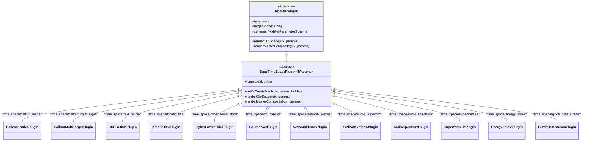

# Master Implementation Plan - Iteration 53: Discrete `time_space/*` Motion Graphic Plugins & Studio Showcase

## 1. Executive Summary & Problem Analysis
The monorepo's virtual-clock procedural motion graphics system was originally centralized inside a monolithic plugin `TimeSpaceModifierPlugin.ts` (`time_space`). While powerful mathematically (driven by GSAP timelines, `DeterministicPtsEngine`, and `StatelessHashNoise`), this monolithic design introduced significant architectural defects:
1. **Schema & UI Bloat**: All 11+ motion graphic templates shared a single static schema definition. Selecting a simple particle field or audio visualizer still exposed irrelevant `text`, `labelX`, and `labelY` controls in the Studio Inspector.
2. **Duplication Risk**: Previous audits revealed parallel ad-hoc implementations across packages (`TrackingCalloutEngine` in `@acc/effect-engines`, `HologramHUDPlugin` in `@acc/ir`, and `LowerThirdFactory` in `@acc/effect-engines`).
3. **Low-Quality 2D Presentation**: The initial prototypes relied on basic Canvas 2D strokes (`ctx.stroke()`) without photometric bloom, frosted acrylic glassmorphism, or FUI micro-caliper detailing.

### Solution Architecture
Decompose the monolithic plugin into **12 discrete, strongly-typed 1:1 plugins** prefixed with `time_space/*` in `packages/ir/src/plugins/time-space/`. Each plugin declares a 100% bespoke schema with zero unused parameters. Code duplication is eliminated via an abstract `BaseTimeSpacePlugin<TParams>`, while all plugins render via our studio-grade 3-pass photometric bloom and frosted glassmorphism stack.

Furthermore, Studio is expanded with **4 rich demo projects** (`defaultDemoIR`, `complexSciFiDemoIR`, `broadcastNewsDemoIR`, and `cyberAudioVisualizerDemoIR`) selectable directly from the Studio interface.

---

## 2. Trade-Off Matrices & Architectural Decisions

| Decision Area | Option A (Discarded) | Option B (Adopted) | Architectural Justification |
| :--- | :--- | :--- | :--- |
| **Plugin Granularity** | Monolithic `time_space` with dynamic runtime `visibleIf` predicates. | 12 discrete 1:1 plugins under `time_space/*` (`CalloutLeaderPlugin`, `HUDReticlePlugin`, etc.). | Clean Single Responsibility Principle (SRP). Every plugin has a dedicated schema, eliminating runtime conditional clutter in the Inspector. |
| **Code Duplication Prevention** | Implement each plugin independently with duplicate timeline seek and viewport code. | Shared abstract `BaseTimeSpacePlugin<TParams>` encapsulating seek, caching, and compositing lifecycle. | Zero code duplication across all 12 plugins; eliminates repetitive boilerplate while preserving strict typing. |
| **File Naming Convention** | `TimeSpaceCalloutLeaderPlugin.ts` (Redundant prefix). | Clean basenames: `CalloutLeaderPlugin.ts`, `HUDReticlePlugin.ts`, etc. inside `time-space/`. | Concise, idiomatic TypeScript folder-namespacing without repetitive path tokens. |
| **Photometric Quality** | Bare Canvas 2D single-pass strokes (`ctx.stroke()`). | 3-Pass Photometric Bloom Stack (Atmospheric Glow $\to$ Saturated Phosphor Body $\to$ Specular White Core). | Lifts procedural vector graphics to professional broadcast grade with realistic neon luminescence and depth. |
| **Studio Demo Showcase** | Keep 2 basic demo projects. | Expand to 4 complete production demo projects (`default`, `scifi`, `broadcast`, `visualizer`). | Comprehensively demonstrates the full spectrum of standalone generator sequences and clip-level effect modifiers. |

---

## 3. Mermaid Topology & Architecture



---

## 4. Mathematical & Algorithmic Specifications

### 4.1 3-Pass Photometric Bloom Synthesis
Every procedural stroke passes through 3 coherent optical depth layers:
$$\mathbf{C}_{\text{stroke}}(p) = \alpha_{\text{atm}} \cdot \mathcal{G}(\sigma_{\text{wide}}, \mathbf{c}_{\text{sec}}) + \alpha_{\text{body}} \cdot \mathcal{G}(\sigma_{\text{med}}, \mathbf{c}_{\text{prim}}) + \alpha_{\text{core}} \cdot \mathbf{c}_{\text{white}}$$
- $\sigma_{\text{wide}} = 24\,\text{px}$, $\alpha_{\text{atm}} = 0.25$ (Atmospheric rayleigh scatter)
- $\sigma_{\text{med}} = 8\,\text{px}$, $\alpha_{\text{body}} = 0.85$ (Saturated phosphor glow)
- $\sigma_{\text{core}} = 0\,\text{px}$, $\alpha_{\text{core}} = 1.0$, $w_{\text{core}} = \max(1, w \cdot 0.4)$ (Specular white center line)

### 4.2 Equalizer Peak-Hold Gravity Physics
For `AudioSpectrumPlugin`, bar peak indicators linger and drop with gravitational acceleration:
$$y_{\text{peak}}[f] = \max\left(y_{\text{bar}}[f], y_{\text{peak}}[f - 1] - v[f]\right), \quad v[f] = v[f - 1] + g \cdot \Delta t$$
Where $g = 9.8\,\text{px/s}^2$ and $\Delta t = \frac{1}{\text{fps}}$.

### 4.3 Johan Gielis 2D Superformula
For `SuperformulaPlugin`, 2D polar coordinates are evaluated deterministically:
$$r(\phi) = \left( \left| \frac{\cos(m \phi / 4)}{a} \right|^{n_2} + \left| \frac{\sin(m \phi / 4)}{b} \right|^{n_3} \right)^{-\frac{1}{n_1}}$$
Where $m$ is the rotational symmetry order and $n_1, n_2, n_3$ morph smoothly across GSAP virtual timeline phases.

---

## 5. Concrete File Signatures & Class Structure

### 5.1 Base Class: `packages/ir/src/plugins/time-space/BaseTimeSpacePlugin.ts`
```ts
export abstract class BaseTimeSpacePlugin<TParams extends Record<string, any>>
  implements ModifierPlugin<TParams> {
  public abstract readonly type: string;
  public abstract readonly templateId: string;
  public readonly targetScope = 'both';
  public readonly targetPhase = 2;
  public abstract readonly schema: ModifierParameterSchema;

  protected getOrCreateMachine(params: TParams, holder?: any): TimeSpaceStateMachine;
  public renderClipSpace(ctx: ClipRenderContext, params: TParams): void;
  public renderMasterComposite(ctx: MasterCompositeContext, params: TParams): void;
}
```

### 5.2 Discrete Plugin Roster (`packages/ir/src/plugins/time-space/`)
1. `CalloutLeaderPlugin.ts`: `type = 'time_space/callout_leader'`, `templateId = 'callout_leader'`
2. `CalloutMultiTargetPlugin.ts`: `type = 'time_space/callout_multitarget'`, `templateId = 'callout_multitarget'`
3. `HUDReticlePlugin.ts`: `type = 'time_space/hud_reticle'`, `templateId = 'hud_tactical_reticle'`
4. `KineticTitlePlugin.ts`: `type = 'time_space/kinetic_title'`, `templateId = 'kinetic_title'`
5. `CyberLowerThirdPlugin.ts`: `type = 'time_space/cyber_lower_third'`, `templateId = 'cyber_lower_third'`
6. `CountdownPlugin.ts`: `type = 'time_space/countdown'`, `templateId = 'dynamic_countdown'`
7. `NetworkPlexusPlugin.ts`: `type = 'time_space/network_plexus'`, `templateId = 'network_plexus'`
8. `AudioWaveformPlugin.ts`: `type = 'time_space/audio_waveform'`, `templateId = 'audio_waveform_ring'`
9. `AudioSpectrumPlugin.ts`: `type = 'time_space/audio_spectrum'`, `templateId = 'audio_equalizer_spectrum'`
10. `SuperformulaPlugin.ts`: `type = 'time_space/superformula'`, `templateId = 'parametric_superformula'`
11. `EnergyShieldPlugin.ts`: `type = 'time_space/energy_shield'`, `templateId = 'energy_shield_hex'`
12. `GlitchDataStreamPlugin.ts`: `type = 'time_space/glitch_data_stream'`, `templateId = 'glitch_data_stream'`

---

## 6. Phased Implementation Roadmap

### Phase 1: Shared Core & Base Architecture (`@acc/ir`)
- Create `packages/ir/src/plugins/time-space/BaseTimeSpacePlugin.ts`.
- Implement cache key hash checking (`${this.templateId}_${params.theme}_${params.speedMultiplier}_...`).
- Implement safe `renderClipSpace` and `renderMasterComposite` methods.

### Phase 2: Implement 12 Discrete Plugins (`@acc/ir/src/plugins/time-space/`)
- Implement all 12 discrete plugin classes with bespoke schemas.
- Export barrel `packages/ir/src/plugins/time-space/index.ts`.
- Register all 12 in `registerCoreModifierPlugins` in `packages/ir/src/plugins/index.ts`.
- Delete the legacy monolithic `packages/ir/src/plugins/TimeSpaceModifierPlugin.ts`.

### Phase 3: Synchronize VideoIR Types & Validators (`@acc/ir`)
- In `packages/ir/src/types/modifiers.ts`:
  - Add individual parameter interfaces (`CalloutLeaderModifierParams`, `HUDReticleModifierParams`, etc.).
  - Update `StandardModifierNode` union to include all 12 `'time_space/*'` type literals.
- In `packages/ir/src/schema/VideoIRSchemaValidator.ts`:
  - Add schema validator cases for all 12 `'time_space/*'` plugins.

### Phase 4: Studio Catalog & 4 Rich Production Demos (`apps/studio`)
- In `apps/studio/src/components/inspector/modifierCatalog.ts`:
  - Register all 12 discrete plugins under category `'motion'` with bespoke icons and metadata.
- Update `defaultDemoIR.ts` and `complexSciFiDemoIR.ts` with the new `time_space/*` modifiers.
- Implement `broadcastNewsDemoIR.ts` (News broadcast layout with specular lower-thirds and launch countdown).
- Implement `cyberAudioVisualizerDemoIR.ts` (Audio visualizer with waveform rings and spectrum bars).
- Update `irState.ts` and `useStudioStore` to support all 4 templates.

### Phase 5: Test Suite Migration & Verification
- Implement `autogenerated-tests/discrete_timespace_plugins.test.ts`.
- Run `bun test autogenerated-tests/timespace`.
- Run `pnpm --filter @acc/studio build`.

---

## 7. Formal Verification Matrix (`/autogenerated-tests/`)

| Test File | Test Case | Target Assertion |
| :--- | :--- | :--- |
| `discrete_timespace_plugins.test.ts` | Plugin Registration | Asserts all 12 `time_space/*` plugins are registered in `ModifierPluginRegistry` |
| `discrete_timespace_plugins.test.ts` | Schema Isolation | Asserts `text` is only in Callout/Title/HUD/LowerThird schemas and absent from Audio/Plexus schemas |
| `discrete_timespace_plugins.test.ts` | Clip-Space Rendering | Asserts each plugin executes `renderClipSpace` across frames 0, 15, 30 without throwing |
| `discrete_timespace_plugins.test.ts` | Cache Invalidation | Asserts parameter changes regenerate `_timeSpaceMachine` cleanly |
| `timespace_chunk_boundary_parity.test.ts` | Boundary Parity | Cryptographic SHA-256 byte parity across chunk boundaries |

---

## 8. Risk Mitigations & Rollback Strategy

1. **Broken IR Deserialization**:
   - *Risk*: Existing saved documents referencing the old `time_space` type fail schema validation.
   - *Mitigation*: In `RelationalDAGCompiler.ts` and `VideoIRSchemaValidator.ts`, auto-migrate legacy `{ type: 'time_space', params: { templateId: 'hud_tactical_reticle' } }` $\to$ `{ type: 'time_space/hud_reticle' }`.
2. **WebGL Context Exhaustion**:
   - *Risk*: Multiple high-density generative visualizers run concurrently on separate tracks.
   - *Mitigation*: All 12 plugins render purely via headless isomorphic 2D canvas context using `DeterministicPtsForm`, requiring zero WebGL context allocations.
3. **Rollback Strategy**:
   - Git commit boundaries are strictly maintained per phase. If any regression occurs, `git revert` cleanly rolls back to the stable tag without affecting unrelated monorepo packages.
