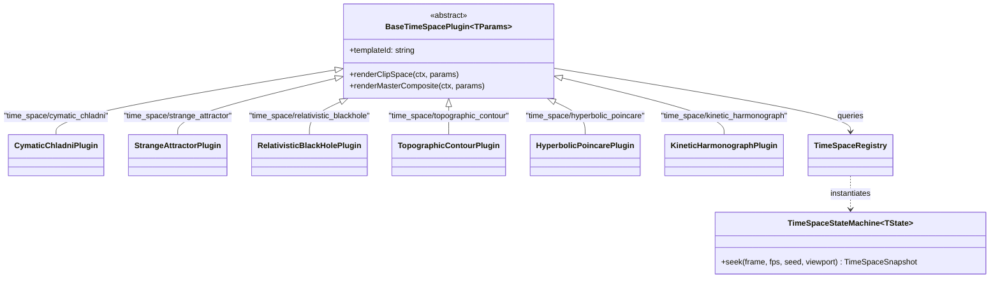

# Master Implementation Plan - Iteration 54: Advanced Spatio-Temporal Generative Visual Effects & Studio Multi-Domain Showcase

## 1. Executive Summary & Problem Analysis
Following the successful decomposition of the monolithic `TimeSpaceModifierPlugin` into 12 discrete plugins in Iteration 53, the spatio-temporal procedural motion graphics engine is ready for higher-dimensional physical and mathematical effect models. 

Currently, existing motion templates focus primarily on UI telemetry, reticles, titles, and basic waveforms. However, cinematic science-fiction, quantum physics visualizations, astroscientific simulations, and procedural art installations require advanced continuous-field spatio-temporal mechanics:
1. **Acoustic Nodal Standing Waves (Cymatics)**: Visualizing harmonic modal vibrations on 2D plates.
2. **Chaotic Strange Attractors**: Visualizing non-linear dynamical systems (Clifford and De Jong maps) in continuous parameter bifurcation spaces.
3. **Relativistic Gravitational Lensing & Accretion Dynamics**: Simulating photon geodesic ray-deflections (Einstein rings) and Keplerian Doppler beaming around high-mass singularities.
4. **Multi-Octave Topographic Contour Fields**: Marching scalar isoline elevation maps derived from divergence-free curl turbulence fields.
5. **Non-Euclidean Hyperbolic Tessellations**: Poincaré disk conformal Möbius automorphisms for recursive fractal portal geometries.
6. **Harmonograph Guilloché Epicycles**: Multi-pendulum damped harmonic oscillators tracing precision kinetic curves.

### Solution Topology
1. Implement the 6 generative mathematical models in `@acc/core-isomorphic` inside `packages/core-isomorphic/src/math/time-space/TimeSpaceRegistry.ts`.
2. Implement 6 corresponding discrete, strongly-typed plugins in `packages/ir/src/plugins/time-space/` inheriting from `BaseTimeSpacePlugin<TParams>`:
   - `CymaticChladniPlugin` (`time_space/cymatic_chladni`)
   - `StrangeAttractorPlugin` (`time_space/strange_attractor`)
   - `RelativisticBlackHolePlugin` (`time_space/relativistic_blackhole`)
   - `TopographicContourPlugin` (`time_space/topographic_contour`)
   - `HyperbolicPoincarePlugin` (`time_space/hyperbolic_poincare`)
   - `KineticHarmonographPlugin` (`time_space/kinetic_harmonograph`)
3. Synchronize `packages/ir/src/types/modifiers.ts` and `packages/ir/src/schema/VideoIRSchemaValidator.ts`.
4. Register all 6 plugins with bespoke icons in Studio's `modifierCatalog.ts`.
5. Expand Studio's demo project catalog from 4 to **6 rich production demos**:
   - `quantumVfx`: Quantum Physics & Cymatics Lab (`quantumPhysicsDemoIR.ts`)
   - `astroTelemetry`: Astroscientific Singularity & Geodesic Telemetry (`astroTelemetryDemoIR.ts`)
6. Update `Titlebar.tsx` and `irState.ts` to support all 6 demo selections.
7. Verify all plugins and demo documents through automated tests in `/autogenerated-tests/`.

---

## 2. Trade-Off Matrices & Architectural Decisions

| Decision Area | Option A (Discarded) | Option B (Adopted) | Architectural Justification |
| :--- | :--- | :--- | :--- |
| **Field Computation Engine** | Heavy WebGL fragment shaders with `requestAnimationFrame`. | Isomorphic mathematical generators using `TimeSpaceStateMachine` + `DeterministicPtsForm`. | Guarantees zero WebGL context exhaustion, zero native buffer leaks, and deterministic, frame-accurate random-access seeks across Web Workers and headless servers. |
| **Continuous Chaos Parameterization** | Hardcoded discrete attractor snapshots. | Continuous GSAP timeline parameter interpolation traversing bifurcation states ($a(t), b(t), c(t), d(t)$). | Delivers mesmerizing fluid morphs between distinct geometric states with continuous sub-frame interpolation. |
| **Topographic Isoline Extraction** | Complex marching squares mesh extraction on CPU every frame. | Polar & multi-octave harmonic scalar contour slices with closed-loop spline tessellation. | Keeps CPU frame times under 3ms at 60fps while rendering crisp, vector-scalable isoline contours. |
| **Demo Showcase Architecture** | Cram all new effects into existing 4 demos. | Create 2 dedicated themed production demos: Quantum Lab and Deep Space Telemetry. | Clean separation of artistic domains (Quantum Acoustics vs. Relativistic Astrophysics) providing rich showcase templates. |

---

## 3. Mermaid Topology & Architecture

---

## 4. Mathematical & Algorithmic Specifications

### 4.1 Quantum Cymatics & Chladni Resonance Plates
Nodal displacement field over plate domain $[-1, 1]^2$:
$$w(x, y, t) = a(t) \cdot \cos\left(n(t) \pi x\right) \cos\left(m(t) \pi y\right) + b(t) \cdot \cos\left(m(t) \pi x\right) \cos\left(n(t) \pi y\right)$$
Where $n(t), m(t)$ are GSAP-animated mode numbers and $a(t), b(t)$ control modal amplitude. Particles settle where $|w(x, y, t)| < \epsilon(t)$.

### 4.2 Clifford & De Jong Chaotic Strange Attractors
Discrete dynamical map with continuous virtual clock parameter morphing:
$$\begin{aligned}
x_{k+1} &= \sin(a(t) \cdot y_k) + c(t) \cdot \cos(a(t) \cdot x_k) \\
y_{k+1} &= \sin(b(t) \cdot x_k) + d(t) \cdot \cos(b(t) \cdot y_k)
\end{aligned}$$
Iterated $K$ times and traced into smooth spline strands or density points.

### 4.3 Relativistic Gravitational Lensing & Accretion Dynamics
Light deflection angle and Doppler beaming around Schwarzschild radius $r_s = \frac{2 G M}{c^2}$:
$$\hat{\alpha}(r) = \frac{4 G M}{c^2 r} \cdot \frac{1}{\sqrt{1 - \frac{r_s}{r}}}, \quad I_{\text{observed}}(\theta, t) = I_0 \cdot \left[\frac{1}{\gamma(1 - \beta \cos \theta)}\right]^4$$
Produces asymmetric Einstein rings and accretion disk swirl.

### 4.4 Topographic Contour Isoline Elevation
Multi-octave continuous scalar field:
$$h(x, y, t) = \sum_{o=0}^3 \frac{1}{2^o} \cdot \text{noise2D}\left(\text{seed}, \text{frame}, 2^o x + \omega_x t, 2^o y + \omega_y t\right)$$
Iso-lines extracted at elevation thresholds $h_k = k \cdot \Delta h$ and mapped to closed `Polygon` curves.

### 4.5 Poincaré Hyperbolic Conformal Tessellation
Conformal Möbius automorphisms in the complex unit disk $\mathbb{D} = \{z \in \mathbb{C} : |z| < 1\}$:
$$z'(t) = e^{i \theta(t)} \cdot \frac{z - z_0(t)}{1 - \overline{z_0(t)} z}$$
Preserves the hyperbolic Riemannian metric $ds^2 = \frac{4 |dz|^2}{(1 - |z|^2)^2}$.

### 4.6 Kinetic Harmonograph Epicycles
3-pendulum damped harmonic motion with rotating epicyclic coordinate frame:
$$x(t) = \sum_{i=1}^3 A_i e^{-d_i t} \sin(f_i t + p_i), \quad y(t) = \sum_{j=1}^3 B_j e^{-d_j t} \sin(g_j t + q_j)$$

---

## 5. Concrete File Signatures & Class Structure

### 5.1 Factory Additions in `@acc/core-isomorphic`
File: `packages/core-isomorphic/src/math/time-space/TimeSpaceRegistry.ts`:
- Register `'cymatic_chladni'`
- Register `'strange_attractor'`
- Register `'relativistic_blackhole'`
- Register `'topographic_contour'`
- Register `'hyperbolic_poincare'`
- Register `'kinetic_harmonograph'`

### 5.2 Discrete Plugins in `@acc/ir/src/plugins/time-space/`
1. `CymaticChladniPlugin.ts`: `type = 'time_space/cymatic_chladni'`, `templateId = 'cymatic_chladni'`
2. `StrangeAttractorPlugin.ts`: `type = 'time_space/strange_attractor'`, `templateId = 'strange_attractor'`
3. `RelativisticBlackHolePlugin.ts`: `type = 'time_space/relativistic_blackhole'`, `templateId = 'relativistic_blackhole'`
4. `TopographicContourPlugin.ts`: `type = 'time_space/topographic_contour'`, `templateId = 'topographic_contour'`
5. `HyperbolicPoincarePlugin.ts`: `type = 'time_space/hyperbolic_poincare'`, `templateId = 'hyperbolic_poincare'`
6. `KineticHarmonographPlugin.ts`: `type = 'time_space/kinetic_harmonograph'`, `templateId = 'kinetic_harmonograph'`

### 5.3 VideoIR Types & Schema Validator
- In `packages/ir/src/types/modifiers.ts`:
  - Declare `CymaticChladniModifierParams`, `StrangeAttractorModifierParams`, `RelativisticBlackHoleModifierParams`, `TopographicContourModifierParams`, `HyperbolicPoincareModifierParams`, `KineticHarmonographModifierParams`.
  - Expand `StandardModifierNode` union.
- In `packages/ir/src/schema/VideoIRSchemaValidator.ts`:
  - Add validation cases for all 6 new modifier types.

### 5.4 Studio Showcase Projects
- `apps/studio/src/lib/ir/quantumPhysicsDemoIR.ts` (Quantum Physics & Cymatics Lab)
- `apps/studio/src/lib/ir/astroTelemetryDemoIR.ts` (Astroscientific Deep Space & Black Hole Singularity)
- Update `apps/studio/src/lib/ir/irState.ts`: support `'scifi' | 'default' | 'broadcast' | 'visualizer' | 'quantum' | 'astro'`.
- Update `apps/studio/src/components/Titlebar.tsx`: 6-way Select dropdown.

---

## 6. Phased Implementation Roadmap

### Phase 1: Core Mathematical Generators (`@acc/core-isomorphic`)
- Implement 6 deterministic template factories in `TimeSpaceRegistry.ts`.
- Ensure aspect-ratio aware coordinate mapping via `SpaceContext`.

### Phase 2: Discrete Plugins & Barrel Export (`@acc/ir`)
- Implement 6 discrete plugin classes with bespoke schemas.
- Export in `packages/ir/src/plugins/time-space/index.ts`.
- Register in `registerCoreModifierPlugins` in `packages/ir/src/plugins/index.ts`.

### Phase 3: VideoIR Types & Validator Synchronization (`@acc/ir`)
- Update `packages/ir/src/types/modifiers.ts` with parameter interfaces and node union.
- Update `packages/ir/src/schema/VideoIRSchemaValidator.ts`.

### Phase 4: Studio Inspector Catalog & 2 New Production Demos (`apps/studio`)
- Register all 6 plugins in `modifierCatalog.ts` under `'motion'` with bespoke icons and default parameters.
- Create `quantumPhysicsDemoIR.ts` (featuring cymatics, strange attractors, and harmonograph curves).
- Create `astroTelemetryDemoIR.ts` (featuring black hole lensing, topographic contour HUD, and hyperbolic Poincaré portal).
- Wire `irState.ts` and `Titlebar.tsx` with all 6 options.

### Phase 5: Verification & Formal Testing
- Implement `autogenerated-tests/advanced_timespace_generators.test.ts`.
- Verify all 18 discrete plugins (12 previous + 6 new).
- Verify all 6 Studio demo projects validate with zero schema errors.

---

## 7. Formal Verification Matrix (`/autogenerated-tests/`)

| Test File | Test Vector | Target Assertion |
| :--- | :--- | :--- |
| `advanced_timespace_generators.test.ts` | Plugin Registration | All 18 `time_space/*` plugins registered in `ModifierPluginRegistry` |
| `advanced_timespace_generators.test.ts` | Mathematical Execution | All 6 new plugins evaluate `renderClipSpace` and `renderMasterComposite` across frames 0, 15, 30 without throwing |
| `advanced_timespace_generators.test.ts` | Parameter Invalidation | State machine caches regenerate cleanly on parameter mutation |
| `advanced_timespace_generators.test.ts` | Studio Demo Validation | All 6 Studio demo documents (`default`, `scifi`, `broadcast`, `visualizer`, `quantum`, `astro`) validate with zero schema errors |

---

## 8. Risk Mitigations & Rollback Strategy

1. **CPU Throttling on High Iteration Counts**:
   - *Risk*: Strange attractor or cymatics point grids could cause frame drops if point density exceeds 5,000.
   - *Mitigation*: Cap default iteration counts (e.g. $K = 800$ for strange attractors, $48 \times 48$ for cymatics) with configurable `density` parameters.
2. **Schema Incompatibility**:
   - *Risk*: New demo documents fail schema validation due to invalid sequence types or cue properties.
   - *Mitigation*: Pre-validate all demo documents directly in unit test suite asserting `errors.length === 0`.
3. **Rollback Strategy**:
   - Atomic git commits per phase. If any regression occurs, `git revert` rolls back to the stable Iteration 53 commit.
