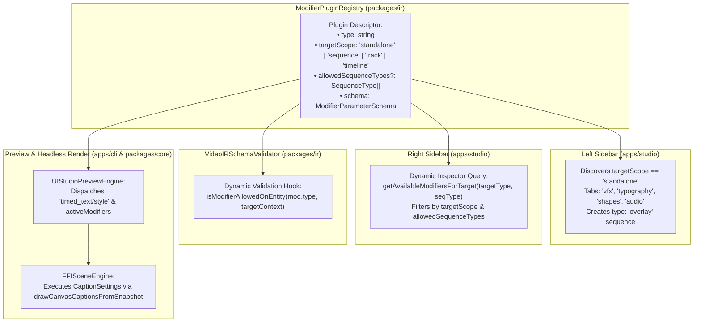

# Master Implementation Plan - Iteration 55: Unified Modifier Target Model, Dynamic Registry Validation & 7-Package Synchronization

## 1. Executive Summary & Problem Analysis
Following the creation of discrete spatio-temporal and particle motion plugins, the VideoIR modifier ecosystem faces critical architectural scaling challenges:
1. **Target Ambiguity**: Modifiers previously had ambiguous or multi-target definitions (`targetScope: 'both'`, array targets `['sequence', 'track']`), creating confusion between modifiers that act as contextual filters on existing media versus modifiers that act as standalone procedural generators.
2. **UI Routing Friction**: The Studio interface lacked a deterministic rule to know which modifiers belong in the **Left Sidebar** (Asset/Element Creation Vault) versus the **Right Sidebar** (Entity Inspector).
3. **Overlay Sequence Incompatibilities**: Standalone generative sequences (like rain, snow, HUDs, or lower-thirds on a transparent `type: 'overlay'` sequence) could accidentally have heavy footage-centric modifiers attached (e.g. AI Depth Estimation, 3D Camera Projection, Color LUTs), leading to missing normal map/depth buffer runtime crashes.
4. **Naming Inconsistency**: `text/style` was ambiguously named despite being solely designed for subtitle/caption tracks, blocking future standalone typography overlay plugins (`text/*`).
5. **Monorepo Invariant Drift**: Full synchronization across 7 packages (`packages/ir`, `apps/studio`, `apps/cli`, `packages/effect-engines`, `packages/core`, `packages/core-web`, `packages/core-isomorphic`) is required to preserve zero-alloc render loops and bit-identical parity.

### Solution Topology
1. **Strict 4-Domain Target Taxonomy**:
   Every modifier declares strictly ONE target scope:
   ```typescript
   export type ModifierTargetScope = 'standalone' | 'sequence' | 'track' | 'timeline';
   ```
2. **Dynamic UI Dispatching**:
   - `standalone`: Discovered in **Left Sidebar** library tabs (`vfx`, `typography`, `shapes`, `audio`). Drag-and-drop spawns a sovereign `type: 'overlay'` sequence on the timeline.
   - `sequence`, `track`, `timeline`: Discovered in **Right Sidebar** inspector tabs.
3. **Dynamic Registry Whitelisting**:
   - `ModifierPlugin` declares `allowedSequenceTypes?: readonly SequenceType[]`.
   - Standalone `overlay` sequences strictly allow ONLY `transform` and `overlay/blend_mode` (and transitions). Incompatible filters are dynamically pruned.
4. **Rename `text/style` $\to$ `timed_text/style`**:
   - Strict rename across all 7 packages, demo documents, and tests, cleanly reserving `text/*` for future typography elements.
5. **8-Component Schema Synchronization**:
   - Synchronize all 8 components defined in monorepo rules.
6. **Studio-Grade Ecosystem Expansion**:
   - Implement `motion/vector_blur` (Phase 2), `generator/solid_backdrop` (Phase 2 Standalone), `timeline/photometric_bloom` (Phase 4), and `timeline/anamorphic_glare` (Phase 4).

---

## 2. Trade-Off Matrices & Architectural Decisions

| Decision Area | Option A (Discarded) | Option B (Adopted) | Architectural Justification |
| :--- | :--- | :--- | :--- |
| **Modifier Target Model** | Multi-target arrays (`targetScope: ['sequence', 'track']`) or `'both'`. | Strict single-target enum: `'standalone' \| 'sequence' \| 'track' \| 'timeline'`. | Eliminates runtime ambiguity and provides an exact 1:1 mapping to UI discovery and compiler pipelines. |
| **Overlay Sequence Permitted Modifiers** | Allow all visual filters on overlays; let renderers fail gracefully. | Dynamic whitelist via `allowedSequenceTypes`; only allow `transform`, `blend_mode`, and `transitions`. | Prevents nonsensical operations (e.g. AI depth estimation on an audio spectrum or particle field) and avoids runtime canvas crashes. |
| **Caption Modifier Naming** | Keep `text/style` or alias dynamically with deprecation warnings. | Strict rename to `timed_text/style` across all packages and demos. | Enforces clean domain boundaries between timed subtitle cues (`track.type === 'timed_text'`) and graphic typography overlays (`text/*`). |
| **Subtitle DSP Integration** | Rename internal `CaptionSettings` across `effect-engines` and `core`. | Retain `CaptionSettings` in `effect-engines`/`core` and adapt via `CaptionModifierPlugin`. | Preserves battle-tested FFI and WebCodecs subtitle rasterizer bindings without unnecessary churn. |

---

## 3. Mermaid Topology & Architecture



---

## 4. Mathematical & Algorithmic Specifications

### A. Sub-frame Optical Vector Motion Blur (`motion/vector_blur`)
For a sequence with keyframed transform matrix $M(t)$ at local frame $f$:
$$\vec{v}(f) = \frac{\partial \mathbf{p}}{\partial t} \approx \frac{\mathbf{p}(f + \Delta t) - \mathbf{p}(f - \Delta t)}{2 \cdot \Delta t}$$
The shutter angle $\theta_{shutter} \in [0^\circ, 360^\circ]$ determines temporal sampling range:
$$T_{exposure} = \frac{\theta_{shutter}}{360^\circ \cdot \text{fps}}$$
The motion blur convolves $N$ temporal samples along the instantaneous velocity vector:
$$I_{blur}(\mathbf{x}) = \frac{1}{N} \sum_{k=0}^{N-1} I\left(\mathbf{x} - \frac{k - \frac{N-1}{2}}{N-1} \cdot \vec{v}(f) \cdot T_{exposure}\right)$$

### B. Dual-Pass Photometric Bloom (`timeline/photometric_bloom`)
Pixels exceeding the luminance threshold $L_{th}$ are isolated:
$$I_{bright}(\mathbf{x}) = \begin{cases} 
I(\mathbf{x}) \cdot \frac{Y(\mathbf{x}) - L_{th}}{1.0 - L_{th}} & \text{if } Y(\mathbf{x}) > L_{th} \\
0 & \text{otherwise}
\end{cases}$$
where $Y = 0.2126 R + 0.7152 G + 0.0722 B$. A downsampled separable Gaussian blur $G_\sigma$ is applied and composited additively:
$$I_{final} = I_{in} + \kappa_{bloom} \cdot (G_\sigma * I_{bright})$$

---

## 5. Concrete File Signatures & Package Updates

### 1. `packages/ir/src/types/modifiers.ts`
```typescript
export type ModifierTargetScope = 'standalone' | 'sequence' | 'track' | 'timeline';

export interface VectorMotionBlurModifierParams {
  shutterAngle?: number; // default 180 (degrees)
  samples?: number;      // default 8
}

export interface PhotometricBloomModifierParams {
  luminanceThreshold?: number; // 0.0 - 1.0, default 0.8
  intensity?: number;          // default 1.0
  tint?: string;
}

export interface AnamorphicGlareModifierParams {
  threshold?: number;
  streakLengthPx?: number;
  streakTint?: string;
  intensity?: number;
}

export interface SolidBackdropModifierParams {
  colorA: string;
  colorB?: string;
  type?: 'solid' | 'linear_gradient' | 'radial_gradient';
  angleDeg?: number;
  dither?: boolean;
}
```

### 2. `packages/ir/src/plugins/ModifierPluginRegistry.ts`
```typescript
export interface ModifierPlugin<TParams = Record<string, unknown>> {
  readonly type: string;
  readonly targetScope: ModifierTargetScope;
  readonly allowedSequenceTypes?: readonly SequenceType[];
  readonly schema?: ModifierParameterSchema;
  // ...
}

export class ModifierPluginRegistry {
  public getAvailableModifiersForTarget(
    targetScope: 'sequence' | 'track' | 'timeline',
    sequenceType?: SequenceType
  ): ModifierPlugin<any>[];

  public getGeneratorsForLibrary(category?: string): ModifierPlugin<any>[];

  public isModifierAllowedOnEntity(
    modifierType: string,
    targetContext: { type: 'track' | 'timeline' } | { type: 'sequence'; sequenceType: SequenceType }
  ): { allowed: boolean; reason?: string };
}
```

---

## 6. Phased Roadmap

- [ ] **Phase 1: Registry Contracts & Dynamic Query APIs (`packages/ir`)**
  - Implement `ModifierTargetScope` and update `ModifierPlugin` interface.
  - Add `getAvailableModifiersForTarget()`, `getGeneratorsForLibrary()`, and `isModifierAllowedOnEntity()`.
  - Update all existing plugins in `packages/ir/src/plugins/` with explicit `targetScope` and `allowedSequenceTypes`.
- [ ] **Phase 2: Strict Rename `text/style` $\to$ `timed_text/style` across Monorepo**
  - Update `CaptionModifierPlugin.ts` (`type = 'timed_text/style'`, `allowedSequenceTypes = ['timed_text']`).
  - Update `packages/ir/src/types/modifiers.ts` and `packages/ir/src/schema/VideoIRSchemaValidator.ts`.
  - Update `packages/ir/src/renderer/shared/IRCanvasCompositor.ts`.
  - Update `apps/studio` presets, hit testers, commands, and all 6 demo IR files.
- [ ] **Phase 3: Studio UI Dynamic Wiring (`apps/studio`)**
  - Refactor `RightSidebar.tsx` and `SequenceInspector.tsx` to dynamically query available modifiers via registry.
  - Enforce that `'overlay'` sequences strictly display `Transform`, `Blend Mode`, and `Transitions`.
  - Wire `LeftSidebar.tsx` to surface `'standalone'` procedural generators in `vfx`, `shapes`, `typography`, and `audio` tabs.
- [ ] **Phase 4: Expanded Studio-Grade Plugins (`packages/ir`)**
  - Implement `motion/vector_blur` plugin (`targetScope: 'sequence'`).
  - Implement `generator/solid_backdrop` plugin (`targetScope: 'standalone'`).
  - Implement `timeline/photometric_bloom` and `timeline/anamorphic_glare` plugins (`targetScope: 'timeline'`).
  - Register new plugins in `registerCoreModifierPlugins()`.
- [ ] **Phase 5: CLI & Cross-Package Verification (`apps/cli`, `packages/core`)**
  - Verify `UIStudioPreviewEngine.ts` and `FFISceneEngine.ts` handle `timed_text/style` and new modifiers with zero regressions.
  - Run typechecks and builds across all packages.

---

## 7. Formal Verification Matrix (`/autogenerated-tests/`)

| Test File | Test Case | Expected Behavior |
| :--- | :--- | :--- |
| `modifier_targets_dynamic_sync.test.ts` | Test Single-Target Isolation | Each plugin returns exactly one valid `ModifierTargetScope`. |
| `modifier_targets_dynamic_sync.test.ts` | Test Dynamic Allowed Modifiers on `'overlay'` | Querying `'sequence'` for `'overlay'` returns ONLY `transform`, `overlay/blend_mode`, and transitions. |
| `modifier_targets_dynamic_sync.test.ts` | Test `timed_text/style` Rename | `VideoIRSchemaValidator` approves `'timed_text/style'` on `timed_text` track and rejects legacy `'text/style'`. |
| `modifier_targets_dynamic_sync.test.ts` | Test Standalone Generator Resolution | Standalone overlay sequence renders on clean transparent canvas without requiring an asset. |
| `modifier_targets_dynamic_sync.test.ts` | Test Studio-Grade Plugins | `motion/vector_blur` and `timeline/photometric_bloom` instantiate and execute without canvas exceptions. |

---

## 8. Risk Analysis & Rollback Mitigations

| Risk | Likelihood | Impact | Mitigation |
| :--- | :---: | :---: | :--- |
| **Breaking Legacy Documents using `text/style`** | Medium | Medium | Run automated migration script on load in `IRStateManager.loadDocument()`: if `mod.type === 'text/style'`, map to `'timed_text/style'`. |
| **Performance Overhead of Dynamic Registry Queries** | Low | Low | Registry caches query results keyed by `${targetScope}_${sequenceType ?? 'all'}` to guarantee $O(1)$ lookups. |
| **Left Sidebar Drag-and-Drop Desynchronization** | Low | Medium | Re-use existing `handleInsertPreset` / `handleDragEnd` pipeline in `App.tsx`, inserting standard `IRSequence` with `type: 'overlay'`. |
