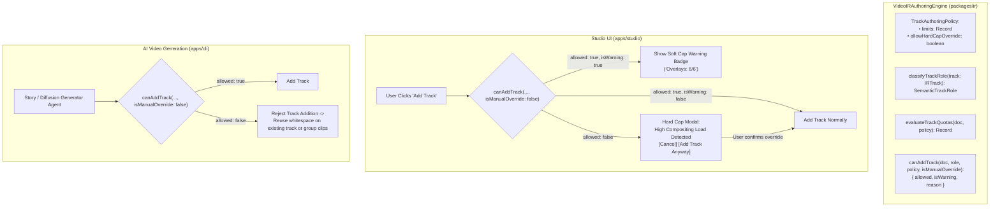

# Master Implementation Plan - Iteration 56: Universal Track Soft-Cap Constraints & Semantic Track Quotas in VideoIRAuthoringEngine

## 1. Executive Summary & Problem Analysis
As the VideoIR authoring ecosystem scales to support both human manual editing and autonomous AI video generation (e.g., text-to-story LLM/diffusion pipelines), timeline architecture requires disciplined structural guardrails:
1. **Unbounded Track Bloat**: Without constraints, AI video generators frequently spawn chaotic timelines with 20–30 tracks, causing severe GPU out-of-memory (OOM) failures, WebGL context loss, and canvas compositing lag.
2. **Lack of Semantic Role Differentiation**: Physically, VideoIR tracks are typed broadly as `'video'`, `'audio'`, `'timed_text'`, or `'data'`. However, creative workflows rely on distinct semantic roles: **Main Track** (story spine), **Overlays** (PIP, particles, HUDs), **Audio** (voiceover, BGM, SFX), **Text & Captions** (subtitles), **Effects & Filters** (adjustment tracks), and **Stickers** (animated graphics/emojis).
3. **Preserving Foundational Generality**: We must enforce CapCut-style layer quotas (e.g. 1 Main Track, 6–10 Overlays) *without* polluting the foundational `VideoIRDocument` schema.

### Solution Topology
1. **Configurable Authoring Policy & Semantic Classifier in `VideoIRAuthoringEngine`**:
   Implement `TrackAuthoringPolicy`, `SemanticTrackRole`, `classifyTrackRole()`, and `evaluateTrackQuotas()` directly inside `packages/ir/src/authoring/VideoIRAuthoringEngine.ts`.
2. **Dual-Mode Enforcement (Human vs. AI)**:
   - **Manual Studio Users**: Soft caps trigger non-intrusive performance warning badges in the timeline track header; hard caps open a confirmation modal with an explicit `[Add Track Anyway]` manual override.
   - **Autonomous AI Generation (`apps/cli`)**: Hard caps strictly prevent agent generators from spawning excess tracks, automatically guiding the AI to reuse whitespace or group non-overlapping clips into existing tracks.
3. **Studio UI Integration**:
   Add track quota telemetry to `StudioTimelineState.ts` and `apps/studio/src/components/timeline/` with ambient Liquid Glass warnings.

---

## 2. Trade-Off Matrices & Architectural Decisions

| Decision Area | Option A (Discarded) | Option B (Adopted) | Architectural Justification |
| :--- | :--- | :--- | :--- |
| **Track Schema Representation** | Expand `TrackType` enum to `'main_video' \| 'overlay' \| 'effects' \| 'stickers'`. | Keep `TrackType` general (`'video' \| 'audio' \| 'timed_text'`) and classify roles in `VideoIRAuthoringEngine`. | Preserves backward compatibility, keeps VideoIR lean and portable, and adheres strictly to the Open-Closed Principle. |
| **Cap Enforcement Mechanism** | Hard-coded strict numerical limits in Studio React components. | Configurable `TrackAuthoringPolicy` object with default quotas in the isomorphic authoring engine. | Allows both human editors (with overrides) and automated AI pipelines (with strict compliance) to share the identical policy logic. |
| **Cap Breach UI Experience** | Hard blocking / error toast refusing to add the track. | Soft warning badges (amber) + confirmation modal on hard cap with `[Add Track Anyway]`. | Respects user autonomy and power-user workflows while clearly communicating rendering performance trade-offs. |

---

## 3. Mermaid Topology & Architecture



---

## 4. Mathematical & Algorithmic Specifications

### A. Dynamic Semantic Role Classification Algorithm
Given track $T_i \in \text{doc.tracks}$:
$$\text{Role}(T_i) = \begin{cases}
\text{'audio'} & \text{if } T_i.\text{type} = \text{'audio'} \\
\text{'text'} & \text{if } T_i.\text{type} = \text{'timed\_text'} \\
\text{'main'} & \text{if } i = 0 \lor T_i.\text{id} \in \{\text{'track\_v\_main'}, \text{'track\_v\_1'}\} \lor \text{match}(T_i.\text{name}, \text{"main"}) \\
\text{'stickers'} & \text{if } \text{match}(T_i.\text{name}, \text{"sticker"}\mid\text{"emoji"}) \\
\text{'effects'} & \text{if } \text{match}(T_i.\text{name}, \text{"effect"}\mid\text{"filter"}) \lor |T_i.\text{modifiers}| > 0 \\
\text{'overlay'} & \text{otherwise}
\end{cases}$$

### B. Quota Evaluation Heuristic
For each role $R \in \{\text{main}, \text{overlay}, \text{text}, \text{effects}, \text{stickers}, \text{audio}\}$:
$$N_R = \sum_{T \in \text{tracks}} \mathbb{I}(\text{Role}(T) = R)$$
$$\text{Status}(R) = \begin{cases}
\text{OK} & N_R < \text{SoftCap}(R) \\
\text{SoftCapWarning} & \text{SoftCap}(R) \le N_R < \text{HardCap}(R) \\
\text{HardCapReached} & N_R \ge \text{HardCap}(R)
\end{cases}$$

---

## 5. Concrete Code Signatures

### `packages/ir/src/authoring/VideoIRAuthoringEngine.ts`
```typescript
export type SemanticTrackRole =
  | 'main'
  | 'overlay'
  | 'audio'
  | 'text'
  | 'effects'
  | 'stickers';

export interface TrackQuotaLimit {
  softCap: number;
  hardCap: number;
}

export interface TrackAuthoringPolicy {
  limits: Record<SemanticTrackRole, TrackQuotaLimit>;
  allowHardCapOverride: boolean;
}

export const DEFAULT_TRACK_AUTHORING_POLICY: TrackAuthoringPolicy = {
  limits: {
    main: { softCap: 1, hardCap: 1 },
    overlay: { softCap: 6, hardCap: 10 },
    text: { softCap: 3, hardCap: 6 },
    effects: { softCap: 2, hardCap: 4 },
    stickers: { softCap: 2, hardCap: 4 },
    audio: { softCap: 4, hardCap: 8 },
  },
  allowHardCapOverride: true,
};

export interface TrackQuotaStatus {
  role: SemanticTrackRole;
  currentCount: number;
  softCap: number;
  hardCap: number;
  isSoftCapExceeded: boolean;
  isHardCapReached: boolean;
  message?: string;
}
```

---

## 6. Phased Implementation Roadmap

- [x] **Phase 1: Authoring Policy & Engine Implementation (`packages/ir`)**
  - Add `SemanticTrackRole`, `TrackQuotaLimit`, and `TrackAuthoringPolicy` types.
  - Implement `classifyTrackRole()`, `evaluateTrackQuotas()`, and `canAddTrack()`.
  - Add `generateNextTrackId(doc, type, role)` with role-specific ID prefixes (e.g. `track_v_overlay_`).
- [x] **Phase 2: Authoring Engine Unit Tests (`autogenerated-tests/`)**
  - Write test suite verifying correct role classification across various track names and types.
  - Verify soft-cap warnings and hard-cap rejections.
  - Verify manual override logic.
- [x] **Phase 3: Studio UI Integration (`apps/studio`)**
  - Wire `canAddTrack` into `IRStateManager.addTrack()`.
  - Display non-intrusive soft-cap badges in the track header area when approaching limits.
  - Implement confirmation modal for hard-cap override.
- [x] **Phase 4: AI Generation Guardrails (`apps/cli`)**
  - Update `apps/cli/src/pipelines/04-generative-story/` to query `canAddTrack` before track allocation.
  - Implement whitespace reuse fallback when track addition is rejected.
- [x] **Phase 5: Full Build & Verification**
  - Run `pnpm --filter @acc/ir check-types` and `pnpm --filter @acc/studio check-types`.
  - Execute monorepo tests and studio production build.

---

## 7. Formal Verification Matrix (`/autogenerated-tests/`)

| Test File | Test Case | Expected Behavior |
| :--- | :--- | :--- |
| `track_soft_cap_policy.test.ts` | Test Default Classification | Accurately identifies `main`, `overlay`, `text`, `audio`, `effects`, `stickers`. |
| `track_soft_cap_policy.test.ts` | Test Soft Cap Threshold | Returns `isWarning: true` when overlay count reaches 6. |
| `track_soft_cap_policy.test.ts` | Test Hard Cap Rejection | Rejects 11th overlay track when `isManualUserOverride: false`. |
| `track_soft_cap_policy.test.ts` | Test Hard Cap Manual Override | Allows 11th overlay track when `isManualUserOverride: true` with warning reason. |
| `track_soft_cap_policy.test.ts` | Test Custom Policy Ingestion | Custom policy with `overlay.softCap = 2` triggers warning at 2 tracks. |

---

## 8. Risk Analysis & Rollback Mitigations

| Risk | Likelihood | Impact | Mitigation |
| :--- | :---: | :---: | :--- |
| **Existing Demos Exceeding Hard Caps** | Low | Low | All 6 existing Studio demo projects have $\le 5$ overlay tracks, well below the soft cap of 6. |
| **UI Annoyance from Frequent Warnings** | Low | Medium | Soft cap warnings are rendered as subtle ambient badges (Liquid Glass style), not blocking alerts. Only hard caps trigger a modal. |
| **AI Generator Deadlock on Complex Stories** | Low | High | AI generator has an automatic fallback to reuse existing tracks by finding non-overlapping temporal whitespace. |
