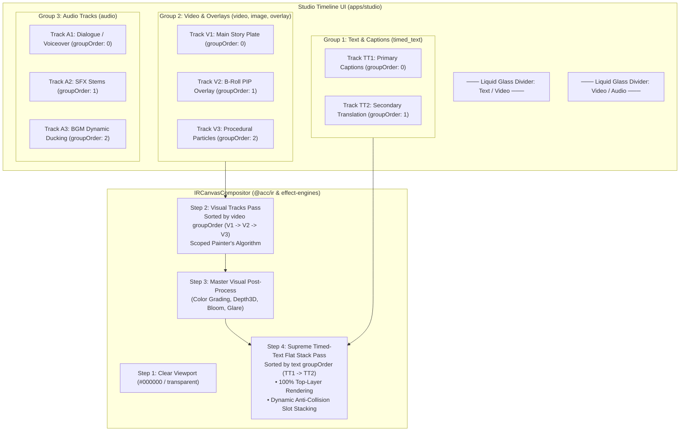

# Master Implementation Plan - Iteration 57: Universal Track Type Grouping, Backward-Compatible `groupOrder`, and Supreme Timed-Text Flat Rendering Stack

## 1. Executive Summary & Problem Analysis
As timelines grow in complexity with mixed media modalities, Studio editors and headless rendering pipelines face two major architectural challenges:
1. **Unordered Interleaving & Boundary Bleed**: Tracks in VideoIR documents are stored in a flat array (`doc.tracks`). When users or generators reorder tracks, video tracks can accidentally be moved below audio tracks or between subtitle cues, breaking user expectations and causing rendering order anomalies.
2. **Subtitle Occlusion & Stacking Collisions**: Physically, `timed_text` tracks represent subtitles/captions that must unconditionally sit at the highest visual layer (above video plates, B-roll overlays, particles, and volumetric cards). When multiple `timed_text` tracks are active concurrently (e.g. bilingual subtitles, translations, karaoke + captions), drawing them naively causes overlapping text collisions at identical anchor positions.

### Solution Topology
1. **Backward-Compatible Intra-Group Ordering (`groupOrder`)**:
   Add `groupOrder?: number` to `IRTrack` and `ResolvedTrack`. Tracks are organized into 3 primary modality groups:
   - **Text & Captions**: `timed_text`
   - **Video & Overlays**: `video`, `image`, `overlay`
   - **Audio Tracks**: `audio`
   `groupOrder` defines the 0-indexed position *within* each modality group. Legacy documents without `groupOrder` automatically fallback to their document occurrence index.
2. **Modality-Isolated Reordering**:
   Reordering a track moves it strictly within its own modality group, never crossing group boundaries.
3. **Supreme Timed-Text Flat Rendering Stack & Anti-Collision**:
   `IRCanvasCompositor` promotes all `timed_text` tracks to an isolated top-level flat stack pass composited strictly on top of all visual tracks. Concurrently active subtitle tracks are assigned dynamic vertical anti-collision slots (`slotIndex`), stacking them cleanly without overlapping text.
4. **Studio Liquid Glass Grouping UI**:
   `TimelineDom.tsx` renders modality sections with ambient Liquid Glass group headers, track counters, and intra-group reorder limits.

---

## 2. Trade-Off Matrices & Architectural Decisions

| Decision Area | Option A (Discarded) | Option B (Adopted) | Architectural Justification |
| :--- | :--- | :--- | :--- |
| **Track Ordering Representation** | Maintain a single global array index for track ordering across all modalities. | Introduce `IRTrack.groupOrder?: number` and scope reordering within each modality group. | Preserves NLE mental models; prevents audio tracks from interleaving between video layers; guarantees backward compatibility for existing documents. |
| **Subtitle Rendering Layering** | Interleave `timed_text` rendering with visual tracks in document order. | Promote all `timed_text` tracks to an isolated **Flat Subtitle Stack** rendered strictly on top of all visual tracks. | Ensures subtitles are never occluded by overlay clips, particles, or adjustment layers while allowing explicit layering among subtitle tracks. |
| **Multi-Subtitle Collision** | Let overlapping subtitle cues draw directly over each other at identical coordinates. | Dynamic vertical slot stacking in `drawCanvasCaptionsFromSnapshot` based on `slotIndex`. | Guarantees multi-lingual or dual-caption timelines remain completely legible without manual repositioning. |
| **Global Modifiers vs. Subtitles** | Apply global post-processing shaders (bloom, glare) after subtitles. | Run visual stream and master modifiers **before** the timed-text flat stack pass. | Preserves 100% crisp, unblurred caption typography and prevents readability degradation from visual filters. |

---

## 3. Mermaid Topology & Architecture



---

## 4. Mathematical & Algorithmic Specifications

### A. Intra-Group Order Normalization Algorithm
Given document tracks $D.\text{tracks}$ containing tracks of mixed modalities:
Let $\text{Modality}(t) \in \{\text{'timed\_text'}, \text{'video'}, \text{'audio'}, \text{'data'}\}$.
For each modality group $M$:
$$T_M = [t \in D.\text{tracks} \mid \text{Modality}(t) = M]$$
Sort $T_M$ by:
$$\text{SortKey}(t) = \begin{cases} t.\text{groupOrder} & \text{if } t.\text{groupOrder} \in \mathbb{N} \\ \text{indexInDoc}(t) & \text{otherwise} \end{cases}$$
Normalize each track in $T_M$:
$$t_i.\text{groupOrder} = i \quad (i = 0, 1, \dots, |T_M| - 1)$$

### B. Vertical Anti-Collision Slot Offset Function
For active timed_text tracks $K = \{t_0, t_1, \dots, t_{k-1}\}$ sharing identical vertical anchor (e.g. `bottom-center`):
Let $s \in [0, k-1]$ be the slot index of track $t_s$:
$$Y(t_s) = \begin{cases}
H - \text{marginV} - s \cdot (\text{fontSize} \cdot 1.25 + \text{slotPadding}) & \text{if position is bottom} \\
\text{marginV} + \text{fontSize} + s \cdot (\text{fontSize} \cdot 1.25 + \text{slotPadding}) & \text{if position is top} \\
H/2 - s \cdot (\text{fontSize} \cdot 1.25 + \text{slotPadding}) & \text{if position is center}
\end{cases}$$
where $H$ is canvas height, $\text{marginV}$ is safe margin, and $\text{slotPadding} = 8\text{px}$.

---

## 5. Concrete File & Class Signatures

### `packages/ir/src/types/VideoIR.ts`
```typescript
export interface IRTrack {
  id: string;
  type: TrackType;
  name?: string;
  routeTo?: string;
  parentTrack?: string;
  blendMode?: BlendMode;
  muted?: boolean;
  visible?: boolean;
  locked?: boolean;
  style?: TrackStyle;
  modifiers?: ModifierNode[];
  groupOrder?: number; // Optional intra-group ordering index (0 = first in group)
  sequences: IRSequence[];
}

export interface ResolvedTrack {
  id: string;
  type: TrackType;
  blendMode?: BlendMode;
  opacity?: number;
  muted?: boolean;
  visible?: boolean;
  locked?: boolean;
  routeTo?: string;
  style?: TrackStyle;
  modifiers?: ModifierNode[];
  groupOrder?: number;
  sequences: ResolvedSequence[];
}
```

### `packages/effect-engines/src/types.ts`
```typescript
export interface CaptionSettings {
  // Existing properties...
  slotIndex?: number;
  slotSpacing?: number;
}
```

---

## 6. Phased Implementation Roadmap

- [x] **Phase 1: VideoIR Schema & Authoring Engine Foundations (`packages/ir`)**
  - Add `groupOrder?: number` to `IRTrack` and `ResolvedTrack` in `packages/ir/src/types/VideoIR.ts`.
  - Add schema validation for `groupOrder` in `VideoIRSchemaValidator.ts` and `schema/video-ir.schema.json`.
  - Pass `groupOrder` through in `RelationalDAGCompiler.ts`.
  - Implement `groupTracksByType`, `getTrackModalityGroup`, and `reorderTrackInGroup` in `VideoIRAuthoringEngine.ts`.
- [x] **Phase 2: Subtitle Anti-Collision & Supreme Flat Stack Compositor (`packages/effect-engines`, `packages/ir`)**
  - Update `drawCanvasCaptionsFromSnapshot` in `captions-canvas.ts` to compute vertical slot offsets using `slotIndex`.
  - Update `IRCanvasCompositor.ts` to promote all `timed_text` tracks into an isolated flat stack pass on top of all visual layers, sorted by `groupOrder`.
  - Implement concurrent subtitle slot calculation to prevent text collisions.
- [x] **Phase 3: Studio Reordering Command & State Integration (`apps/studio`)**
  - Update `ReorderTrackCommand.ts` to execute intra-group swaps with complete undo/redo snapshot safety.
  - Update `IRStateManager.reorderTrack` to respect modality boundaries.
  - Expose modality-aware track addition helpers in `Timeline.tsx` (`+ Video`, `+ Text`, `+ Audio`).
- [x] **Phase 4: Studio Timeline UI Grouping & Liquid Glass Dividers (`apps/studio`)**
  - Group tracks into `timed_text`, `video`, and `audio` in `TimelineDom.tsx`.
  - Render Liquid Glass group headers with title, icon, and track counters.
  - Update `TrackHeaderCard.tsx` `canMoveUp` and `canMoveDown` to reflect intra-group limits.
- [x] **Phase 5: Automated Verification & Documentation**
  - Create test suite in `autogenerated-tests/track_group_order_and_stack.test.ts`.
  - Create local companion plan `apps/studio/doc/implementation_plan_51.md` and walkthrough `apps/studio/doc/walkthrough_51.md`.
  - Document history entry `docs/history/398_track_grouping_and_timed_text_flat_stack.md` and update `docs/history/README.md`.

---

## 7. Formal Verification Matrix (`/autogenerated-tests/`)

| Test File | Test Case | Expected Behavior |
| :--- | :--- | :--- |
| `track_group_order_and_stack.test.ts` | Test Modality Grouping | Segregates mixed tracks into `timed_text`, `video`, and `audio` with normalized `groupOrder`. |
| `track_group_order_and_stack.test.ts` | Test Intra-Group Reorder | Reordering a video track swaps with adjacent video track without touching text or audio tracks. |
| `track_group_order_and_stack.test.ts` | Test Group Order Schema Validation | Rejects non-integer or negative `groupOrder`; accepts valid non-negative integer. |
| `track_group_order_and_stack.test.ts` | Test Timed-Text Flat Stack Ordering | `timed_text` tracks composite in order of `groupOrder` strictly after visual tracks. |
| `track_group_order_and_stack.test.ts` | Test Subtitle Anti-Collision Slot Stacking | Concurrently active subtitle tracks calculate distinct vertical `slotOffset`s. |

---

## 8. Risk Analysis & Rollback Mitigations

| Risk | Likelihood | Impact | Mitigation |
| :--- | :---: | :---: | :--- |
| **Legacy Documents Without `groupOrder`** | Low | Low | Engine treats missing `groupOrder` as document index fallback; zero schema regression. |
| **Visual Desync with Complex Transitions** | Low | Medium | Transitions operate on sequence layers within their respective visual tracks; flat subtitle stack executes post-transition. |
| **Multi-Subtitle Slot Jumping** | Low | Low | Slot index is computed deterministically per frame based on active tracks sorted by stable `groupOrder`. |
