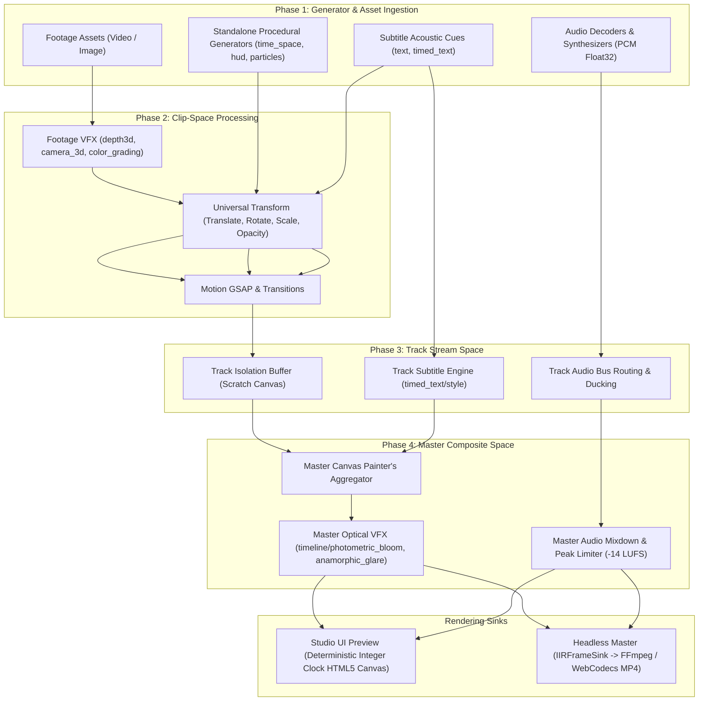
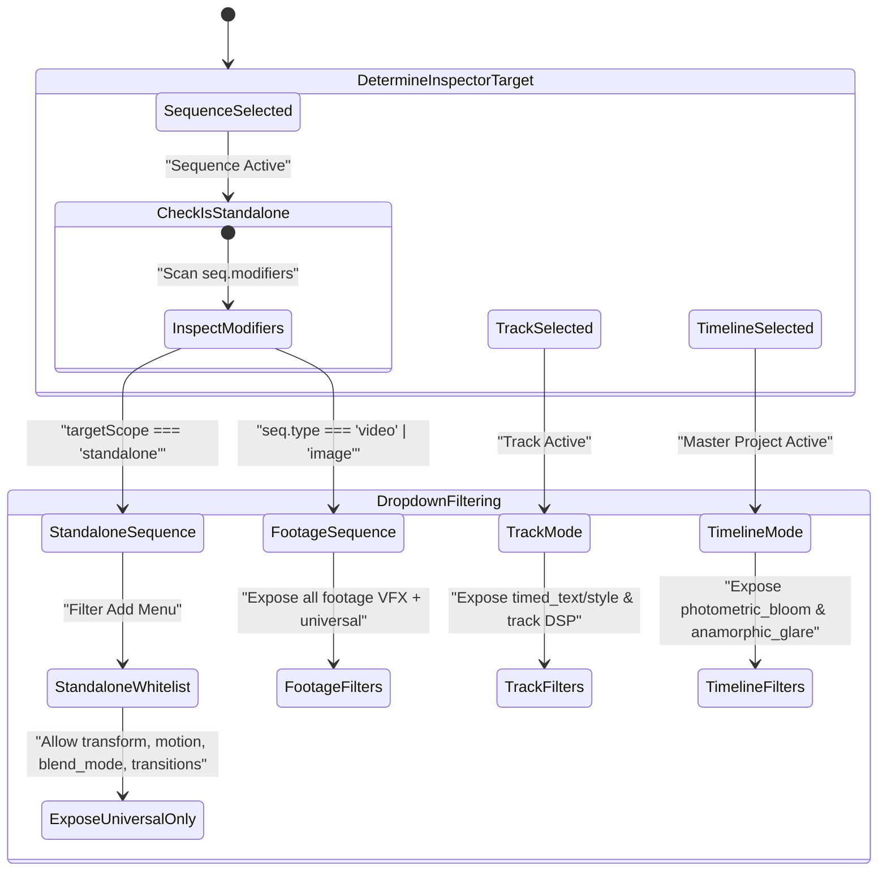

# Master Implementation Plan - Iteration 59: Multi-Tier Modifier Hierarchy, Standalone Generator Sequence Invariants, Universal Transform Whitelisting, and Preview/Headless Rendering Parity

## 1. Executive Summary

This master implementation plan establishes the definitive architectural foundation for modifier and plugin dispatch across the 3 core structural levels of the Universal Video IR architecture: **Sequence**, **Track**, and **Timeline**.

In particular, it resolves the architectural role of **Standalone Modifiers** (`targetScope: 'standalone'`):
- A standalone modifier (e.g. `time_space/*`, `overlay/hologram_hud`, `overlay/canvas_particles`, `generator/solid_backdrop`) functions as a **Phase 1 Source Provider** rather than a downstream filter.
- On the timeline, it manifests as its own dedicated sequence (typically on an `overlay` or generator track).
- **Single-Source Invariant**: Exactly **one** primary standalone generator can reside on a sequence. Stacking competing standalone generators on a single sequence clip is invalid and strictly prohibited.
- **Footage Filter Prohibition**: Standalone procedural generators lack decoded video rasters, depth maps, and facial tracking telemetry. Therefore, footage-dependent modifiers (`vfx/depth3d`, `vfx/camera_3d`, `vfx/depth_relighting`, `vfx/color_grading`, `vfx/auto_reframe`, `vfx/partial`) are completely disallowed on standalone sequences.
- **Universal Whitelist**: A standalone sequence accepts only a strictly preconfigured set of universal canvas modifiers:
  1. `transform`: 2D spatial translation, rotation, scale, anchor point, and opacity. Mandatory and universal for any visual entity in the canvas.
  2. `motion/gsap`: Keyframe and curve animation of spatial transform properties.
  3. `overlay/blend_mode`: Composite blend modes (`screen`, `multiply`, `add`, `overlay`).
  4. `transition/*`: Clip boundary transitions (`crossfade`, `wipe`, `push`, `zoom`, `dip`).

Furthermore, this plan formalizes how all 3 levels (`sequence`, `track`, `timeline`) are harmonized between **Studio UI Preview Rendering** (via `IRCanvasCompositor`) and **Headless Production Rendering** (via `IRMasterRenderer`), ensuring zero-alloc loops, deterministic backpressure, and bit-identical frame parity:
- **Zero `requestAnimationFrame` Drift**: Rendering is strictly tied to a **Deterministic Integer Frame Clock ($t \in [0, N_{\text{total}}-1]$)** synchronized to `DeterministicAudioClock` in preview playback and `FrameBackpressureLock` in headless mode. `requestAnimationFrame` is never used to drive the frame index.
- **Single Source of Truth (SSOT) Plugin Manifest**: Developers declare modifier capabilities (`targetScope`, `allowedSequenceTypes`, `isUniversal`, `supportedTrackTypes`) directly on the plugin class. The matrix is derived automatically without manual table edits.

---

## 2. Trade-off Matrices

### A. Modifier Scope Hierarchy & Capability Matrix

| Capability / Modifier Type | Sequence Level (Footage) | Sequence Level (Standalone) | Track Level (Stream) | Timeline Level (Master) | Architectural Rationale |
| :--- | :--- | :--- | :--- | :--- | :--- |
| **Asset Decoding** | Required (`assetId`) | **Prohibited** (No Asset) | N/A | N/A | Standalone generators compute visual pixels procedurally in memory. |
| **Primary Generator Count** | 0 (Footage Source) | **Exactly 1** | 0 | 0 | Prevents conflicting generator passes competing for the base buffer. |
| **Footage VFX Filters** | Allowed (`vfx/*`) | **Prohibited** | Prohibited | Prohibited | Standalone graphics lack facial landmarks and RGB depth maps. |
| **Universal Transform** | **Mandatory** | **Mandatory** | Track Style Scale/Pos | Master Crop / Aspect Fit | All visual objects must be spatially addressable and animatable on canvas. |
| **Motion GSAP** | Allowed | Allowed | Prohibited | Prohibited | Clip-level motion tweening. |
| **Transitions** | In/Out Cuts | In/Out Cuts | Track-to-Track Dissolve | N/A | Cut-to-cut spatial and alpha blending. |
| **Subtitle Styling** | Cue-level Overrides | Prohibited | **Mandatory** (`timed_text/style`) | Prohibited | Enforces unified typography, acoustic font, and platform safe zones across all cues. |
| **Audio Processing** | Clip Volume / Pan | Procedural Synth / Tone | Track Bus Routing & Ducking | Master Limiter & LUFS Target | Clear separation between clip-level trim, track sub-mixing, and broadcast normalization. |
| **Post-Processing VFX** | Prohibited | Prohibited | Prohibited | **Mandatory** (`timeline/*`) | Photometric bloom and anamorphic flare require the fully flattened composite. |

### B. Execution Model Trade-offs: Strict Whitelist vs. Permissive Type Checking

| Criterion | Permissive (Current Fallback) | Strict Whitelist (Proposed) | Selected Decision & Trade-off |
| :--- | :--- | :--- | :--- |
| **Type Safety & Schema Clarity** | Low: Incompatible filters can be added to procedural clips. | **High**: Zero ambiguity on what a procedural sequence can receive. | **Strict Whitelist**: Schema validator immediately flags invalid combinations. |
| **User Experience in Studio** | Cluttered: "+ Add Effect" lists irrelevant video filters for HUDs and shapes. | **Curated**: "+ Add Effect" only exposes valid spatial and transition tools. | **Strict Whitelist**: Prevents broken or non-functioning controls in the Inspector. |
| **Rendering Performance** | Variable: May invoke no-op or crashing shader loops. | **Deterministic**: Only relevant rendering passes execute in Phase 2. | **Strict Whitelist**: Guarantees zero unneeded canvas context allocations. |

### C. Developer Workflow: Self-Describing Declarative Plugin Manifest (SSOT)

To guarantee that this taxonomy matrix remains strictly maintained **without requiring developers to manually edit multiple hardcoded tables, switch statements, or static catalogs** across packages, we introduce the **Declarative Plugin Manifest Architecture**:

#### 1. The Plugin Manifest as the Single Source of Truth
Every modifier plugin declares its complete structural capabilities directly in its class definition via typed fields on `ModifierPlugin`:
- `targetScope: 'standalone' | 'sequence' | 'track' | 'timeline'`: Establishes the execution tier.
- `allowedSequenceTypes?: readonly SequenceType[]`: Sequence modalities permitted to host this plugin (e.g. `['video', 'image']` for footage VFX, `['overlay']` for standalone graphics, `['audio']` for audio DSP).
- `isUniversal?: boolean`: **The Universal Canvas Tool Flag**.
  - When `true`: Indicates that this modifier is an in-canvas geometric/compositing primitive (e.g. `transform`, `motion/gsap`, `overlay/blend_mode`, `transition/*`) that is universally permitted on *any* visual sequence—including standalone procedural generator clips.
  - When `false` or omitted: The modifier requires underlying media/raster footage, and is **automatically prohibited** from standalone generator sequences.
- `supportedTrackTypes: readonly TrackType[]`: Modality routing (`['video']`, `['audio']`, `['timed_text']`).
- `instancePolicy?: 'single' | 'multiple'`: Enforces whether an entity can attach multiple instances (default `'single'` for transforms and generators; `'multiple'` for regional partial VFX masks).
- `targetPhase: PluginTargetPhase`: Integer phase (1: Source Generator, 2: Clip Space, 3: Track Stream, 4: Master Composite).
- `schema: ModifierParameterSchema`: UI descriptor declaring fields, control types (sliders, pickers, toggles), units, and defaults.

#### 2. The 3-Step Zero-Friction Developer Guide for Adding New Modifiers
When adding any new modifier (e.g. `vfx/neon_edge` or `time_space/quantum_field`):
1. **Step 1: Implement `ModifierPlugin` with Declarative Capabilities**:
   ```typescript
   export class NeonEdgePlugin implements ModifierPlugin<NeonEdgeParams> {
     public readonly type = 'vfx/neon_edge';
     public readonly targetScope = 'sequence';
     public readonly allowedSequenceTypes = ['video', 'image'] as const;
     public readonly isUniversal = false; // Requires decoded media raster; forbidden on standalone generator clips
     public readonly supportedTrackTypes = ['video'] as const;
     public readonly targetPhase = 2; // Clip space
     public readonly schema = {
       displayName: 'Neon Edge Detection',
       category: 'vfx',
       fields: { ... }
     };

     public renderClipSpace(ctx: ClipRenderContext, params: NeonEdgeParams) {
       // Pure frame rendering math
     }
   }
   ```
2. **Step 2: Register in `registerCoreModifierPlugins()`**:
   ```typescript
   registry.register(new NeonEdgePlugin());
   ```
3. **Step 3: ZERO Other Files to Edit!**:
   - `ModifierPluginRegistry` automatically categorizes, caches, and exposes the plugin in `registry.getCapabilityMatrix()`.
   - `VideoIRSchemaValidator` automatically validates it against target entities and enforces standalone sequence boundaries using `plugin.isUniversal`.
   - `RightSidebar.tsx` automatically displays it in the "+ Add Effect" dropdown for video sequences, and automatically hides/disables it on standalone clips or tracks.

#### 3. Automated Matrix Audit & Self-Enforcing Test Suite
To prevent human error (such as a developer forgetting to declare `supportedTrackTypes` or leaving `targetScope` ambiguous), an automated contract test `autogenerated-tests/modifier_plugin_contract_audit.test.ts` runs on every CI/build pass:
- Inspects every registered plugin in `ModifierPluginRegistry`.
- Asserts that all capability metadata is defined and mathematically consistent (e.g., if `targetScope === 'standalone'`, `isUniversal` must not be `true`; if `isUniversal === true`, `allowedSequenceTypes` must permit `overlay`).
- Automatically exports the compiled capability matrix table into documentation.

---

## 3. Mermaid Topology

### A. 4-Phase Multi-Tier Rendering Topology



### B. Studio Inspector Dropdown & State Machine



---

## 4. Mathematical / Algorithmic Specifications

### A. Universal 2D Affine Spatial Transform in Clip Space
Every visual sequence $S_i$ is mapped from local generator/asset coordinates $(x, y)$ to canvas coordinates $(x', y')$ via affine matrix transformation $M_{\text{clip}}(t)$:

$$
\begin{bmatrix} x' \\ y' \\ 1 \end{bmatrix} = 
\begin{bmatrix}
s_x(t) \cos \theta(t) & -s_y(t) \sin \theta(t) & x_0(t) \\
s_x(t) \sin \theta(t) & s_y(t) \cos \theta(t) & y_0(t) \\
0 & 0 & 1
\end{bmatrix}
\begin{bmatrix} x \\ y \\ 1 \end{bmatrix}
$$

Where:
- Anchor offset: $x_a = W \cdot \alpha_x, \quad y_a = H \cdot \alpha_y$ with anchor $\alpha \in [0, 1]$.
- Position translation: $x_0(t) = x_a + \Delta x(t) - s_x(t)(x_a \cos \theta(t) - y_a \sin \theta(t))$
- Position translation: $y_0(t) = y_a + \Delta y(t) - s_y(t)(x_a \sin \theta(t) + y_a \cos \theta(t))$
- Uniform or anisotropic scale: $s_x(t) = s_y(t) = S(t)$
- Rotation angle: $\theta(t) = \frac{\pi}{180} \cdot \theta_{\text{deg}}(t)$

### B. Track Compositing with Painter's Algorithm & Alpha Blending
For $K$ visual tracks sorted in document order $0 \le k < K$, track stream canvas $C_k$ is rendered into isolated scratch buffer $B_k$:

$$
B_k(x, y) = \sum_{j \in \text{ActiveSeqs}(k, t)} M_{\text{clip}, j}(t) \circ \text{Render}(S_j, t)
$$

The master accumulator $A_k(x, y)$ is iteratively composited:

$$
A_k(x, y) = A_{k-1}(x, y) \odot_{\text{blend}(k)} \left( B_k(x, y) \cdot \alpha_{\text{track}, k} \right)
$$

Where $\odot_{\text{blend}}$ is mapped directly to standard W3C 2D compositing operations (`screen`, `multiply`, `overlay`, `lighter`, `source-over`).

### C. Master Photometric Bloom Kernel
On the flattened master canvas $A_K$, pixels exceeding luminance threshold $L_{\text{th}}$ are isolated and convolved with a normalized separable Gaussian kernel $G_\sigma(r) = \frac{1}{\sqrt{2\pi}\sigma} e^{-\frac{r^2}{2\sigma^2}}$:

$$
I_{\text{bright}}(x, y) = \max\left(0, \frac{L(A_K(x, y)) - L_{\text{th}}}{1 - L_{\text{th}}}\right) \cdot A_K(x, y)
$$

$$
B(x, y) = \int_{-\infty}^{\infty} \int_{-\infty}^{\infty} I_{\text{bright}}(\xi, \eta) G_{\sigma_x}(x - \xi) G_{\sigma_y}(y - \eta) \, d\xi \, d\eta
$$

$$
A_{\text{final}}(x, y) = \text{clamp}\left(0, 1, A_K(x, y) + \gamma_{\text{bloom}} \cdot B(x, y) \odot C_{\text{tint}}\right)
$$

---

## 5. Concrete File / Class Signatures

### A. `packages/ir/src/types/modifiers.ts`
```typescript
export type ModifierTargetScope = 'standalone' | 'sequence' | 'track' | 'timeline';

export interface EntityModifierContext {
  target: 'sequence' | 'track' | 'timeline';
  sequenceType?: SequenceType;
  /** True if the target sequence currently contains a standalone generator */
  hasStandaloneGenerator?: boolean;
  /** List of modifier types currently attached to the target entity */
  existingModifierTypes?: readonly string[];
}

export interface EntityModifierCheckResult {
  allowed: boolean;
  reason?: string;
}
```

### B. `packages/ir/src/plugins/ModifierPluginRegistry.ts`
```typescript
export const STANDALONE_SEQUENCE_ALLOWED_MODIFIERS: ReadonlySet<string> = new Set([
  'transform',
  'motion/gsap',
  'overlay/blend_mode',
  'transition/crossfade',
  'transition/wipe',
  'transition/push',
  'transition/zoom',
  'transition/dip',
  'transition/glitch',
  'transition/light_leak',
  'transition/radial_wipe',
  'transition/iris',
]);

export class ModifierPluginRegistry {
  public isModifierAllowedOnEntity(
    modifierType: string,
    targetContext: EntityModifierContext
  ): EntityModifierCheckResult;
}
```

### C. `packages/ir/src/schema/VideoIRSchemaValidator.ts`
```typescript
export class VideoIRSchemaValidator {
  private static validateSequenceModifierConstraints(
    seq: IRSequence,
    trackType: TrackType,
    context: string,
    errors: string[]
  ): void;
}
```

---

## 6. Phased Roadmap

### Phase 1: Core Taxonomy & Schema Validator Hardening
- Define `EntityModifierContext` and `STANDALONE_SEQUENCE_ALLOWED_MODIFIERS`.
- In `VideoIRSchemaValidator.ts`:
  - Validate that any sequence contains at most **one** modifier with `targetScope === 'standalone'`.
  - Validate that if a sequence contains a standalone generator, all other modifiers on that sequence exist in `STANDALONE_SEQUENCE_ALLOWED_MODIFIERS`.
  - Reject all footage-specific modifiers on standalone sequences.

### Phase 2: Registry Compatibility Enforcement
- Update `ModifierPluginRegistry.isModifierAllowedOnEntity` to evaluate `hasStandaloneGenerator` and `existingModifierTypes`.
- Guard against duplicate standalone generators and enforce the universal whitelist.

### Phase 3: Studio UI Dropdown & Inspector Alignment
- In `RightSidebar.tsx`:
  - Pass `hasStandaloneGenerator` and `existingModifierTypes` to `isModifierAllowedOnEntity`.
  - Dynamically restrict the "+ Add Effect" menu for standalone sequences to universal modifiers.
- In `SequenceInspector.tsx`:
  - Visually prioritize the standalone generator card at the top, followed by universal transform controls.

### Phase 4: Compositor & Headless Parity
- In `IRCanvasCompositor.ts`:
  - Verify that standalone generator `renderClipSpace` cleanly establishes the initial clip buffer before universal `transform` affine matrix application.
- In `IRMasterRenderer.ts`:
  - Verify deterministic headless rendering of standalone sequences with master timeline bloom.

### Phase 5: Verification & History Archival
- Author formal tests in `autogenerated-tests/standalone_generator_hierarchy_and_whitelist.test.ts`.
- Verify zero regressions across all existing test vectors.
- Document history in `docs/history/`.

---

## 7. Formal Verification Matrix (`/autogenerated-tests/`)

| Test Vector ID | Description | Target Test File | Success Criteria |
| :--- | :--- | :--- | :--- |
| **TV-59-1** | Single Standalone Generator Invariant | `standalone_generator_hierarchy_and_whitelist.test.ts` | Schema rejects attaching multiple standalone generators to one sequence. |
| **TV-59-2** | Footage Modifier Prohibition on Standalone | `standalone_generator_hierarchy_and_whitelist.test.ts` | Schema and Registry reject `vfx/depth3d`, `vfx/camera_3d`, `vfx/color_grading` on standalone sequences. |
| **TV-59-3** | Universal Whitelist Acceptance | `standalone_generator_hierarchy_and_whitelist.test.ts` | `transform`, `motion/gsap`, `overlay/blend_mode`, transitions validate cleanly on standalone sequences. |
| **TV-59-4** | Multi-Tier Hierarchy Isolation | `standalone_generator_hierarchy_and_whitelist.test.ts` | Track modifiers rejected on sequence/timeline; timeline modifiers rejected on sequence/track. |
| **TV-59-5** | Preview & Headless Render Parity | `standalone_generator_hierarchy_and_whitelist.test.ts` | Procedural generator + transform + master bloom renders identically without runtime errors. |

---

## 8. Risk & Rollback Mitigations

| Risk | Impact | Mitigation Strategy |
| :--- | :--- | :--- |
| **Legacy Documents with Mixed Modifiers** | High (Schema validation failure on older project files) | `IRStateManager.migrateLegacyModifiers()` automatically separates or sanitizes conflicting modifiers on load. |
| **Performance Overhead in Registry Checking** | Low (O(1) Set lookups) | Pre-compute static sets (`STANDALONE_SEQUENCE_ALLOWED_MODIFIERS`) using `ReadonlySet<string>`. |
| **UI Dropdown Lockout** | Medium (User unable to add desired modifiers) | Clearly badge standalone sequences in the inspector and provide informative tooltip explaining the universal whitelist. |
