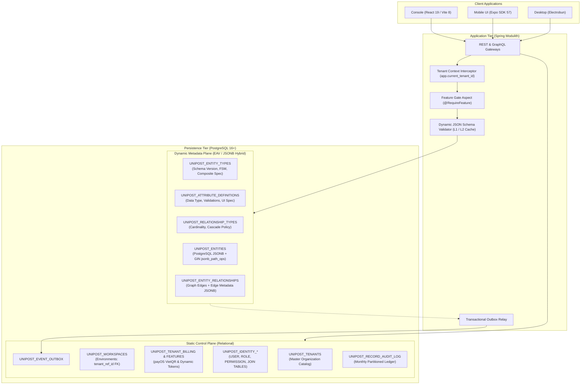
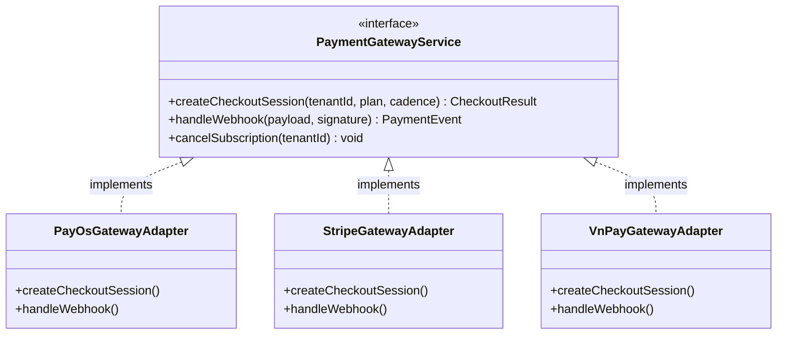
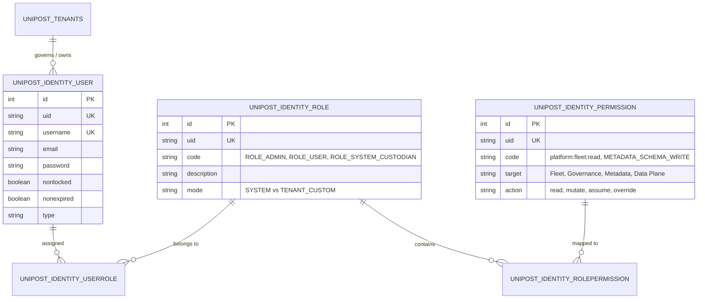
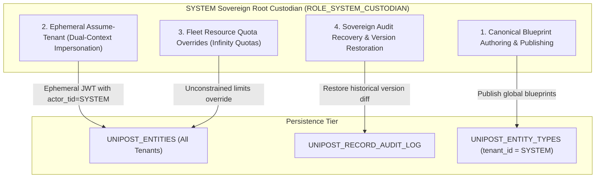
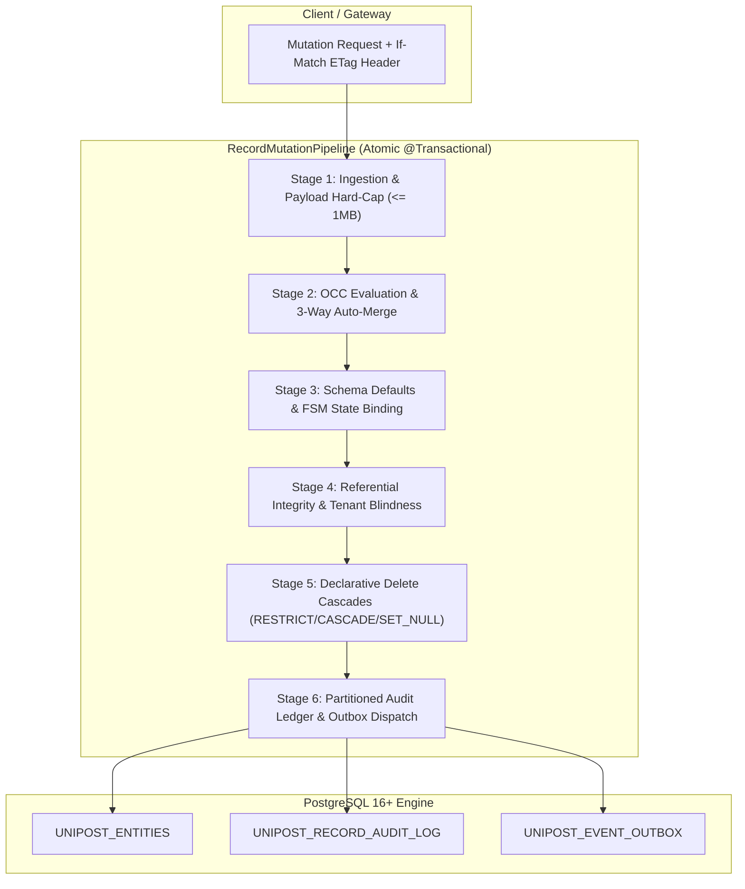
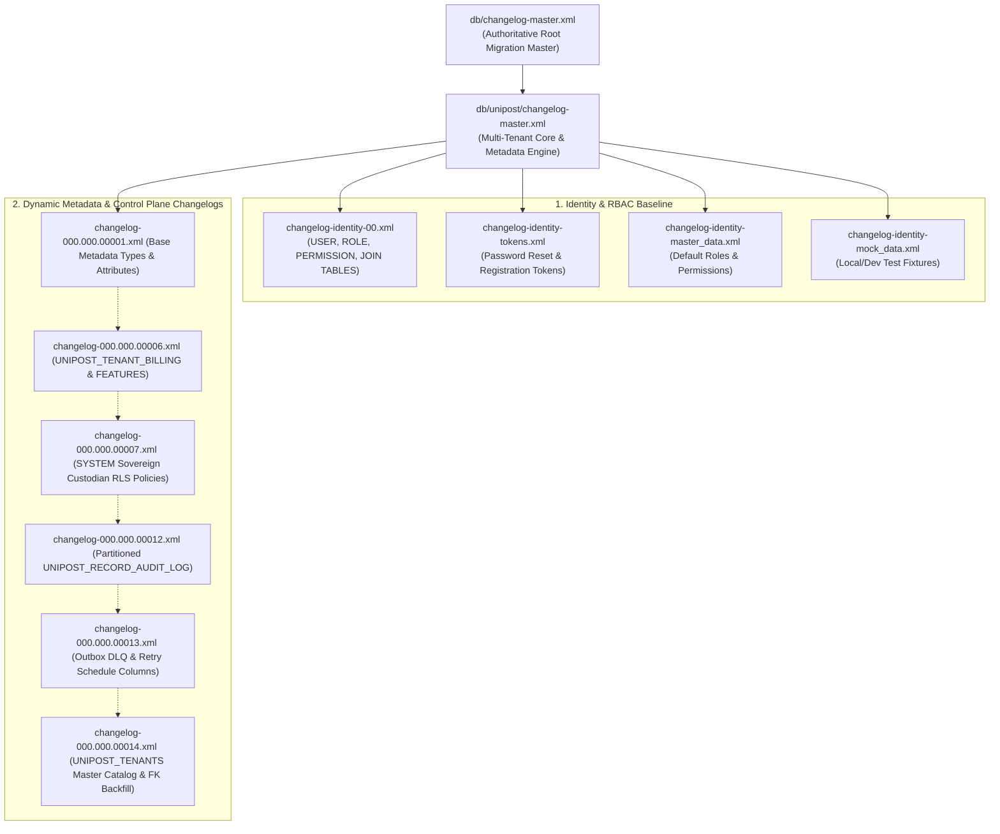

# Architecture Reference: Persistence & Metadata-Driven Database Engine
**Document Version:** 1.2.0 (Enterprise Hardened & Resilient Specification)  
**Status:** Living Master Specification (Single Source of Truth)  
**System Domain:** Unipost Enterprise Monorepo Data Persistence Layer  
**Target Audience:** Staff / Principal Architects, Backend & Frontend Engineers, DevOps/DBAs  

---

## 1. Executive Architecture Summary

Unipost utilizes a **Hybrid Polyglot-Relational / Dynamic Metadata Architecture** built on **PostgreSQL 16+**, **Spring Boot 3.x (Spring Modulith)**, and **Liquibase**. 

The system bridges two traditionally divergent database paradigms:
1. **Fixed Relational Infrastructure (System Core & Control Plane):** Strongly-typed, normalized tables with static referential integrity for Tenants (`UNIPOST_TENANTS`), Identity & RBAC (`UNIPOST_IDENTITY_*`), Workspaces (`UNIPOST_WORKSPACES`), Billing & Entitlements (`UNIPOST_TENANT_BILLING`, `UNIPOST_TENANT_FEATURES`), Audit (`UNIPOST_RECORD_AUDIT_LOG`), and Event Outbox (`UNIPOST_EVENT_OUTBOX`).
2. **Metadata-Driven Dynamic Plane (EAV / JSONB Dynamic Schema):** An in-engine dynamic schema evolution runtime allowing individual tenants and system custodians to declare custom Entities, Dynamic Attributes, Composite Virtual Schemas, Finite State Machine (FSM) Lifecycles, and Typed Edge Graphs **without running DDL migrations or dropping production connections**.



---

## 2. Core Architectural Principles & Invariants

| Principle | Invariant Rule | Implementation Mechanism |
| :--- | :--- | :--- |
| **Strict Multi-Tenancy** | Zero Cross-Tenant Data Leaks at the Hardware/Engine Level. | Native PostgreSQL Row-Level Security (`ENABLE ROW LEVEL SECURITY` + `FORCE ROW LEVEL SECURITY`) bound to session-level variable `app.current_tenant_id`. |
| **Zero-DDL Extensibility** | Tenants modify business data models at runtime without database restarts or schema locks. | Entity-Attribute-Value (EAV) hybrid schema storing dynamic payloads in binary JSONB with JSON Schema L1/L2 caching. |
| **Sovereign Custodian Override** | System administrators (`SYSTEM` tenant) possess read/write access across all tenants for fleet telemetry, auditing, and maintenance. | Dual-condition RLS policies: `current_setting('app.current_tenant_id', true) = 'SYSTEM' OR tenant_id = current_tenant`. |
| **Schema Determinism & Evolution** | Attribute additions or modifications must guarantee backwards and forwards compatibility. | Monotonic increment of `UNIPOST_ENTITY_TYPES.schema_version` on every attribute mutation; JSON Schema compilation with `additionalProperties: false`. |
| **ACID Eventual Consistency** | Distributed consumers must never miss state changes, even if network partitions occur. | Transactional Outbox Pattern (`UNIPOST_EVENT_OUTBOX`) written atomically in the same local database transaction as business mutations. |
| **Immutable Temporal Auditability** | Historical revisions of records must be permanent, non-repudiable, and high-performance. | Monthly range-partitioned ledger table `UNIPOST_RECORD_AUDIT_LOG` with JSONB delta calculation. |

---

## 3. Data Plane Topology: Complete Table Registry

### 3.1. Metadata Plane (Dynamic Schema Engine)

#### 1. `UNIPOST_ENTITY_TYPES` (Meta-Entity Definitions)
Defines dynamic classes (e.g., `Customer`, `Invoice`, `WarehousePackage`, `ShipmentItem`).

| Column | Type | Constraints | Description |
| :--- | :--- | :--- | :--- |
| `id` | `BIGINT` | `PK`, Auto-increment | Internal surrogate primary key. |
| `uid` | `VARCHAR(255)` | `NOT NULL`, Unique | Globally unique immutable identifier (UUIDv7 or NanoID). |
| `tenant_id` | `VARCHAR(255)` | `NOT NULL`, Default `'default-tenant'` | Scopes model to a specific tenant or `'SYSTEM'` for global blueprints. |
| `name` | `VARCHAR(255)` | `NOT NULL` | Human-readable entity label. |
| `system_name` | `VARCHAR(255)` | `NOT NULL` | Programmatic identifier (`kebab-case` or `snake_case`). |
| `description` | `TEXT` | Nullable | Detailed functional purpose of the entity. |
| `schema_version` | `BIGINT` | `NOT NULL`, Default `1` | Incrementing version counter for compiled JSON Schema cache eviction. |
| `lifecycle_config` | `JSONB` | Nullable | Declarative Finite State Machine (FSM): initial state, transition rules, required attributes, allowed roles, and guard expressions. |
| `is_composite` | `BOOLEAN` | `NOT NULL`, Default `FALSE` | Flag determining whether this entity is a physical record or a virtual aggregation. |
| `composite_spec` | `JSONB` | Nullable | Composite join definition: primary entity, joined child entities, and projections. |
| `createdBy_uid` | `VARCHAR(255)` | Audit trail | User UID who initialized the model. |
| `createdDate` | `TIMESTAMP` | Audit trail | Creation timestamp. |
| `lastUpdatedBy_uid` | `VARCHAR(255)` | Audit trail | User UID who last updated the model. |
| `lastUpdatedDate` | `TIMESTAMP` | Audit trail | Last update timestamp. |
| `version` | `BIGINT` | Optimistic Lock | JPA `@Version` concurrency control. |
| `deletedDate` | `TIMESTAMP` | Soft Delete | Non-null indicates logical deletion. |

*Unique Index:* Partial unique index on `(tenant_id, system_name) WHERE "deletedDate" IS NULL`.

---

#### 2. `UNIPOST_ATTRIBUTE_DEFINITIONS` (Field & Validation Dictionary)
Defines dynamically typed fields attached to an Entity Type.

| Column | Type | Constraints | Description |
| :--- | :--- | :--- | :--- |
| `id` | `BIGINT` | `PK`, Auto-increment | Surrogate primary key. |
| `uid` | `VARCHAR(255)` | `NOT NULL`, Unique | Unique attribute definition UID. |
| `tenant_id` | `VARCHAR(255)` | `NOT NULL` | Multi-tenant isolation scope. |
| `entity_type_id` | `BIGINT` | `FK` -> `UNIPOST_ENTITY_TYPES.id` | Target entity model (Cascade Delete). |
| `name` | `VARCHAR(255)` | `NOT NULL` | Display label (e.g., "Tracking Code"). |
| `system_name` | `VARCHAR(255)` | `NOT NULL` | JSON key in `UNIPOST_ENTITIES.attributes` (e.g., `trackingCode`). |
| `data_type` | `VARCHAR(50)` | `NOT NULL` | Primitive: `STRING`, `NUMBER`, `BOOLEAN`, `DATE`, `DATETIME`, `JSON`, `RELATION_PICKER`. |
| `ui_component` | `VARCHAR(50)` | `NOT NULL` | UI Form widget: `TEXT_INPUT`, `NUMERIC_INPUT`, `DATE_PICKER`, `DROPDOWN`, `RICH_TEXT`, `SWITCH`. |
| `is_required` | `BOOLEAN` | Default `FALSE` | Triggers JSON Schema `required: [...]` compilation. |
| `is_archived` | `BOOLEAN` | Default `FALSE` | Soft deprecation without breaking historical record reads. |
| `display_order` | `INT` | Default `0` | Form/table layout rendering order. |
| `options` | `JSONB` | Nullable | Validation rules (regex pattern, min, max, allowed enum list). |
| `default_value` | `VARCHAR(255)` | Nullable | Default value applied before schema validation. |
| *Audit Columns* | `VARCHAR`/`TIMESTAMP`/`BIGINT` | Standard | Standard auditing and soft-deletion columns. |

*Unique Constraint:* `(entity_type_id, system_name)` ensures unique attribute names per model.

---

#### 3. `UNIPOST_ENTITIES` (Dynamic Data Plane Records)
Stores actual business records conforming to dynamic schemas.

| Column | Type | Constraints | Description |
| :--- | :--- | :--- | :--- |
| `id` | `BIGINT` | `PK`, Auto-increment | Record ID. |
| `uid` | `VARCHAR(255)` | `NOT NULL`, Unique | Immutable record UID across external APIs. |
| `tenant_id` | `VARCHAR(255)` | `NOT NULL` | Multi-tenant isolation key (strictly evaluated by RLS). |
| `entity_type_id` | `BIGINT` | `FK` -> `UNIPOST_ENTITY_TYPES.id` | Associated entity model. |
| `attributes` | `JSONB` | Default `'{}'` | Hybrid JSON document containing user-defined key-values validated against the compiled JSON Schema. |
| *Audit Columns* | `VARCHAR`/`TIMESTAMP`/`BIGINT` | Standard | Authoring and optimistic locking version. |

*Critical Indexes:*
1. `idx_entities_type_tenant_active`: `ON UNIPOST_ENTITIES (entity_type_id, tenant_id) WHERE "deletedDate" IS NULL` (B-Tree filter index for multi-tenant table queries).
2. `idx_entities_attributes_gin`: `ON UNIPOST_ENTITIES USING GIN (attributes jsonb_path_ops)` (High-performance JSON path indexing supporting `@>`, `?`, and `@@` operators).

---

#### 4. `UNIPOST_RELATIONSHIP_TYPES` (Graph Schema Definitions)
Defines semantic directed graph edges between Entity Types.

| Column | Type | Constraints | Description |
| :--- | :--- | :--- | :--- |
| `id` | `BIGINT` | `PK`, Auto-increment | Edge type ID. |
| `uid` | `VARCHAR(255)` | `NOT NULL`, Unique | Immutable relationship UID. |
| `tenant_id` | `VARCHAR(255)` | `NOT NULL` | Tenant isolation scope. |
| `system_name` | `VARCHAR(255)` | `NOT NULL` | Edge label (e.g., `INVOICE_HAS_ITEMS`, `PARENT_COMPANY_OF`). |
| `source_entity_type_id` | `BIGINT` | `FK` -> `UNIPOST_ENTITY_TYPES.id` | Allowed source model type. |
| `target_entity_type_id` | `BIGINT` | `FK` -> `UNIPOST_ENTITY_TYPES.id` | Allowed target model type. |
| `cascade_policy` | `VARCHAR(20)` | Default `'RESTRICT'` | Referential deletion policy: `RESTRICT`, `CASCADE`, or `SET_NULL`. |
| `description` | `TEXT` | Nullable | Edge semantic description. |

---

#### 5. `UNIPOST_ENTITY_RELATIONSHIPS` (Graph Data Plane Edges)
Stores actual instance-level directed relationships between entity records.

| Column | Type | Constraints | Description |
| :--- | :--- | :--- | :--- |
| `id` | `BIGINT` | `PK`, Auto-increment | Edge instance ID. |
| `uid` | `VARCHAR(255)` | `NOT NULL`, Unique | Edge UID. |
| `tenant_id` | `VARCHAR(255)` | `NOT NULL` | Multi-tenant isolation key. |
| `relationship_type_id` | `BIGINT` | `FK` -> `UNIPOST_RELATIONSHIP_TYPES.id` | Edge type classification. |
| `source_entity_id` | `BIGINT` | `FK` -> `UNIPOST_ENTITIES.id` | Origin record. |
| `target_entity_id` | `BIGINT` | `FK` -> `UNIPOST_ENTITIES.id` | Destination record. |
| `edge_metadata` | `JSONB` | Default `'{}'` | Typed attributes attached to the edge itself (e.g., `quantity`, `relationshipStartDate`). |

*Unique Triplet Constraint:* `uk_entity_rel_triplet (source_entity_id, target_entity_id, relationship_type_id)` prevents duplicate parallel edges of the same type.

---

### 3.2. Static Control Plane & Resiliency Tables

#### 6. `UNIPOST_TENANTS` (Master Tenant Entity)
The root master catalog governing tenant-level lifecycles, commercial tiers, regions, and sovereign custodial status.

| Column | Type | Constraints | Description |
| :--- | :--- | :--- | :--- |
| `id` | `BIGINT` | `PK`, Auto-increment | Internal surrogate primary key. |
| `uid` | `VARCHAR(255)` | `NOT NULL`, Unique | Globally unique immutable tenant UID. |
| `code` | `VARCHAR(100)` | `NOT NULL`, Unique | Programmatic tenant slug matching RLS context (e.g., `tenant-acme`, `SYSTEM`). |
| `name` | `VARCHAR(255)` | `NOT NULL` | Organization name. |
| `status` | `VARCHAR(50)` | Default `'ACTIVE'` | Lifecycle: `ACTIVE`, `SUSPENDED`, `ARCHIVED`. |
| `plan_tier` | `VARCHAR(50)` | Default `'BASIC'` | Commercial entitlement tier: `BASIC`, `PRO`, `PRO_MAX`, `ENTERPRISE`. |
| `owner_user_uid`| `VARCHAR(255)`| Nullable | User UID of the primary tenant custodian/owner. |
| `region` | `VARCHAR(50)` | Default `'ap-southeast-1'` | Data residency deployment region. |
| `metadata` | `JSONB` | Default `'{}'` | Flexible configuration attributes (white-label theme tokens, domain maps). |
| *Audit Columns*| `VARCHAR`/`TIMESTAMP`/`BIGINT` | Standard | Authoring and optimistic locking version. |

*Critical RLS Policy:* Enforces `current_setting('app.current_tenant_id', true) = 'SYSTEM' OR code = current_tenant`.

---

#### 7. `UNIPOST_WORKSPACES` (Environments & Workspaces)
Represents isolated environments (e.g., `MAIN`, `STAGING`, `DEV`) owned by a master Tenant.

| Column | Type | Constraints | Description |
| :--- | :--- | :--- | :--- |
| `id` | `BIGINT` | `PK`, Auto-increment | Workspace ID. |
| `uid` | `VARCHAR(255)` | `NOT NULL`, Unique | Immutable workspace UID. |
| `tenant_ref_id` | `BIGINT` | `FK` -> `UNIPOST_TENANTS.id` | Referential foreign key to master tenant. |
| `tenant_id` | `VARCHAR(255)` | `NOT NULL` | Denormalized tenant slug for high-speed RLS evaluation. |
| `code` | `VARCHAR(100)` | `NOT NULL` | Workspace code unique per tenant (e.g., `MAIN`). |
| `name` | `VARCHAR(255)` | `NOT NULL` | Display name. |
| `is_default` | `BOOLEAN` | Default `FALSE` | Exactly 1 active default workspace per tenant (`uk_tenant_default_workspace`). |
| `is_immutable` | `BOOLEAN` | Default `FALSE` | Prevents accidental deletion of primary default workspace. |

---

#### 8. `UNIPOST_EVENT_OUTBOX` (Transactional Outbox Pattern)
Guarantees atomicity between local state changes and event pub/sub.

| Column | Type | Constraints | Description |
| :--- | :--- | :--- | :--- |
| `id` | `BIGINT` | `PK`, Auto-increment | Outbox row ID. |
| `uid` | `VARCHAR(255)` | `NOT NULL`, Unique | Outbox message UID. |
| `event_id` | `VARCHAR(255)` | `NOT NULL`, Unique | Deduplication idempotency key for downstream message brokers. |
| `event_type` | `VARCHAR(150)` | `NOT NULL` | Event classifier (e.g., `METADATA_SCHEMA_UPDATED`, `RECORD_CREATED`). |
| `aggregate_type` | `VARCHAR(100)` | `NOT NULL` | Target aggregate root (`ENTITY_TYPE`, `RECORD`). |
| `aggregate_id` | `VARCHAR(255)` | `NOT NULL` | Target aggregate ID. |
| `payload` | `JSONB` | `NOT NULL` | Complete event state payload. |
| `status` | `VARCHAR(50)` | Default `'PENDING'` | Lifecycle: `PENDING`, `PUBLISHED`, `FAILED`, `DLQ`. |
| `retry_count` | `INT` | Default `0` | Number of dispatch attempts. |
| `max_retries` | `INT` | Default `5` | Maximum retry attempts before routing to Dead Letter Queue (DLQ). |
| `next_retry_at` | `TIMESTAMPTZ` | Nullable | Exponential backoff scheduled timestamp. |
| `dead_letter_reason`| `TEXT` | Nullable | Captured stacktrace or failure root-cause. |

---

#### 9. `UNIPOST_RECORD_AUDIT_LOG` (Range-Partitioned Audit Ledger)
Append-only chronological history of all dynamic record mutations.

- **Partitioning Strategy:** PostgreSQL `PARTITION BY RANGE (created_at)` with automated monthly partitions (`unipost_record_audit_log_YYYY_MM`).
- **Primary Key:** Composite `(id, created_at)` to satisfy PostgreSQL partition indexing prerequisites.

| Column | Type | Constraints | Description |
| :--- | :--- | :--- | :--- |
| `id` | `BIGINT` | Default `nextval(...)` | Sequence-generated sequence ID. |
| `tenant_id` | `VARCHAR(64)` | `NOT NULL` | Multi-tenant isolation scope. |
| `record_id` | `BIGINT` | `NOT NULL` | Target record foreign identifier. |
| `entity_type_id` | `BIGINT` | `NOT NULL` | Target model type ID. |
| `operation` | `VARCHAR(16)` | `NOT NULL` | Action: `INSERT`, `UPDATE`, `DELETE`, `TRANSITION`. |
| `actor` | `VARCHAR(64)` | `NOT NULL` | User UID or API service token performing mutation. |
| `version` | `BIGINT` | `NOT NULL` | Record version at time of snapshot. |
| `old_attributes` | `JSONB` | Nullable | State prior to modification (null on `INSERT`). |
| `new_attributes` | `JSONB` | Nullable | State after modification (null on `DELETE`). |
| `delta` | `JSONB` | Nullable | Exact diff object: `{ field: { old: v1, new: v2 } }`. |
| `created_at` | `TIMESTAMPTZ` | `NOT NULL`, Default `clock_timestamp()` | High-precision mutation timestamp. |

---

#### 10. `UNIPOST_TENANT_BILLING` (Multi-Gateway Commercial Subscriptions & Payments)
Manages commercial tier subscriptions, billing terms, and decoupled payment provider bindings. The schema is strictly **payment-provider agnostic**, avoiding hardcoded gateway identifiers in physical columns and allowing seamless expansion across payOS VietQR, Stripe, PayPal, VNPay, MoMo, or Wire Invoicing.

| Column | Type | Constraints | Description |
| :--- | :--- | :--- | :--- |
| `tenant_id` | `VARCHAR(255)` | `PK`, `NOT NULL` | Tenant identifier scoped strictly via PostgreSQL RLS. |
| `plan_tier` | `VARCHAR(50)` | `NOT NULL`, Default `'BASIC'` | Commercial entitlement tier: `BASIC`, `PRO`, `PRO_MAX`, `ENTERPRISE`. |
| `billing_cadence` | `VARCHAR(20)` | `NOT NULL`, Default `'MONTHLY'` | Billing period cadence: `MONTHLY`, `YEARLY`. |
| `status` | `VARCHAR(50)` | `NOT NULL`, Default `'ACTIVE'` | Subscription status: `ACTIVE`, `PAST_DUE`, `CANCELED`, `TRIALING`. |
| `currency` | `VARCHAR(10)` | `NOT NULL`, Default `'VND'` | ISO 4217 currency code (e.g., `VND`, `USD`, `EUR`). |
| `amount_paid` | `BIGINT` | Default `0` | Cumulative amount paid in minor currency units / base currency. |
| `payment_provider` | `VARCHAR(50)` | Nullable | Active payment gateway adapter: `PAYOS`, `STRIPE`, `VNPAY`, `MANUAL_INVOICE`. |
| `provider_customer_ref`| `VARCHAR(255)`| Nullable | Generic provider customer identifier (e.g., Stripe `cus_xxx`, payOS customer ID). |
| `current_order_ref`| `VARCHAR(255)` | Nullable | Current or last transaction/order reference code across gateways. |
| `billing_metadata` | `JSONB` | Default `'{}'` | Extensible provider-specific payload (e.g., checkout URLs, webhook IDs, mandates, card last4, QR strings). |
| `expires_at` | `TIMESTAMP` | Nullable | Subscription term expiration timestamp. |
| `created_date` | `TIMESTAMP` | Standard | Row creation timestamp. |
| `last_updated_date` | `TIMESTAMP` | Standard | Row modification timestamp. |

*RLS Policy:* `tenant_isolation_billing ON UNIPOST_TENANT_BILLING` enforces `current_setting('app.current_tenant_id', true) = 'SYSTEM' OR tenant_id = current_tenant`.

##### Generic Multi-Gateway Payment Architecture
To decouple business logic from third-party vendor lock-in, Unipost employs the **Strategy & Adapter Pattern** in the persistence and service layers:



1. **Provider Independence**: Columns `payment_provider`, `provider_customer_ref`, and `current_order_ref` provide high-speed indexing and lookup without embedding vendor names into column DDL.
2. **Provider-Specific Metadata in `billing_metadata` JSONB**:
   - For payOS: `{"qrCode": "...", "accountNumber": "...", "bin": "970422", "paymentLinkId": "..."}`
   - For Stripe: `{"subscriptionId": "sub_xxx", "paymentMethodId": "pm_xxx", "defaultCardBrand": "visa"}`
   - For Enterprise Manual: `{"purchaseOrder": "PO-2026-001", "invoiceNumber": "INV-891", "terms": "NET30"}`
3. **Database Compatibility**: In existing environments where physical columns exist (e.g., legacy `payos_customer_id`), the JPA entity and DDL migrate to generic aliases via database views or non-breaking column mapping (`@Column(name = "payos_customer_id")` alias mapped to generic getter/setter `getProviderCustomerRef()`).

---

#### 11. `UNIPOST_TENANT_FEATURES` (Dynamic Feature Entitlements)
Stores fine-grained dynamic feature toggle tokens granted to specific tenants beyond baseline plan tiers.

| Column | Type | Constraints | Description |
| :--- | :--- | :--- | :--- |
| `id` | `BIGINT` | `PK`, Auto-increment | Unique entitlement token row ID. |
| `tenant_id` | `VARCHAR(255)` | `NOT NULL` | Tenant identifier scoped strictly via PostgreSQL RLS. |
| `feature_key` | `VARCHAR(100)` | `NOT NULL` | Feature token moniker (e.g., `ai_copilot`, `unlimited_exports`, `audit_diff_restore`). |
| `is_enabled` | `BOOLEAN` | `NOT NULL`, Default `TRUE` | Explicit enablement flag. |
| `expires_at` | `TIMESTAMP` | Nullable | Optional temporal expiration for time-limited feature trials. |
| `created_date` | `TIMESTAMP` | Standard | Entitlement provisioned timestamp. |
| `last_updated_date` | `TIMESTAMP` | Standard | Entitlement updated timestamp. |

*Unique Index:* `uk_tenant_feature_active ON UNIPOST_TENANT_FEATURES (tenant_id, feature_key)`.  
*RLS Policy:* `tenant_isolation_features ON UNIPOST_TENANT_FEATURES` enforces `current_setting('app.current_tenant_id', true) = 'SYSTEM' OR tenant_id = current_tenant`.

##### Dynamic Feature Gate Evaluation Pipeline
Dynamic feature validation is executed dual-side across backend boundaries and UI components:
1. **Backend Method Aspect (`@RequireFeature`)**:
   - Controller or Service methods are annotated with `@RequireFeature("ai_copilot")`.
   - `FeatureGateAspect` evaluates `DefaultTenantEntitlementService.hasFeature(tenantId, "ai_copilot")`.
   - Entitlements check plan tier defaults (e.g., `ENTERPRISE` grants all features) and active unexpired overrides in `UNIPOST_TENANT_FEATURES` with L2 Hazelcast caching (`ttl = 15m`).
   - If not entitled, throws `FeatureNotEntitledException`, mapped to HTTP 403 `ProblemDetail` (`title = "Feature Entitlement Required"`).
2. **Frontend Component Guard (`<FeatureGate />`)**:
   - Client views wrap premium controls in `<FeatureGate feature="ai_copilot" fallback={<PayOsUpgradeCard feature="ai_copilot" />}>`.
   - Unentitled tenants are seamlessly presented with a Liquid Glass payOS VietQR upgrade card rather than broken views.

---

### 3.3. Identity, RBAC Matrix & Global Users Control Plane

The identity layer employs a dual-scope architecture: **Global Authentication (Identity Registry)** combined with **Tenant-Scoped Authorization (RBAC Permission Matrix)** and **Sovereign Fleet Governance**.



#### 12. `UNIPOST_IDENTITY_USER` (Global User Identity Registry)
Centralized user store supporting cross-tenant membership and universal platform lockout.

| Column | Type | Constraints | Description |
| :--- | :--- | :--- | :--- |
| `ID` | `INT` | `PK`, Auto-increment | Internal surrogate key. |
| `UID` | `VARCHAR(50)` | `NOT NULL`, Unique | Globally unique user UUID. |
| `USERNAME` | `VARCHAR(50)` | `NOT NULL`, Unique | Login credential handle. |
| `EMAIL` | `VARCHAR(200)` | Nullable | Primary contact & password-reset destination. |
| `PASSWORD` | `VARCHAR(128)` | `NOT NULL` | Cryptographic password hash (BCrypt / Argon2id). |
| `NONLOCKED` | `BOOLEAN` | Default `TRUE` | **Universal User Lockout**: When set to `FALSE` by a Sovereign Custodian, denies authentication across *all* tenants instantly. |
| `NONEXPIRED` | `BOOLEAN` | Default `TRUE` | Account expiration flag. |
| `CREDENTIALSNONEXPIRED` | `BOOLEAN` | Default `TRUE` | Password expiration / rotation flag. |
| `STATUS` | `TINYINT` | Default `1` | Account lifecycle state (`1 = Active`, `0 = Inactive`, `2 = Suspended`). |
| `FIRSTNAME` / `LASTNAME` | `VARCHAR(125)` | Nullable | Legal identity profile names. |
| *Audit Columns* | `TIMESTAMP`/`INT`/`VARCHAR` | Standard | Standard created/updated timestamps and soft-delete dates. |

---

#### 13. `UNIPOST_IDENTITY_ROLE` & `UNIPOST_IDENTITY_PERMISSION` (Role-Based Access Control)
Normalizes access definitions into coarse-grained roles and fine-grained atom permissions.

- **`UNIPOST_IDENTITY_ROLE`**:
  - `CODE`: Role moniker (e.g., `ROLE_SYSTEM_CUSTODIAN`, `ROLE_TENANT_ADMIN`, `ROLE_OPERATOR`, `ROLE_VIEWER`).
  - `MODE`: Distinguishes immutable system roles (`SYSTEM`) from tenant-defined custom enterprise roles (`TENANT_CUSTOM`).
- **`UNIPOST_IDENTITY_PERMISSION`**:
  - `CODE`: Fine-grained permission atom formatted as `category:domain:action` or upper snake case.
  - `TARGET` & `ACTION`: Architectural boundary categorization (Fleet, Governance, Metadata, Data Plane, Billing).
- **`UNIPOST_IDENTITY_ROLEPERMISSION` & `UNIPOST_IDENTITY_USERROLE`**:
  - Join tables linking `USER <-> ROLE` and `ROLE <-> PERMISSION` with unique pairing constraints (`UID` cross-references).

---

#### 14. Sovereign RBAC Permission Matrix Specification

The system governs operational boundaries via the following authoritative permission atoms:

| Domain | Permission Atom (`key`) | Description | Default Roles Granted |
| :--- | :--- | :--- | :--- |
| **Fleet Ops** | `platform:fleet:read` | View fleet diagnostics, cross-tenant telemetry & health metrics. | `ROLE_SYSTEM_CUSTODIAN` |
| **Fleet Ops** | `platform:fleet:mutate` | Provision new tenants, suspend delinquent tenants, edit fleet. | `ROLE_SYSTEM_CUSTODIAN` |
| **Fleet Ops** | `platform:tenant:assume` | Generate ephemeral dual-context `Assume-Tenant` JWTs. | `ROLE_SYSTEM_CUSTODIAN` |
| **Fleet Ops** | `platform:quotas:override` | Override resource quotas to unconstrained infinity ($\infty$). | `ROLE_SYSTEM_CUSTODIAN` |
| **Governance**| `platform:roles:manage` | Mutate the global RBAC Matrix & dynamically bind permissions. | `ROLE_SYSTEM_CUSTODIAN` |
| **Governance**| `platform:users:lock` | Execute universal account lockout across the global user registry. | `ROLE_SYSTEM_CUSTODIAN` |
| **Metadata**  | `METADATA_SCHEMA_READ` | Inspect entity types, attributes, validation rules, and FSMs. | Custodian, Admin, Operator, Viewer |
| **Metadata**  | `METADATA_SCHEMA_WRITE`| Create/modify models, attribute definitions, and relationship edges. | `ROLE_SYSTEM_CUSTODIAN`, `ROLE_TENANT_ADMIN` (Architect Mode) |
| **Data Plane**| `METADATA_RECORD_READ` | Query and inspect dynamic entity record payloads and edges. | Custodian, Admin, Operator, Viewer |
| **Data Plane**| `METADATA_RECORD_WRITE`| Create, edit, and soft-delete dynamic records and graph links. | Custodian, Admin, Operator |
| **Tenancy**   | `TENANT_SETTINGS_MANAGE`| Configure workspaces, custom branding themes, and team users. | Custodian, Admin |
| **Tenancy**   | `BILLING_MANAGE` | Initiate payOS VietQR upgrades, view invoices, change plans. | Custodian, Admin |

---

## 4. Multi-Tenant Engine & Sovereign `SYSTEM` Tenant Workflows

Multi-tenancy is enforced natively in the PostgreSQL engine via **Row-Level Security (RLS)** coupled with Spring Modulith's tenant session interceptor. The platform distinguishes between standard commercial tenants (e.g., `tenant-acme`, `tenant-globex`) and the sovereign root custodian (`SYSTEM`).

```sql
SET LOCAL app.current_tenant_id = 'tenant-acme';
```

### 4.1. The Sovereign Custodian RLS Pattern (PostgreSQL RLS Write Paradox Resolution)
In multi-tenant PostgreSQL systems, naive RLS policies enforce `WITH CHECK (tenant_id = current_setting('app.current_tenant_id'))`. However, this produces the **RLS Write Paradox**: when a platform administrator (`SYSTEM`) attempts to provision blueprints, seed data into another tenant, or repair corrupted records, the check fails because `SYSTEM != tenant-acme`.

Unipost resolves this across all tables via the **Dual-Scope Sovereign Custodian RLS Pattern**:
1. **Commercial Isolation**: Regular tenants can **only read and write rows matching their assigned `tenant_id`**.
2. **Global Immutability**: Regular tenants can **never alter, overwrite, or delete `SYSTEM` canonical rows**.
3. **Sovereign Custody**: Sovereign Custodians (`app.current_tenant_id = 'SYSTEM'`) have unconditional bypass to inspect, repair, seed, or audit across all tenant partitions:

```sql
CREATE POLICY tenant_isolation_entity_types ON UNIPOST_ENTITY_TYPES
    FOR ALL
    USING (
        current_setting('app.current_tenant_id', true) = 'SYSTEM'
        OR tenant_id = NULLIF(current_setting('app.current_tenant_id', true), '')
        OR tenant_id = 'SYSTEM'
    )
    WITH CHECK (
        current_setting('app.current_tenant_id', true) = 'SYSTEM'
        OR (
            tenant_id = NULLIF(current_setting('app.current_tenant_id', true), '')
            AND tenant_id != 'SYSTEM'
        )
    );
```

---

### 4.2. Sovereign `SYSTEM` Operational Workflows

The `SYSTEM` tenant operates four mission-critical governance workflows:



#### Workflow 1: Canonical Blueprint Authoring & Ecosystem Publishing
- **Goal**: Enable system architects to design, update, and publish domain blueprint templates (e.g., Headless CMS, B2B CRM, Healthcare Records) available to all tenants.
- **Persistence Mechanism**:
  - `SYSTEM` creates `UNIPOST_ENTITY_TYPES` with `tenant_id = 'SYSTEM'` and `is_composite = false/true`.
  - The model is globally readable by all tenants via the RLS policy (`OR tenant_id = 'SYSTEM'`).
  - When commercial tenants onboard, `BlueprintCatalogService` clones the canonical structure into their tenant partition or mounts it as a read-only inherited schema.
- **Immutability Guard**: Any attempt by a commercial tenant to modify or delete a `tenant_id = 'SYSTEM'` model is immediately rejected at the database engine level via `WITH CHECK (tenant_id != 'SYSTEM')`.

#### Workflow 2: Dual-Context Sovereign Impersonation (`Assume-Tenant`)
- **Goal**: Resolve tenant support escalations and inspect complex data bugs without asking for customer passwords or compromising zero-trust.
- **Execution Lifecycle**:
  ```mermaid
  sequenceDiagram
      actor Custodian as Sovereign Admin (ROLE_SYSTEM_CUSTODIAN)
      participant Gateway as REST Gateway (/system/tenants/{id}/assume)
      participant JWT as Token Service
      participant Aspect as TenantSessionAspect
      participant DB as PostgreSQL 16+

      Custodian->>Gateway: POST /api/v1/system/tenants/tenant-123/assume
      Gateway->>JWT: Mint Ephemeral Impersonation Token
      JWT-->>Custodian: Return Token { sub: admin_uid, tid: SYSTEM, effective_tid: tenant-123 }
      
      Custodian->>Gateway: GET /api/metadata/entities (with Bearer Token)
      Gateway->>Aspect: Intercept Request
      Aspect->>DB: SET LOCAL app.current_tenant_id = 'tenant-123'
      Aspect->>DB: SET LOCAL app.is_system_custodian = 'true'
      Gateway->>DB: Query Records (Scoped to tenant-123)
      DB-->>Gateway: Return Isolated Tenant View
      Gateway-->>Custodian: Render exact customer dashboard in Console UI
  ```
- **Non-Repudiation Audit Invariant**: If the custodian performs a mutation during the session, `UNIPOST_RECORD_AUDIT_LOG` stamps:
  - `actor`: Custodian's actual global user UID.
  - `tenant_id`: `tenant-123`.
  - `delta`: Full before/after attribute diff.

#### Workflow 3: Fleet Resource Quota Overrides (Infinity Quotas)
- **Goal**: Support high-volume data migrations, benchmark tests, or VIP enterprise onboarding without triggering Noisy Neighbor rate limits.
- **Persistence Mechanism**:
  - Regular tenants enforce strict multi-tier guards: 60 req/min rate limit, 50ms ReDoS validation timeout, 3000ms database statement timeout.
  - When `ROLE_SYSTEM_CUSTODIAN` issues a quota override (`POST /api/v1/system/tenants/{id}/quotas/override`), the active connection sets:
    ```sql
    SET LOCAL statement_timeout = 0; -- Unconstrained execution
    ```
  - Quota checks in `RateLimitingAspect` evaluate `app.is_system_custodian` and bypass throttling unconditionally.

#### Workflow 4: Sovereign Audit Recovery & Historical Rollback
- **Goal**: Provide disaster recovery against accidental mass deletions or erroneous batch updates in dynamic metadata.
- **Execution Lifecycle**:
  - The Console UI surfaces the Liquid Glass `RecordAuditHistoryDrawer`.
  - For standard tenant users, the "Restore to this Version" action is strictly disabled.
  - For `ROLE_SYSTEM_CUSTODIAN`, the restoration button is unlocked, triggering a 2-step dry-run diff preview:
    1. Compares target version snapshot from `UNIPOST_RECORD_AUDIT_LOG.new_attributes` with current `UNIPOST_ENTITIES.attributes`.
    2. Performs dry-run JSON Schema validation against current `UNIPOST_ENTITY_TYPES.schema_version`.
    3. Persists atomic `TRANSITION` record in `UNIPOST_RECORD_AUDIT_LOG` and updates `UNIPOST_ENTITIES`.

---

## 5. Dynamic Metadata Write Plane: The 6-Stage Record Mutation Pipeline

Dynamic record mutations (`CREATE`, `UPDATE`, `PATCH`, `DELETE`, `RESTORE`) bypass static Hibernate entity generation and are orchestrated through the **6-Stage Record Mutation Pipeline** (`RecordMutationPipeline.java`) within atomic `@Transactional` boundaries:



### Stage 1: Ingestion & Payload Hard-Cap (DoS Guard)
Before deserializing complex object trees, the pipeline inspects raw payload byte size:
```java
if (bytes.length > 1024 * 1024) { // 1MB Hard-Cap
    throw new MetadataConflictException("Payload size limit exceeded: Maximum 1MB allowed per record payload");
}
```
Composite entity models (`isComposite = true`) are strictly virtual read-only projections and are rejected immediately if targeted for direct mutation.

---

### Stage 2: Dual-Mode OCC & 3-Way Auto-Merge Algorithm
To prevent lost updates in collaborative, multi-user web environments without locking rows aggressively, the pipeline executes **Dual-Mode Optimistic Concurrency Control (OCC)**:

1. **Dual-Mode Version Extraction**:
   - Primary: HTTP `If-Match: "12"` (or weak `W/"12"`) header.
   - Fallback: Request body `version: 12`.
2. **3-Way Auto-Merge on Non-Conflicting Changes**:
   If `expectedVersion != currentRecord.version` and the client provided its initial snapshot (`baseAttributes`), the pipeline calculates a 3-way delta:
   ```
   Base (Original)        Current (Database)        Incoming (Client)
   { status: "DRAFT",     { status: "REVIEW",       { status: "DRAFT",
     assignee: "Alice" }    assignee: "Alice" }       assignee: "Bob" }
                                   │
                                   ▼
                   Merged: { status: "REVIEW", assignee: "Bob" }
   ```
   - **Disjoint Fields**: If the server changed Field A and the client changed Field B, changes are auto-merged silently, incrementing version to `version + 1`.
   - **Direct Collision**: If both server and client changed the exact same field to different values, the pipeline immediately aborts and returns HTTP 409 Conflict (`ProblemDetail` detailing colliding keys).

---

### Stage 3: Schema Defaults & Finite State Machine (FSM) Binding
1. **Server-Side Default Injection**: Before validating against JSON Schema, missing optional attributes with declared `default_value` in `UNIPOST_ATTRIBUTE_DEFINITIONS` are injected into the map.
2. **FSM State Initialization & Transition**:
   - On `CREATE`: `EntityLifecycleService` evaluates `UNIPOST_ENTITY_TYPES.lifecycle_config` and assigns the defined initial state.
   - On `UPDATE`: Verifies whether state transitions comply with allowed roles, required fields, and guard conditions.

---

### Stage 4: Referential Integrity & Strict Tenant Blindness
Dynamic records reference other records via two distinct patterns:
- **Pattern B (JSONB Embedded References)**: Attributes with `ui_component = 'relation_picker'` storing a target record ID.
- **Pattern C (Explicit Graph Edges)**: Rows in `UNIPOST_ENTITY_RELATIONSHIPS`.

**Strict Tenant Blindness**: When checking target record existence (`validateReferentialIntegrity`), the query executes strictly within the caller's RLS session:
```sql
SELECT COUNT(*) FROM UNIPOST_ENTITIES 
WHERE id = ? AND entity_type_id = ? AND "deletedDate" IS NULL;
```
If a rogue user supplies a foreign record ID belonging to another tenant, the engine returns `0` records (blind to existence), triggering `MetadataNotFoundException` rather than exposing cross-tenant presence.

---

### Stage 5: Declarative Delete Cascades
When a record is deleted (`executeDelete`), the pipeline enforces the target model's `cascade_policy`:

| Policy | Behavior on Pattern B (Inbound JSONB Attribute) | Behavior on Pattern C (Graph Edge `UNIPOST_ENTITY_RELATIONSHIPS`) |
| :--- | :--- | :--- |
| **`RESTRICT` (Default)** | If active child records reference this ID, abort mutation with HTTP 409 Conflict. | If active edges connect to this record, abort mutation with HTTP 409 Conflict. |
| **`CASCADE`** | Executes bulk soft-delete on all referencing child records: `UPDATE UNIPOST_ENTITIES SET "deletedDate" = NOW() ...` | Soft-deletes all connecting edge rows. |
| **`SET_NULL`** | Strips the attribute key from referencing child records via PostgreSQL JSONB subtraction: `attributes = attributes - ?` | Removes relationship edge without deleting target records. |

---

### Stage 6: Partitioned Audit Ledger & Transactional Outbox
1. **Delta Calculation**: Computes exact structured diffs: `{ field: { old: v1, new: v2 } }`.
2. **Monthly Partitioned Audit Insert**: Writes append-only revision into `UNIPOST_RECORD_AUDIT_LOG`.
3. **Transactional Outbox Event**: Enqueues event (`RECORD_CREATED`, `RECORD_UPDATED`, `RECORD_DELETED`, `RECORD_RESTORED`) into `UNIPOST_EVENT_OUTBOX` within the same database transaction.
4. **Spring Application Event**: Dispatches `EntityRecordMutatedEvent` for asynchronous SSE push notifications and workflow triggers.

## 6. Enterprise Resilience & Resource Protection (3-Tier Defense-in-Depth)

To safeguard the multi-tenant cluster from rogue queries, DoS attacks, and algorithmic complexity exploits, Unipost enforces a **3-Tier Defense-in-Depth Architecture**:

```
+---------------------------------------------------------------------------------------------------+
|                           3-TIER DEFENSE-IN-DEPTH RESOURCE PROTECTION MATRIX                      |
+------------------------------------+--------------------------------+-----------------------------+
| TIER 1: NETWORK & CONCURRENCY      | TIER 2: SCHEMA & REDOS DEFENSE | TIER 3: PERSISTENCE GUARDS  |
| • 60 req/min Token Bucket Limit    | • 1MB Payload Hard-Cap         | • 3000ms Statement Timeout  |
| • HTTP 429 + Retry-After Header    | • Static ReDoS Regex Inspector | • Connection Pool Isolation |
| • Tenant-blind quota throttling    | • 50ms Schema Validation Cap   | • GIN Autovacuum Scale 0.05 |
| • Custodian bypass (is_sovereign)  | • Max 100 attributes per model | • Partition Monthly Rolling |
+------------------------------------+--------------------------------+-----------------------------+
```

### 6.1. Tier 1: Tenant Token-Bucket Rate Limiting
- **Mechanism**: Incoming requests pass through `RateLimitingAspect` managing in-memory token buckets per tenant partition.
- **Enforcement**: Sustained traffic exceeding plan quotas is rejected with HTTP 429 Too Many Requests and an accurate `Retry-After: <seconds>` header.
- **Sovereign Exemption**: Sovereign Custodians (`ROLE_SYSTEM_CUSTODIAN`) executing migration or support tasks bypass Tier 1 unconditionally.

### 6.2. Tier 2: Schema Complexity & ReDoS Mitigation
Adversarial regex patterns in dynamic attributes can cause exponential backtracking, locking CPU threads indefinitely (Regular Expression Denial of Service).
1. **Pre-flight Static Regex Analysis**:
   When an attribute definition is created or updated, `MetadataService` statically checks the regex pattern against dangerous nested repetition structures:
   ```java
   private static final Pattern DANGEROUS_REGEX_PATTERN = 
       Pattern.compile("(\\(.*[+*]\\)[+*]|\\([a-zA-Z0-9_\\[\\]|-]+[+*]\\)[+*])");
   ```
   Patterns such as `^([a-zA-Z0-9]+)*$` or `(a+)+` are rejected at configuration time with HTTP 409 Conflict before saving to the database.
2. **Computational Validation Budget Ceiling (50ms)**:
   During record validation, `SchemaValidationService` executes schema evaluation in a dedicated thread pool bounded by a 50ms strict timeout:
   ```java
   Future<Set<ValidationMessage>> future = validationExecutor.submit(() -> schema.validate(payloadNode));
   try {
       validationResult = future.get(50, TimeUnit.MILLISECONDS);
   } catch (TimeoutException te) {
       future.cancel(true);
       throw new ValidationTimeoutException("Schema validation timed out (>50ms); evaluation aborted to mitigate ReDoS");
   }
   ```
3. **Model Complexity Quota**: Maximum of 100 dynamic attributes allowed per Entity Type.

### 6.3. Tier 3: Database Statement & Persistence Protection
1. **Session Statement Timeout**: Every tenant transaction configures:
   ```sql
   SET LOCAL statement_timeout = '3000ms';
   ```
   Runaway JSON queries or unindexed sequential scans are terminated by PostgreSQL before exhausting HikariCP database pool connections.
2. **Aggressive GIN Index Vacuuming**: PostgreSQL GIN indexes on `UNIPOST_ENTITIES.attributes` accumulate pending lists under heavy writes. The engine tunes autovacuum:
   ```sql
   ALTER TABLE UNIPOST_ENTITIES SET (autovacuum_vacuum_scale_factor = 0.05);
   ```

---

## 7. Composite Virtual Schemas & Hybrid Query Execution Engine

Composite Entity Types allow architects to declare virtual, denormalized view documents aggregating parent records, children, and lookup relationships **without duplicating storage or breaking single-source-of-truth normalization**.

### 7.1. Hybrid Dual-Mode Query Execution Architecture
Querying composite records operates through a resilient dual-mode strategy:

```mermaid
flowchart TD
    Req["Query Composite Record (ID or Root Paginated)"] --> Compiler["DynamicQueryCompiler (SQL Pushdown)"]
    Compiler --> RunSQL{"Execute Native PostgreSQL Query\n(jsonb_build_object + jsonb_agg)"}
    
    RunSQL -->|Success (< 3000ms)| ReturnDoc["Return Aggregated JSON Document"]
    RunSQL -->|Timeout / SQL Error / Complex Edge| Fallback["Catch Exception & Fallback"]
    Fallback --> DataLoader["DataLoaderBatchResolver\n(In-Memory Assembly & Batching)"]
    DataLoader --> ReturnDoc
```

1. **Primary: Dynamic SQL Pushdown (`DynamicQueryCompiler`)**:
   - Compiles recursive composite specs directly into a single PostgreSQL native query using `jsonb_build_object`, subqueries, and `jsonb_agg`.
   - Executes with complete index pushdown in a single network round-trip.
2. **Resilient Fallback: `DataLoaderBatchResolver`**:
   - If SQL generation fails, exceeds statement timeouts, or encounters unsupported recursive patterns, `CompositeRecordService` catches the failure and delegates to `DataLoaderBatchResolver`.
   - The DataLoader batches child record IDs across relations into single `WHERE id IN (...)` queries, resolving N+1 bottlenecks in memory.

### 7.2. Composite Referential Dependency & Cycle Invariants
1. **Compile-Time Cycle Detection**:
   `CompositeSpecCompiler` inspects tree hierarchies before saving, detecting and rejecting circular dependencies (`A -> B -> A` or recursive self-joins) with `SchemaValidationException("Cycle detected in composite tree path")`.
2. **Referential Deletion Protection**:
   A base Entity Type or Attribute Definition **cannot be deleted or archived** if it is actively referenced in any active Composite Entity Specification:
   ```java
   if (isAttributeReferencedInSpec(et.getCompositeSpec(), entityTypeId, attributeSystemName)) {
       throw new MetadataConflictException("Cannot delete base attribute because it is actively referenced in composite entity specification");
   }
   ```

---

## 8. Composite Caching Fabric & Dual-Layer Versioning

To achieve sub-millisecond dynamic record evaluation, schema compilation is cached across a 2-tier caching fabric:

```
+---------------------------------------------------------------------------------------------------+
|                                DUAL-LAYER SCHEMA CACHING FABRIC                                   |
+-------------------------------------------------+-------------------------------------------------+
| L1: IN-MEMORY LOCAL CACHE (Caffeine/Concurrent) | L2: DISTRIBUTED SHARED CACHE (Hazelcast IMap)   |
| • Stores pre-compiled JsonSchema validator      | • Stores serialized compiled JSON Schema spec   |
| • Sub-microsecond validation throughput         | • Shared across all Spring Boot cluster nodes   |
| • Local instant invalidation                    | • Global invalidation via ITopic broadcast      |
+-------------------------------------------------+-------------------------------------------------+
```

### Dual-Layer Versioned Cache Key Structure
Every cached schema entry incorporates tenant scope and both tenant/system version counters:
```
schema:{tenant_id}:{entity_type_id}:v{tenant_version}_s{system_version}
```
- Example: `schema:tenant-acme:42:v5_s1`
- When `UNIPOST_ENTITY_TYPES.schema_version` increments from 5 to 6, the old key automatically becomes a cache miss without waiting for TTL expiration, guaranteeing **zero schema drift**.
- `MetadataCacheListener` captures Spring domain events and publishes distributed eviction notices across the Hazelcast cluster.

---

## 9. Architectural Trade-Off Analysis (ADR)

| Architectural Dimension | Chosen: Hybrid EAV-JSONB with PostgreSQL RLS | Alternative A: Pure Relational DDL per Tenant | Alternative B: Separate NoSQL Database (MongoDB / DynamoDB) |
| :--- | :--- | :--- | :--- |
| **Development Velocity** | **High:** Instant runtime schema modifications; no database migration downtime. | **Low:** Requires runtime `ALTER TABLE` DDL executions, lock contention, and high migration failure risks. | **Medium:** Fast initial document writes, but requires maintaining dual database stacks. |
| **Transactional Integrity** | **High (Full ACID):** Dynamic records, control planes, audit ledgers, and outbox reside in the exact same transaction boundary. | **High:** Native SQL referential integrity. | **Low:** Requires distributed 2PC or Saga patterns to synchronize relational metadata with document stores. |
| **Operational Simplicity** | **High:** Single PostgreSQL cluster to operate, backup, replica, and monitor. | **Very Low:** Schema drift across thousands of tenants leads to catalog exhaustion. | **Medium/Low:** Requires polyglot monitoring, dual security baselines, and cross-database backup orchestration. |
| **Query Performance** | **High:** Partial B-Tree + GIN indexing enables sub-millisecond lookups on JSON paths. | **Highest:** Native typed columnar access. | **High:** Fast document retrieval, but joins across entity graphs require expensive application-layer fan-out. |

---

## 10. Operational & Maintenance Runbook

1. **Partition Pruning & Maintenance:**
   - Run rolling monthly partition creation jobs on `UNIPOST_RECORD_AUDIT_LOG` before the 25th of each month.
   - Historical partitions older than 365 days can be detached and moved to cold compressed columnar storage (`pg_analytics` / Parquet).
2. **Vacuum & Reindex Hygiene:**
   - Because `UNIPOST_ENTITIES.attributes` uses PostgreSQL GIN indexes, configure aggressive auto-vacuum tuning:
     ```sql
     ALTER TABLE UNIPOST_ENTITIES SET (autovacuum_vacuum_scale_factor = 0.05);
     ```
3. **Outbox Cleanup:**
   - Published outbox events (`status = 'PUBLISHED'`) older than 7 days must be purged by the scheduled background cleaner job.

---

## 11. Unified Liquibase Master Migration Topology

All relational persistence definitions, identity/RBAC baselines, PostgreSQL RLS policies, indexes, and incremental migrations are strictly governed through a unified Liquibase master topology:



### Liquibase Migration Invariants
1. **Zero Raw DDL Outside Migrations**: No database tables or columns may be modified in production without a versioned XML changeset.
2. **Clean Pruning Policy**: Obsolete legacy structures (e.g. `ADDRESS`, `USERPROFILE`, `USERACTIVITY`) must be eliminated directly at source rather than piling up runtime drop scripts.
3. **Idempotent RLS Enforcement**: Every table creation or alteration must explicitly declare:
   ```xml
   <sql dbms="postgresql">
       ALTER TABLE <TABLE_NAME> ENABLE ROW LEVEL SECURITY;
       ALTER TABLE <TABLE_NAME> FORCE ROW LEVEL SECURITY;
       DROP POLICY IF EXISTS tenant_isolation_<table_name> ON <TABLE_NAME>;
       CREATE POLICY tenant_isolation_<table_name> ON <TABLE_NAME> ...
   </sql>
   ```

---

## 12. UI/UX Design System Integration & WCAG 2.2 AA Compliance

The persistence layer bridges to client applications via strict UI design tokens, component state matrices, and universal accessibility guarantees.

### 12.1. Dynamic Form Widget Token Mapping
Dynamic attributes defined in `UNIPOST_ATTRIBUTE_DEFINITIONS` declare a `ui_component` token that binds directly to `@unipost/ui` component primitives:

| `ui_component` Token | `@unipost/ui` Component Primitive | Input Validation & Behavior |
| :--- | :--- | :--- |
| `TEXT_INPUT` | `<Input type="text" />` | String regex pattern, min/max length, trim whitespace. |
| `NUMERIC_INPUT` | `<Input type="number" />` | Number bounds (min/max), step increments, decimal parsing. |
| `DATE_PICKER` | `<DatePicker />` | ISO 8601 calendar picker with keyboard arrow navigation. |
| `DROPDOWN` | `<Select><SelectItem /></Select>` | Single-choice selection backed by `options.enum` array. |
| `SWITCH` | `<Switch />` | Boolean flag toggle with high-visibility focus ring. |
| `RICH_TEXT` | `<RichTextEditor />` | Multi-line formatted markdown/HTML editor with character counter. |
| `RELATION_PICKER` | `<RelationPickerDrawer />` | Searchable modal drawer querying target `UNIPOST_ENTITIES`. |

### 12.2. Liquid Glass Optical Specifications
All metadata forms, inspectors, and audit history drawers adhere to the monorepo's **Liquid Glass Design System**:
- **Frosted Scrim**: `backdrop-blur-xl bg-white/65 dark:bg-slate-900/65`.
- **Specular Border**: `border border-white/30 dark:border-white/10 shadow-[inset_0_1px_1px_rgba(255,255,255,0.4)]`.
- **Diffuse Elevation**: `shadow-xl shadow-black/5 dark:shadow-black/30`.

### 12.3. Mandatory 5-State Component Matrix
Every dynamic metadata form, data table, and audit history drawer must implement all 5 operational states:

```
+---------------------------------------------------------------------------------------------------+
|                                 5-STATE COMPONENT MATRIX SPECIFICATION                            |
+-------------------+--------------------+--------------------+--------------------+----------------+
| 1. DEFAULT        | 2. LOADING         | 3. EMPTY           | 4. ERROR           | 5. DISABLED    |
| Standard resting  | Skeleton shimmer   | Informative canvas | Human-readable     | Visually muted |
| glass container   | preserving space;  | with single clear  | recovery alert;    | cursor-not-    |
| with active inputs| zero layout shift  | primary CTA to     | retry button with  | allowed; aria- |
| and valid values. | (CLS = 0).         | create/seed model. | zero raw traces.   | disabled="true"|
+-------------------+--------------------+--------------------+--------------------+----------------+
```

### 12.4. WCAG 2.2 AA Universal Accessibility Invariants
1. **Target Size (SC 2.5.8)**: All interactive controls, dropdown items, and table action buttons must meet a minimum pointer target size of `44x44 CSS px` (or possess >= 24px diameter with sufficient spacing).
2. **Keyboard Operability**: Full keyboard navigation across all forms:
   - `Tab` / `Shift+Tab`: Forward and backward navigation through fields.
   - `Enter` / `Space`: Toggle switches, open dropdowns, submit forms.
   - `Escape`: Instantly dismiss drawers, modal popovers, and relation pickers.
3. **Screen Readers & Focus Management**:
   - Every input has an explicitly associated `<Label htmlFor="field_id">`.
   - Dynamic schema mutation results and audit version diffs announce status updates through polite live regions (`aria-live="polite"`).
4. **Contrast Compliance (SC 1.4.3)**:
   - Minimum `4.5:1` contrast ratio for all normal body text against the frosted glass background scrim.
   - Minimum `3:1` contrast for graphical objects and active UI component boundaries.

