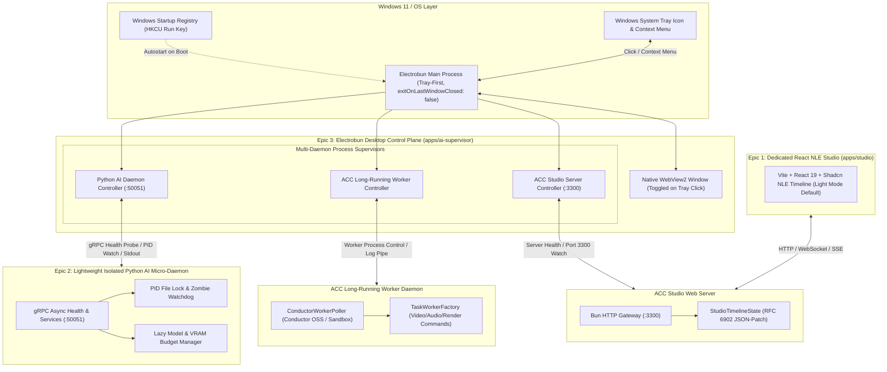

# Master Integration Plan (Iteration 3): Dedicated React Studio Application, WebGL Shader Compositor, Enterprise Python AI Subsystem & Electrobun System-Tray Desktop Control Plane

## 1. Executive Summary & Strategic Objectives

Following the successful completion of Iteration 2 (Narrative Scripting, FFI Hardware GPU Acceleration, and Foundation Option D Studio Preview), **Iteration 3** unites visual creation, client-side rendering parity, and full-stack enterprise process supervision across three pillars:

1. **Epic 1: Professional Non-Linear Editor (NLE) Studio Migration (`apps/studio`)**  
   Migrate the temporary embedded vanilla HTML5 canvas preview in `apps/cli/src/studio/StudioServer.ts` into a dedicated, enterprise-grade React application in `apps/studio` built with **Vite, React 19, TypeScript, TailwindCSS v4, and Shadcn UI (Default Light Mode)**, adopting core design paradigms from [ybouane/videoflow-react-video-editor](https://github.com/ybouane/videoflow-react-video-editor):
   - **Modular Panel Architecture**: Dedicated `<Preview />`, `<Timeline />`, `<Sidebar />` (Inspector & Asset Bin), and `<Titlebar />` wired to reactive state (`useStudioStore`).
   - **Default Light Mode with Theme Toggle**: Clean, crisp, high-contrast light theme by default using Shadcn UI design tokens (`--background`, `--foreground`, `--primary`, `--card`, `--border`), with seamless dark mode switching.
   - **Multi-Track Virtualized Canvas & DOM Timeline**: Multi-layer tracks (Video, Timed Text / Karaoke, Audio Waveform & Foley, Canvas VFX Overlays) with zoomable timecode axis, clip boundary trimming, magnetic snapping, and standard NLE transport (`Space`, `J/K/L`).
   - **Strict WYSIWYG Parity Engine (Browser <-> Headless Server)**: Mathematical calibration between the browser WebGL/Canvas2D preview and server-side FFI rendering (`@napi-rs/canvas`, `pts.js`, `IRMasterRenderer`), ensuring zero visual divergence across normalized $[-1, 1]$ coordinates, seeded particle math, and subtitle metrics.
   - **RFC 6902 JSON-Patch Synchronization**: Bi-directional real-time AST synchronization over WebSocket/REST with sub-second undo/redo stacks.
   - **Live SSE/WebSocket Export Progress Streaming**: Live frame counter, render FPS, ETA, and progress bar during deterministic backend exports.

2. **Epic 2: Enterprise Lightweight & Isolated Python AI Subsystem (`apps/python-backend`)**  
   Harden the isolated Python AI backend (`apps/python-backend`) from a proof-of-concept into a lightweight, fault-tolerant micro-daemon:
   - **Zero-Crash / Zero-Zombie Process Lifecycle**: Clean IPC managed via `uv`, PID file locking, graceful signal traps (`SIGTERM`, `SIGINT`), and parent watchdog heartbeat auto-teardown.
   - **Dynamic Hardware Device & Model Memory Management**: On-demand lazy model weights loading (Kokoro TTS, Depth Anything v2, BiRefNet/SAM 2, GBNF llama.cpp) with automated idle VRAM unloading (120s timeout) and GPU memory budget limits.
   - **Standardized Health Probing & Circuit Breaking**: Standardized gRPC health check service (`grpc.health.v1.Health`), automated watchdog heartbeat, and transparent fallback to `@acc/core` TypeScript in-process algorithms if the Python daemon is offline.
   - **Packaging & Containerization**: Lightweight containerization profile (`uv.lock` pinning) ensuring sub-second cold starts and deterministic runtime isolation.

3. **Epic 3: Electrobun System-Tray First Unified Desktop Control Plane (`apps/ai-supervisor`)**  
   A **Tray-First, Zero-Friction Desktop Control Plane** powered by **Electrobun** (native WebView2 on Windows + Bun runtime, ~12MB bundle size, < 30MB RAM):
   - **System-Tray First Lifecycle Architecture**:
     - Boots silently into the **Windows System Tray** with a live dynamic tray icon reflecting fleet health (Green = Healthy, Yellow = Degraded, Red = Offline).
     - Context menu with quick actions: *Open Dashboard*, *Service Status Badges*, *Start All / Stop All*, *Purge VRAM*, *Restart Daemon*, and *Quit*.
     - Clicking the tray icon seamlessly toggles the full dashboard window without closing background daemon processes (`exitOnLastWindowClosed: false`).
     - Window minimize and close buttons default to minimizing back to the system tray.
   - **OS Auto-Start on System Boot**:
     - Windows Registry auto-start integration (`HKCU:\Software\Microsoft\Windows\CurrentVersion\Run`) with optional `--minimized` / `--tray` argument.
     - Toggleable in GUI settings: *"Launch at System Startup (Minimized to Tray)"*.
   - **Multi-Daemon Process Supervision**:
     - Supervises the **Python AI Subsystem** (gRPC server on `:50051`).
     - Supervises the **ACC Core Engine / Long-Running Task Workers** (`acc worker --conductor-url ...` or sandbox polling workers).
     - Supervises the **ACC Studio Preview Server** (`acc studio` on `:3300`).
     - Independent Start, Stop, Restart, and Auto-Restart on failure with crash-loop backoff.
   - **Unified Health & Telemetry Dashboard**:
     - Real-time CPU, RAM, and GPU VRAM utilization graphs across all managed child processes.
     - gRPC latency histograms and Conductor task queue polling throughput (tasks polled, executing, succeeded, failed).
     - Global "Purge VRAM & Reset Caches" button.
   - **Centralized Environment & Configuration Control Plane**:
     - Environment variable profiles (Local Dev, Staging, Cloud Conductor, Air-gapped Offline).
     - Interactive port and model configuration editor (`ACC_GRPC_PORT`, `STUDIO_PORT`, Conductor URL, Kokoro voice, Depth model size).
   - **Unified Real-time Log Streamer & Aggregator**:
     - Centralized multi-process log console with tabbed filtering by service (`python-backend`, `acc-worker`, `studio-server`), log severity levels, and full-text search.

---

## 2. Architectural Blueprint & Data Flow



---

## 3. Epic 1: React Studio NLE Migration (`apps/studio`)

### 3.1 Layout & Component Design (Learning from VideoFlow)
Adopting the modular headless architecture of `ybouane/videoflow-react-video-editor`, the studio UI is structured as independent, pluggable panels managed via **Shadcn UI + TailwindCSS v4 with Light Mode as Default**:
- **Default Light Theme**: Crisp, high-contrast, professional editing workspace styled with subtle borders (`border-slate-200`), clean white/slate canvas framing, and vibrant primary accents (`indigo-600`), complete with a dark-mode toggle for flexible user preference.
- `<Titlebar />`: Project metadata, canvas resolution selector (16:9, 9:16, 1:1), zoom scale, undo/redo buttons, light/dark mode toggle, and "Export Video" action.
- `<Sidebar />`:
  - **Asset Library Tab**: Media files, sound effects, audio tracks, and text presets.
  - **Modifier Inspector Tab**: Dynamic sliders, color pickers, and mode dropdowns for the currently selected sequence.
- `<Preview />` (Viewport):
  - Canvas monitor locked to IR document resolution.
  - Interactive overlay handles for text bounding boxes and transform gizmos.
- `<Timeline />`:
  - Zoomable time ruler with frame, second, and SMPTE timecode formats.
  - Multi-track vertical stack: Track header (mute, solo, lock, hide) + track lane.
  - Resizable clip items with visual trim handles, waveform peaks, and cue labels.
  - Floating scrub playhead with smooth 60fps interpolation.

### 3.2 Strict WYSIWYG Parity: Browser Preview vs. Server FFI Render
To guarantee that what the user sees in the browser matches the final deterministic MP4 export:
1. **Unified Coordinate & Aspect Mapping**:
   - Both browser WebGL shaders and server-side `@napi-rs/canvas` / C FFI filters share an identical normalized coordinate system $[-1.0, 1.0]$.
   - Letterboxing, pillarboxing, and aspect ratios (16:9, 9:16) use mathematically identical transformation matrices.
2. **Deterministic Particle Math Sharing**:
   - Procedural particle modifiers (`canvas_particle_overlay`, `snow`, `rain`, `dust`) utilize the same deterministic seeded pseudo-random formula ($timeSec \times speed$ without system clock drift).
3. **Typography & Subtitle Bounding Box Metric Synchronization**:
   - Font loading and line breaking rules are calibrated to match ASS subtitle rendering and `@napi-rs/canvas` text layout engines.
4. **Color Grading & Shaders Parity**:
   - WebGL fragment shaders for 3D depth dolly, blur, and chromatic aberration mirror FFmpeg `libplacebo` / `gltransition` shader math.

---

## 4. Epic 2: Enterprise Lightweight & Isolated Python AI Subsystem (`apps/python-backend`)

### 4.1 Problem Statement & Hardening Rationale
1. **Unbounded Model Memory**: Model instances (Kokoro, Depth, SAM 2) could occupy VRAM indefinitely without an LRU eviction or idle timeout policy.
2. **Zombie Process Risk**: If the parent process terminates unexpectedly, the spawned Python daemon might remain orphaned on port 50051.
3. **Cold Start & Heavy Dependency Overhead**: Heavy scientific packages (`torch`, `transformers`) can slow down daemon startup if not strictly isolated with lazy module imports.
4. **Lack of Standardized Health Probing**: gRPC lacks formal `grpc.health.v1` support for enterprise orchestrators and the desktop control plane.

### 4.2 Proposed Hardening & Resilience Architecture
1. **Sub-Second Lazy Bootstrapping & Process Supervisor**:
   - Dedicated launcher with PID file locking (`.acc-python.pid`).
   - Signal handler trapping `SIGINT`, `SIGTERM`, and parent process heartbeat watchdog (auto-exits if supervisor dies).
2. **VRAM & Memory Budget Manager**:
   - Dedicated `ModelLifecycleManager`: on-demand lazy weights loading, 120s idle timeout auto-eviction (`torch.cuda.empty_cache()`, `gc.collect()`), and configurable VRAM caps.
3. **Standardized gRPC Health & Circuit Breaking**:
   - Standard `grpc.health.v1.HealthServicer` supporting `SERVING` and `NOT_SERVING` per service.
   - Enhanced `@acc/core` `IPCFacade` with exponential backoff and circuit breaking routing to fallback strategies.

---

## 5. Epic 3: Electrobun System-Tray First Unified Desktop Control Plane (`apps/ai-supervisor`)

### 5.1 System-Tray First Architecture & OS Boot Integration
`apps/ai-supervisor` is architected as an **Always-On, Tray-First Native Windows Control Plane**:
- **Electrobun Windows Stack**: Native Microsoft Edge WebView2 on Windows + Bun runtime, shipping at $\sim 12$MB binary footprint and consuming $< 30$MB RAM.
- **Silent Boot into System Tray**:
  - The application starts minimized in the system tray when booted via Windows startup (`--minimized` flag).
  - Main window is created lazily or hidden on launch; closing the window hides it back into the tray instead of terminating the app (`exitOnLastWindowClosed: false`).
- **Windows Startup Registry Management**:
  - Main Bun process exposes a native registry helper (`setWindowsStartup(enabled: boolean)`):
    ```typescript
    import { spawn } from "bun";
    export async function setWindowsStartup(enable: boolean) {
      const appPath = process.execPath;
      const cmd = enable
        ? `New-ItemProperty -Path "HKCU:\\Software\\Microsoft\\Windows\\CurrentVersion\\Run" -Name "ACCControlPlane" -Value '"${appPath}" --minimized' -PropertyType String -Force`
        : `Remove-ItemProperty -Path "HKCU:\\Software\\Microsoft\\Windows\\CurrentVersion\\Run" -Name "ACCControlPlane" -ErrorAction SilentlyContinue`;
      await spawn(["powershell", "-NoProfile", "-Command", cmd]).exited;
    }
    ```
- **Context Menu Actions**:
  - `🟢 Open Control Plane Dashboard` (Restores window to foreground)
  - `---`
  - `⚡ Python AI: Running (Port 50051)`
  - `⚙️ ACC Worker: Polling`
  - `🎨 Studio Server: Live (Port 3300)`
  - `---`
  - `🧹 Purge VRAM & Caches`
  - `🔄 Restart All Services`
  - `❌ Quit Entirely`

### 5.2 Managed Services in Control Plane
1. **Python AI Micro-Daemon (`python-backend`)**:
   - Port: `50051` (gRPC).
   - Metrics: Ping latency, VRAM allocation, loaded model weights.
   - Controls: Start, Stop, Force Kill, VRAM Purge.
2. **ACC Long-Running Worker Daemon (`acc-worker`)**:
   - Command: `bun run cli.ts worker --conductor-url <url>` (or sandbox mode).
   - Metrics: Polling status, active task execution, completed vs failed task counter.
   - Controls: Start worker, pause polling, scale concurrency, switch sandbox/production.
3. **ACC Web Studio Server (`studio-server`)**:
   - Port: `3300` (HTTP / WebSocket).
   - Metrics: Connected browser clients, active project path, render dispatch queue.
   - Controls: Start/Stop server, open in default browser, change project directory.

### 5.3 Control Plane User Experience (Shadcn Light UI)
- **Top Navigation Bar**: System overview summary (Total CPU, Total RAM, GPU VRAM, Global Health Badge `ALL SERVICES HEALTHY`, System Startup toggle).
- **Service Cards Grid**:
  - Live status indicator (Green `RUNNING`, Amber `DEGRADED`, Red `STOPPED`).
  - Uptime, PID, port, memory consumption.
  - Action buttons: `Start`, `Stop`, `Restart`, `Logs`.
- **Worker Management Tab**:
  - Live task poller feed from Conductor OSS or local sandbox.
  - Inspection of recent task payloads, execution duration, and error traces.
- **Environment & Configuration Editor**:
  - Profile switcher (`Development`, `Local Conductor`, `Cloud Production`, `Airgapped Offline`).
  - Form controls to update `.env` variables with instantaneous hot-restart.
- **Unified Log Streamer**:
  - Tabbed streaming console merging stdout/stderr across all managed services with ANSI color support, log filtering, and download log file button.

---

## 6. Phased Implementation Roadmap

| Phase | Epic | Scope & Key Deliverables |
| :--- | :--- | :--- |
| **Phase 1** | Epic 1 | **Workspace & Shadcn UI Scaffolding (`apps/studio`)**: Turborepo workspace, Vite, React 19, TailwindCSS v4, Shadcn UI component primitives with **Default Light Mode**, ThemeProvider for dark mode toggle. |
| **Phase 2** | Epic 1 | **State Engine & VideoFlow-Style Modular Architecture**: `useStudioStore` (Zustand), `StudioApiClient` (WebSocket/REST JSON-Patch), `<Titlebar />`, `<Sidebar />`, and `<Preview />`. |
| **Phase 3** | Epic 1 | **Multi-Track Virtualized NLE Timeline**: Zoomable time ruler, track lane headers, draggable/resizable clip items, audio waveform visualization, and transport controls. |
| **Phase 4** | Epic 1 | **WYSIWYG Viewport & WebGL Parity Engine**: WebGL 2.0 shader compositor calibrated against server-side FFI rendering with real-time particle, 3D depth, and text cue preview. |
| **Phase 5** | Epic 2 | **Python Backend Lifecycle & Resilience**: PID file locking, parent watchdog heartbeat, graceful signal shutdown, and zero-zombie process guarantee. |
| **Phase 6** | Epic 2 | **VRAM Memory Manager & Standard Health Service**: Lazy model loader, LRU/idle VRAM eviction, `grpc.health.v1` integration, and core circuit breaking in `IPCFacade`. |
| **Phase 7** | Epic 3 | **Electrobun System-Tray Desktop Scaffolding (`apps/ai-supervisor`)**: Electrobun setup, native Windows tray icon, context menu, window minimize-to-tray, and `exitOnLastWindowClosed: false`. |
| **Phase 8** | Epic 3 | **OS Auto-Start & Multi-Daemon Supervisor Core**: Windows Registry autostart integration, Bun main process multi-daemon controller (`python-backend`, `acc-worker`, `studio-server`). |
| **Phase 9** | Epic 3 | **Control Plane Dashboard, Worker Monitor & Config UI**: Multi-service telemetry cards, Conductor task worker monitor, unified log console, environment profile editor, and manual VRAM purge. |
| **Phase 10** | All | **Master Architecture Sync & End-to-End QA**: Update `docs/SYSTEM_ARCHITECTURE_DOCUMENT.md`, verify full test suite (`bun test`, `pytest`), and test end-to-end multi-service orchestration. |

---

## 7. Verification & Acceptance Criteria
- [ ] `apps/studio` builds cleanly into `apps/studio/dist` via `bun run build` with crisp Light Mode as default.
- [ ] `bun run cli.ts studio -c ./sample-story` starts the server and serves the React Shadcn application on `http://localhost:3300`.
- [ ] Timeline supports multi-track clip boundary dragging and immediately synchronizes AST state via RFC 6902 JSON-Patch.
- [ ] Browser WebGL preview displays particle overlays and 3D depth simulations with visual parity to the deterministic MP4 export.
- [ ] Python backend auto-bootstraps in $< 1.5$s, releases VRAM after idle timeout, and auto-terminates without leaving zombie processes.
- [ ] `apps/ai-supervisor` boots silently into the Windows System Tray, shows dynamic status icons, manages `python-backend`, `acc-worker`, and `studio-server`, supports auto-start with Windows, and restores the full control plane window on tray click.
- [ ] All automated tests pass cleanly (`bun test autogenerated-tests/`, `uv run pytest`).
