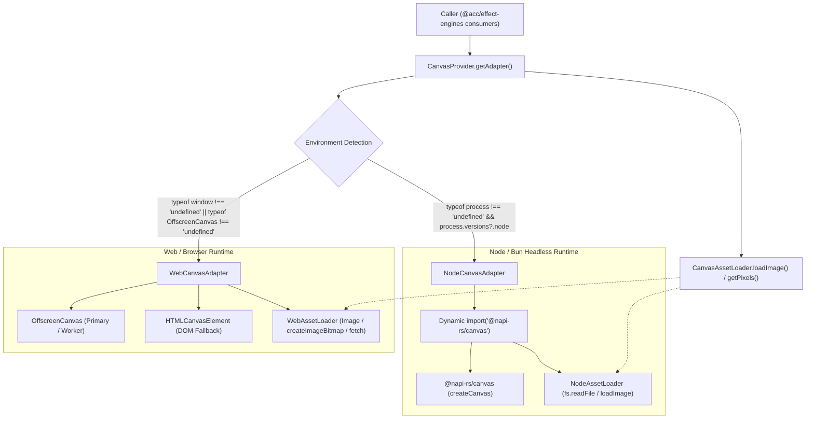

# Master Integration Plan (Iteration 7): Universal Canvas Engine (GSAP + Pts.js) & Enterprise Studio UI/UX Modernization

## 1. Executive Summary & Strategic Objectives

Following the successful execution of **Iteration 6** (Dual-sidebar enterprise workspace, @dnd-kit pointer staging, deep property inspection, and multi-track audio mixing), **Iteration 7** executes a strategic architectural migration and elevates the studio interface to an enterprise-grade NLE experience:

1. **Complete Removal of Three.js**:
   - Completely eliminate Three.js (`three`, `@types/three`) across all workspace packages and apps.
   - Remove WebGL context overhead, shader compilation stutter, and ~600KB+ minified bundle weight.
2. **Universal Canvas Engine (`@acc/effect-engines`)**:
   - Replaces `UniversalThreeScene` with an isomorphic, high-performance `UniversalCanvasEngine` powered by **GSAP** and **Pts.js**.
   - Runs seamlessly on **client-side HTML5 2D Canvas** (`CanvasRenderingContext2D`) in `apps/studio` and on **server-side `@napi-rs/canvas`** in `@acc/effect-engines` headless export pipelines.
3. **Deterministic Frame Evaluation**:
   - GSAP timeline tickers are paused and driven strictly via frame math: `timeline.seek(timeSec)` where `timeSec = currentFrame / fps`.
   - Inviolable bit-identical parity between live client scrubbing and server-side video rendering.
4. **Liquid Glass Theme System**:
   - Translucent frosted glass panels with specular top rim highlights (`inset 0 1px 0 0 rgba(255, 255, 255, 0.15)`), `backdrop-blur-xl`, and ambient fluid gradient mesh.
   - Dual-theme mode (Dark Obsidian default and Light Frosted Acrylic) with fluid luminous control interactions (glossy hover highlights, active spring press).
   - Dedicated Preferences Modal (`SettingsModal.tsx`) allowing full customization of Theme Mode, Optical Glass Style (Specular / Frosted / Cyber-Glass), Blur Intensity, and Accent Colors, persisted to `localStorage`.
5. **Direct On-Canvas Staging & Floating Action Pill**:
   - In-Canvas 2D vector transform bounding box, 8 resize handles, rotation stem/knob, and glowing magnetic snap guides rendered via Pts.js `CanvasForm`.
   - Floating glassmorphic Contextual Action Pill positioned right above the active selection (Duplicate, Delete, Lock, Center Alignment, Layer Order).
6. **Professional Viewport Header HUD**:
   - Floating top HUD in `Preview.tsx` featuring Zoom presets (`Fit`, `50%`, `100%`, `200%`), Pan Hand mode (or `Space + drag`), Broadcast/Social Safe Guides toggle (16:9 & 9:16), and Transparency Checkerboard toggle.
7. **Visual GSAP Motion & Easing Selector**:
   - Right Sidebar Inspector includes a visual easing selector with SVG curve previews for GSAP motion curves (`power2.out`, `back.out`, `elastic.out`, `expo.out`, `bounce.out`).
8. **Direct Multi-Track Timeline Clip Manipulation**:
   - Left/right trim edge drag handles (adjusting in/out points with live edge snapping), horizontal clip dragging along tracks, and instant Razor split (`C` hotkey or Razor tool click).
9. **Enterprise Discovery & Assets Vault**:
   - Real-time search filter, category pill tags (`All`, `Typography`, `VFX`, `Shapes`, `SFX`), dynamic hover micro-animations on preset cards, and drag-and-drop file upload zone in Assets Vault.
10. **Enterprise Feedback & Discovery**:
    - Subdued toast notifications for history actions, live Undo/Redo depth indicators in the Titlebar, and an accessible Keyboard Shortcuts cheat sheet modal (`?` or `Ctrl+/`).

---

## 2. Inviolable Architecture & Guardrail Compliance

> [!IMPORTANT]
> **SSOT, COMMAND PATTERN & CLIENT SAFETY**:
> - All UI modifications to sequences, overlay tracks, or modifiers MUST flow through `IRStateManager.getInstance().updateModifier(...)`, `updateClipTransform(...)`, or `executeCommand(...)`.
> - High-frequency pointer dragging MUST coalesce into a single atomic undo step via `CoalescingHistoryStrategy`.
> - `apps/studio` MUST strictly import client-safe modules from `@acc/effect-engines/client` (zero native `.node` or `@napi-rs/canvas` binaries).
> - All exports flow strictly through `MediabunnyClientSink`.
> - In-canvas selection handles, guides, and HUD overlays must NEVER appear in exported video frames or cached thumbnails.

---

## 3. System Architecture & Component Interaction

```
+---------------------------------------------------------------------------------------------------+
|                                     apps/studio (React 19 NLE)                                    |
|                                                                                                   |
|  +----------------------------+  +-------------------------------------+  +--------------------+  |
|  |     LeftSidebar.tsx        |  |             Preview.tsx             |  |  RightSidebar.tsx  |  |
|  | - Liquid Glass Panel       |  | - HTML5 Canvas2D (Context2D)        |  | - Liquid Glass     |  |
|  | - 48px Activity Rail       |  | - UniversalCanvasEngine             |  | - NLE Action Bar   |  |
|  | - 300px Drawer:            |  | - Ambient Fluid Mesh Glow           |  | - GSAP Easing Curve|  |
|  |   * Real-Time Search       |  | - Pts.js Vector Layer:              |  |   * SVG Previews   |  |
|  |   * Category Pill Tags     |  |   * 8-Point Bounding Box            |  | - Deep 2.5D VFX:   |  |
|  |   * Staging Presets        |  |   * Top Rotation Stem & Knob        |  |   * Spotlight      |  |
|  |   * Assets Vault (Upload)  |  |   * Magnetic Snapping Guides        |  |   * Regional Blur  |  |
|  | - @dnd-kit useDraggable    |  | - Floating Contextual Action Pill   |  |   * Spark Emitters |  |
|  +----------------------------+  | - Viewport Header HUD:              |  | - Universal Audio  |  |
|                                  |   * Fit / 50% / 100% / 200%         |  |   * Master Bus     |  |
|                                  |   * Safe Guides (16:9 / 9:16)       |  |   * Dynamic Ducking|  |
|                                  |   * Checkerboard Toggle             |  +--------------------+  |
|                                  +------------------+------------------+                          |
|                                                     |                                             |
|  +--------------------------------------------------+------------------------------------------+  |
|  |                                  Timeline.tsx (Multi-Track)                                 |  |
|  | - Frosted Glass Track Headers | Direct Edge Trim Handles | Razor Cut Tool ('C' Hotkey)      |  |
|  +--------------------------------------------------+------------------------------------------+  |
|                                                     | Command Execution                           |
|                                                     v                                             |
|  +---------------------------------------------------------------------------------------------+  |
|  |                                 IRStateManager (Observable SSOT)                            |  |
|  |   - executeCommand(new UpdateClipTransformCommand(..., isCoalesced: true))                  |  |
|  |   - executeCommand(new TrimSequenceCommand(...))                                            |  |
|  |   - executeCommand(new SplitSequenceCommand(...))                                           |  |
|  |   - HistoryManager with CoalescingHistoryStrategy & Undo/Redo Depth Observers               |  |
|  +--------------------------------------------------+------------------------------------------+  |
+-----------------------------------------------------|---------------------------------------------+
                                                      |
                                                      v
+---------------------------------------------------------------------------------------------------+
|                                 Shared Core (@acc/effect-engines)                                 |
|                                                                                                   |
|  +---------------------------------------+                 +-----------------------------------+  |
|  |         UniversalCanvasEngine         |                 |        UniversalAudioMixer        |  |
|  | - GSAP Deterministic Seek (`seek(t)`) |                 | - Multi-Track Sample Mixer        |  |
|  | - Pts.js Vector Math & Forms          |                 | - Dynamic Auto-Ducking (75%)      |  |
|  | - 2.5D Parallax & Radial Glow         |                 | - Stereo Panning & Peak/RMS       |  |
|  | - Procedural Cybernetic HUD           |                 | - Procedural Audio Synths         |  |
|  | - CanvasTransformOverlay (2D Vector)  |                 |                                   |  |
|  +---------------------------------------+                 +-----------------------------------+  |
+---------------------------------------------------------------------------------------------------+
```

---

## 4. Phased Implementation Roadmap

### Phase 1: Workspace Manifests & Clean Three.js Removal
- Remove `three` and `@types/three` from `package.json`, `packages/effect-engines/package.json`, and `apps/studio/package.json`.
- Add `gsap` (`^3.12.7`) across the workspace.
- Delete `packages/effect-engines/src/three/` completely.

### Phase 2: Core UniversalCanvasEngine & Pts.js Transform Overlay
- Implement `packages/effect-engines/src/canvas/UniversalCanvasEngine.ts`:
  - Deterministic GSAP timeline runner (`timeline.seek(timeSec)`).
  - Pts.js generative particle networks, procedural HUD telemetry, and 2.5D parallax glow.
  - Partial VFX compositor (spotlights, localized blurs, glitches, spark emitters).
- Implement `packages/effect-engines/src/canvas/CanvasTransformOverlay.ts`:
  - 8 resize handles, rotation stem, magnetic snapping lines rendered via Pts.js `CanvasForm` directly on 2D canvas.
  - Client-safe export via `packages/effect-engines/src/client.ts`.

### Phase 3: Liquid Glass Design System & Theme Provider
- Define liquid glass CSS custom variables in `apps/studio/src/index.css` (`--glass-bg`, `--glass-border`, `--glass-specular`, `--glass-blur`, `--ambient-mesh`).
- Create `apps/studio/src/lib/theme/ThemeProvider.tsx` with Dark/Light mode, optical glass styles, and `localStorage` persistence.
- Implement `apps/studio/src/components/SettingsModal.tsx` (Preferences modal for mode, optical glass style, blur intensity, and accent colors).

### Phase 4: Studio Viewport Modernization (Canvas2D, Action Pill, Viewport HUD)
- Refactor `apps/studio/src/components/Preview.tsx` to mount `UniversalCanvasEngine` on HTML5 2D canvas with ambient fluid mesh lighting.
- Implement responsive mouse cursor states for handles (`nwse-resize`, `nesw-resize`, `crosshair`, `grabbing`).
- Add on-canvas floating glassmorphic Action Pill HUD (Duplicate, Delete, Lock, Center Alignment, Reset).
- Add floating glass Viewport Control Bar in `Preview.tsx` (Zoom, Safe Guides, Checkerboard).

### Phase 5: Right Sidebar GSAP Easing Inspector & Left Sidebar Enhancements
- Add visual GSAP Easing Curve Selector in `RightSidebar.tsx` with SVG preview badges.
- Enhance `LeftSidebar.tsx`:
  - Real-time search filter bar across presets and assets.
  - Category pill filter tags (`All`, `Typography`, `VFX`, `Shapes`, `SFX`).
  - Micro-animation hover state on preset cards.
  - Drag-and-drop asset upload dropzone.

### Phase 6: Multi-Track Timeline Direct Manipulation & Commands
- Implement `TrimSequenceCommand.ts` and `SplitSequenceCommand.ts` in `apps/studio/src/lib/commands/`.
- Add left/right trim handles to timeline clips with magnetic edge snapping.
- Wire Razor cut tool (`C` hotkey or toolbar toggle).
- Add live Undo/Redo depth badges in `Titlebar.tsx` and toast notification system.
- Add Keyboard Shortcuts cheat sheet modal (`?` or `Ctrl+/`).

### Phase 7: Automated Testing & Production Verification
- Create `autogenerated-tests/isomorphic_canvas_engine.test.ts` testing `@napi-rs/canvas` server rendering.
- Update all studio unit tests (`studio_canvas_transform.test.ts`, `studio_partial_vfx_staging.test.ts`, `studio_three_audio_wiring.test.ts`, `studio_iteration6_e2e.test.ts`).
- Compile production bundle via `bun run studio:build` and verify zero Three.js dependencies.

### Phase 8: Universal Canvas Abstraction Layer (Isomorphic Web & Node Environment Switching)
- Create isomorphic `CanvasProvider` with automatic runtime detection (`web` vs `node`) and manual override.
- Implement `WebCanvasAdapter` utilizing `OffscreenCanvas` with `HTMLCanvasElement` fallback.
- Implement `NodeCanvasAdapter` utilizing lazy dynamic `import('@napi-rs/canvas')`.
- Implement `CanvasAssetLoader` for isomorphic image loading and byte extraction.
- Expose browser-pure interfaces in `@acc/effect-engines/client`.

---

## 5. Phase 8: Universal Canvas Abstraction Layer (Isomorphic Web & Node Environment Switching)

### 5.1 Goal & Problem Statement
Currently, canvas operations across `@acc/effect-engines` (e.g. `depth3d`, `overlay-effects`, `vision`, `subtitles`) have disparate and static imports of `@napi-rs/canvas`. While `@acc/effect-engines/client` was introduced as a lightweight re-export for the browser, any deep engine usage or overlay generator executed in the client risks bundling native C++ `.node` binaries or encountering runtime failures.

This architectural enhancement provides a unified, isomorphic **Universal Canvas Abstraction Layer** that dynamically switches between **Web/Browser** (via `OffscreenCanvas` & `HTMLCanvasElement`) and **Node/Bun** (via `@napi-rs/canvas`), with zero native binary bundle errors and unified asset/pixel loading.

### 5.2 Architectural Diagram



### 5.3 Detailed Component Architecture

#### 1. `packages/effect-engines/src/canvas/UniversalCanvasProvider.ts`
- Unified entry point for acquiring an isomorphic `CanvasAdapter`:
  - `CanvasProvider.getAdapter(type?: 'auto' | 'web' | 'node'): CanvasAdapter`
  - `CanvasProvider.setEngine(type: 'auto' | 'web' | 'node'): void`
  - `CanvasProvider.registerAdapter(name: string, adapter: CanvasAdapter): void`
  - `CanvasProvider.getDetectedEnvironment(): 'web' | 'node'`
- Dynamic auto-detection logic:
  - If `typeof window !== 'undefined'` or `(typeof globalThis !== 'undefined' && typeof (globalThis as any).OffscreenCanvas !== 'undefined' && typeof process === 'undefined')` $\to$ `'web'`.
  - If `typeof process !== 'undefined' && (process.versions?.node || process.versions?.bun)` $\to$ `'node'`.

#### 2. `packages/effect-engines/src/canvas/adapters/WebCanvasAdapter.ts`
- Pure Web implementation using zero Node.js/C++ dependencies:
  - Prioritizes `OffscreenCanvas` for performance and WebWorker compliance.
  - Graceful fallback to `document.createElement('canvas')` in DOM environments if `OffscreenCanvas` is unavailable.
  - Implements `CanvasInstance`:
    - `getContext('2d')` $\to$ Returns standard `CanvasRenderingContext2D` / `OffscreenCanvasRenderingContext2D`.
    - `toBuffer('raw')` $\to$ Extracts raw RGBA pixels as `Uint8Array` via `ctx.getImageData()`.
    - `toBlob(mimeType)` $\to$ Converts to Blob.
    - `toDataURL(mimeType)` $\to$ Converts to base64 image string.

#### 3. `packages/effect-engines/src/canvas/adapters/NodeCanvasAdapter.ts`
- Server-side Node/Bun implementation:
  - Lazy dynamic import: `await import('@napi-rs/canvas')` on initialization so that bundlers like Vite do not trace `@napi-rs/canvas` into browser builds.
  - Implements `CanvasInstance` with `@napi-rs/canvas` `createCanvas`.
  - Supports `toBuffer('raw')` converting `Uint8ClampedArray` to Node `Buffer` or `Uint8Array` for FFmpeg streaming.

#### 4. `packages/effect-engines/src/canvas/CanvasAssetLoader.ts`
- Isomorphic asset loader:
  - `loadImage(source: string | Buffer | Uint8Array | Blob | File): Promise<CanvasImageSource | any>`
    - In Web: loads via `new Image()` with `src` (data URL / object URL) or `createImageBitmap(blob)`.
    - In Node: loads via dynamic `@napi-rs/canvas` `loadImage()`.
  - `extractRawPixels(canvas: CanvasInstance): Uint8Array`
    - Uniform byte extraction across environments.

#### 5. Integration Across Existing Modules
- `packages/effect-engines/src/overlay-effects/canvas-strategies/factory.ts`: Route `CanvasAdapterFactory.getAdapter()` directly to `CanvasProvider.getAdapter()`.
- `packages/effect-engines/src/client.ts`: Re-export `CanvasProvider`, `WebCanvasAdapter`, `CanvasAssetLoader`, and `CanvasInstance`, maintaining 100% browser purity.
- `packages/effect-engines/src/index.ts`: Export universal canvas provider and adapter interfaces alongside existing modules.

### 5.4 Verification & Validation Strategy
1. **Automated Tests**:
   - `bun test autogenerated-tests/universal_canvas_switching.test.ts`:
     - Test environment auto-detection (Node vs simulated Web).
     - Test explicit engine override (`setEngine('web')` and `setEngine('node')`).
     - Test render output parity and raw pixel byte extraction parity across Web and Node adapters.
   - `bun test effect-engines`: Verify all existing overlay-effects and depth tests continue passing without regression.
   - `bun test studio`: Verify all Studio tests pass cleanly.
2. **Production Bundle Verification**:
   - `bun run studio:build`: Ensure clean Vite production build with zero native binding warnings or externalized C++ binary errors.
