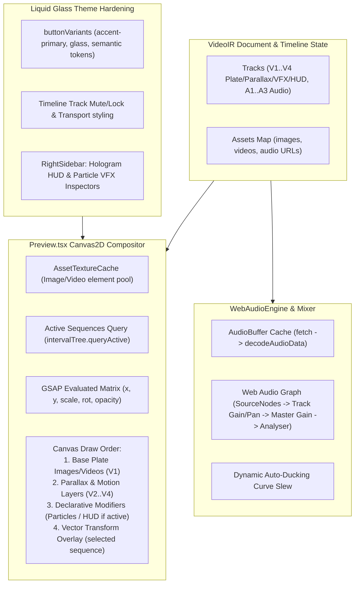

# Iteration 8: Studio Visual/Audio Media Compositor, Declarative VFX & UI/UX Hardening

## Goal Description
The Studio app currently features a modern Liquid Glass layout and timeline manipulation, but suffers from key architectural gaps and visual inconsistencies:
1. **Hardcoded Hologram & Particle VFX**: `Preview.tsx` unconditionally invokes `engine.initHologramHUD(0.35, 40)` and `engine.initParticleSystem(250)` on mount, forcing cyan tech rings and particle swarms into every project regardless of timeline modifiers.
2. **Missing Visual Media Compositing**: `Preview.tsx` only clears the canvas to black and draws particles/vector overlays; active image and video sequence assets are never decoded or drawn (`ctx.drawImage`) onto the Canvas2D context.
3. **Procedural-Only Audio Playback**: `WebAudioEngine` synthesizes generic tones via `UniversalAudioMixer` rather than decoding and mixing real audio assets from asset URLs.
4. **UI/UX Token Inconsistencies**: Several controls (e.g. `button.tsx`, `Timeline.tsx` track mute/lock) contain hardcoded Tailwind classes (`bg-indigo-600`, `hover:bg-slate-200`) instead of semantic Liquid Glass tokens (`--accent-primary`, `--glass-bg`, `--glass-border`).

This initiative turns the Studio into a production-grade media compositor with real visual/audio asset playback, declarative modifier-driven VFX, and unified UI styling.

---

## User Review Required

> [!IMPORTANT]
> **In-Canvas Object Style Isolation**: Per historical design rule 235, in-canvas media placeholders and text cues are video render outputs and must NOT inherit desktop Liquid Glass theme classes. Fallback media cards are rendered with neutral dark video charcoal backgrounds (`#151518`), clean contrast typography, and neutral media icons.

> [!NOTE]
> **Audio Decoding Fallback**: Real audio URLs will be asynchronously decoded into `AudioBuffer`s. If an asset fails to fetch (offline, CORS, 404), `WebAudioEngine` will fall back seamlessly to procedural synthesis so playback never freezes.

---

## Proposed Changes



---

## Phased Implementation Roadmap

### Phase 1: Declarative Particle & HUD Subsystem
- **`packages/effect-engines/src/canvas/UniversalCanvasEngine.ts`**:
  - Add `clearParticles(): void` and `clearHUD(): void`.
  - Add dynamic `setHUDConfig(config: HUDConfig | null)` and `setParticleConfig(config: ParticleConfig | null)`.
- **`apps/studio/src/components/Preview.tsx`**:
  - Remove hardcoded `initHologramHUD(0.35, 40)` and `initParticleSystem(250)` on mount.
  - Dynamically query active sequences for `overlay/canvas_particles` or `overlay/hologram_hud` modifiers in the frame loop.
  - Add FX Ambiance toggle in Viewport Control Bar.

### Phase 2: Real Visual Media Compositor & Preview Architecture Resilience
- **`packages/effect-engines/src/canvas/UniversalCanvasEngine.ts`**:
  - Implement `renderLayers(ctx: CanvasRenderingContext2D, layers: VisualLayerItem[]): void`:
    - Strict multi-track layer ordering ($V1 \to V4$).
    - Aspect ratio math: `'cover'` for background plates (fills 16:9 canvas cleanly) and `'contain'` for subjects/overlays.
    - Modifier-driven `blendMode` parameter support (falling back to track `blendMode` or `'source-over'`).
    - GSAP / Pts.js affine transform matrix stacking (`translate`, `rotate`, `scale`, `globalAlpha`) and defensive `ctx.drawImage()`.
- **`apps/studio/src/lib/textures/AssetTextureCache.ts`**:
  - Implement Observer pattern (`subscribe(callback)`, `notify()`) to reactively notify listeners on image/video frame decoding so the preview redraws immediately without waiting for scrub.
  - Implement real image loading and video element seeking (`new Image()`, HTML5 `<video>`).
  - Implement `getVisualAsset(assetId, src, type)` and `renderMissingAssetPlaceholder(ctx, w, h, name, type)` (Rule 235 isolation).
- **`apps/studio/src/components/preview/`**:
  - Decompose monolithic 1,558-line `Preview.tsx` into clean, single-responsibility sub-components:
    - `ViewportControlBar.tsx`: Monitor HUD, zoom presets, pan hand tool, safe guides, checkerboard, ambiance toggle.
    - `ViewportSafeGuides.tsx`: 16:9 Broadcast & 9:16 Social Reel safe overlays.
    - `ContextualActionPill.tsx`: Floating action pill (Duplicate, Center, Lock/Unlock, Reset, Delete).
    - `SubtitlesOverlay.tsx`: In-canvas isolated subtitles & inline text cue editor modal.
- **`apps/studio/src/components/Preview.tsx`**:
  - Lean orchestrator (~280 lines) delegating visual layer drawing to `engine.renderLayers()` and sub-components.
  - Retain exported types and sub-components (`TransformBodyDraggable`, `TransformHandle`, `computeDragTransform`) ensuring 100% zero-regression test compatibility.

### Phase 3: Multi-Track Web Audio Asset Decoding & Mixing
- **`apps/studio/src/lib/audio/WebAudioEngine.ts`**:
  - Implement asynchronous audio decoding via `AudioContext.decodeAudioData()`.
  - Schedule synchronized `AudioBufferSourceNode`s routed through per-track gain/pan nodes with dynamic auto-ducking.
  - Fallback to procedural synthesis if audio is still fetching or offline.

### Phase 4: RightSidebar Inspector Panels for HUD & Particles
- **`apps/studio/src/components/RightSidebar.tsx`**:
  - Add dedicated **Hologram HUD** Accordion panel (Ring Radius, Scanline Density, Rotation Speed, Color picker).
  - Enhance **Particle VFX** Accordion panel to bind live updates to `UniversalCanvasEngine`.

### Phase 5: UI/UX Consistency & Theme Tokens
- **`apps/studio/src/components/ui/button.tsx`**:
  - Replace hardcoded `bg-indigo-600` with `bg-[var(--accent-primary)] text-slate-950 font-semibold shadow-[0_0_12px_var(--accent-glow)]`.
- **`apps/studio/src/components/Timeline.tsx`**:
  - Replace raw `<button>` track lock/mute elements with styled icon buttons using semantic tokens.
  - Standardize transport buttons with Liquid Glass styling.
- **`apps/studio/src/components/Titlebar.tsx`**:
  - Ensure all action buttons and badges use semantic glass tokens.

### Phase 6: Automated Testing & Production Verification
- Dedicated test suite `autogenerated-tests/studio_media_compositor.test.ts`.
- Full regression verification: `bun test autogenerated-tests/studio`.
- Production bundle verification: `bun run studio:build`.

---

## Verification Plan

### Automated Tests
```bash
# 1. Run full Studio regression suite
bun test autogenerated-tests/studio

# 2. Run new media compositing & UI tests
bun test autogenerated-tests/studio_media_compositor.test.ts

# 3. Verify HTML coverage report generation
bun run coverage:studio

# 4. Verify production bundle build
bun run studio:build
```

### Manual Verification
1. Open Studio in browser:
   - Verify Cyber City Panoramic Plate image displays in Viewport Preview on track V1.
   - Verify Hologram HUD and particles only appear on sequences that have the corresponding modifiers, and can be toggled in Viewport HUD.
   - Adjust Particle Count and HUD Neon Color in RightSidebar and confirm live canvas re-render.
   - Play timeline with audio tracks: confirm voice, SFX, and BGM mix with dynamic ducking.
   - Switch between Dark Obsidian and Light Frosted themes: confirm all buttons and track controls adhere to Liquid Glass styling without rogue indigo or slate backgrounds.
