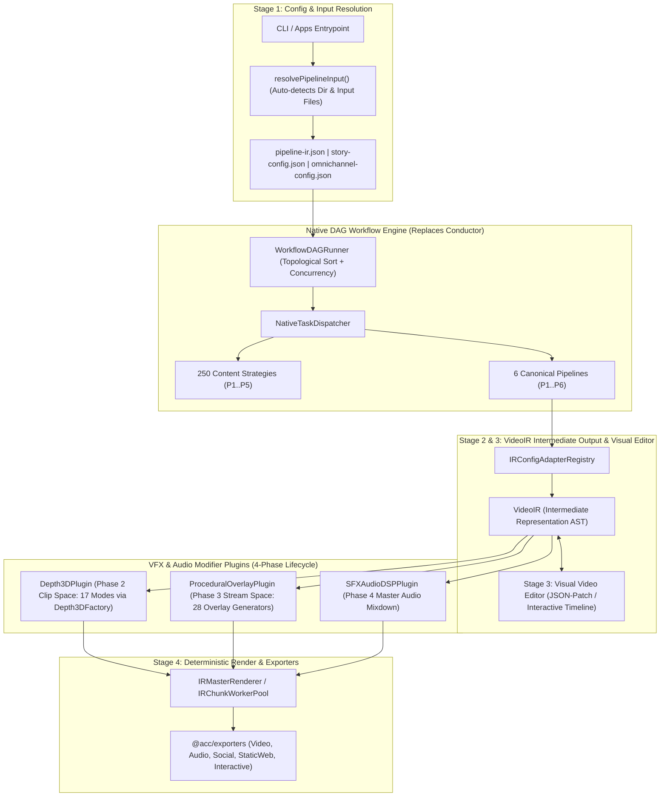

# Master Integration Plan (Iteration 1): Native DAG Orchestrator, VideoIR Intermediate Representation, Full VFX Plugin Migration & 6-Pipeline Integration

## 1. Executive Summary & Context

Following an exhaustive audit of all documentation (`docs/*.md`, `docs/brainstorming/*.md`, `docs/ir/*.md`, `docs/video-production-techniques/*.md`) and implementation packages (`apps/*`, `packages/*`), this plan establishes the actionable roadmap for Iteration 1 across four core architectural pillars:

1. **Clarification of VideoIR Intermediate Representation**:
   - `VideoIR` is an **intermediate output** (compiled AST) representing the Single Source of Truth (SSOT) for deterministic video rendering (Stage 2 in `docs/brainstorming/four-stage-content-generation.md`).
   - Rather than being strictly transient/in-memory, `VideoIR` serves as the serializable, content-addressed intermediate artifact that can be stored and later loaded into **Stage 3: Visual Video Editor** for interactive non-linear timeline editing, JSON-Patch revisions, and iterative preview re-rendering (`Stage 3 <-> Stage 4`).
   - Disk entry configs remain `pipeline-ir.json` (Stage 1 pipeline config), `omnichannel-config.json`, or `story-config.json` (legacy/director). `VideoIRDocument` is compiled via `IRConfigAdapterRegistry`, can be saved as an intermediate artifact for visual editing, and executed by `IRMasterRenderer`.

2. **Deprecation of Netflix Conductor OSS in Favor of Native DAG Workflow Orchestrator**:
   - Netflix Conductor OSS (`@io-orkes/conductor-javascript`, `ConductorWorkerPoller`) has been **dropped**.
   - A lightweight, native, zero-external-dependency workflow orchestration engine (`NativeWorkflowEngine` / `WorkflowDAGRunner`) will be implemented in `@acc/core` following `docs/brainstorming/four-stage-content-generation.md` and `PipelineRunner`.
   - All 250 content strategies (`Phase1` through `Phase5`) and task commands will be driven natively without polling external Conductor servers.

3. **Complete VFX Migration to VideoIR Modifier Plugins (`docs/ir/9.*`)**:
   - Bridge **all 17 3D Depth Renderers** (`packages/effect-engines/src/depth3d/renderers/`) through `Depth3DPlugin` in Phase 2 (Clip Space).
   - Bridge **all 28 Procedural Canvas Overlays** (`packages/effect-engines/src/overlay-effects/generators/`) into a unified `ProceduralOverlayPlugin` in Phase 3 (Stream Space) using zero-alloc canvas rendering without launching subprocesses.

4. **CLI Directory Ingestion & Pipeline Integration**:
   - Fix `resolvePipelineInput` in `apps/cli/src/index.ts` so passing directory paths like `./samples/01-scraper-summarizer` probes for valid pipeline inputs (`source_feed.json`, `breaking_news.md`, `database_payload.json`, `pipeline-ir.json`, `story-config.json`) instead of throwing `EISDIR`.

---

## 2. High-Level Architecture Flow

---

## 3. Detailed Audit of Docs vs Current Implementation

| Area / Document | Architectural SSOT | Status & Findings | Action Plan |
| :--- | :--- | :--- | :--- |
| **VideoIR Intermediate Representation** (`docs/brainstorming/four-stage-content-generation.md` & `docs/ir/1.*`) | Intermediate output AST compiled from Stage 1 (`pipeline-ir.json` or `story-config.json`), editable by Stage 3 Visual Video Editor, and consumed by Stage 4 deterministic renderers. | Previously mischaracterized as purely in-memory. In reality, it is a fully serializable intermediate representation AST that visual editing tools can inspect, mutate via JSON-Patch, and feed back into the render engine. | Formalize `VideoIRDocument` serialization and deserialization APIs so visual editing tools can load, patch, and trigger re-renders. Keep Stage 1 input configs (`pipeline-ir.json`, etc.) separated from the compiled intermediate VideoIR representation. |
| **Workflow Engine** (`docs/master_implementation_plan_250_content_task_strategies.md`) | Dropped Conductor OSS in favor of an internal DAG workflow engine. | Legacy Conductor poller (`@io-orkes/conductor-javascript`, `ConductorWorkerPoller`) remains in `WorkerCommand.ts` and core commands. | Implement `NativeWorkflowEngine` / `WorkflowDAGRunner` in `@acc/core` supporting task dependencies, retries, step progress, and claim-check memory caching. Wire all 250 content strategies into the native engine. |
| **3D Depth VFX Suite** (`docs/ir/9.*` & `docs/video-production-techniques/01-17`) | 17 modes: 5 core, 4 transform/framing, 4 lighting/shadow, 4 optics/atmospheric. | `Depth3DFactory` has all 17 renderers registered, but `Depth3DPlugin` in `@acc/ir` only routed 5 core modes with hardcoded branching. | Connect `Depth3DPlugin.renderClipSpace` dynamically to `Depth3DFactory.getRenderer(mode)` with all preflight states (bounding box, cutout, particles, canvas) passed directly. |
| **Procedural Overlays** (`docs/ir/9.*` & `packages/effect-engines/src/overlay-effects/`) | 28 procedural generators in `packages/effect-engines`. Must run per-frame in Stream Space (Phase 3). | `CanvasParticleOverlayPlugin` in `@acc/ir` only implemented `rain`, `snow`, `dust`, `embers`. The other 24 generators were not exposed to IR. | Implement a unified `ProceduralOverlayPlugin` in `@acc/ir` supporting all 28 generator types directly in Phase 3 stream space without ffmpeg subprocesses. |
| **CLI 6-Pipeline Ingestion** (`apps/cli/src/index.ts`) | Passing a folder path to `acc run <pipeline> -c <folder>` should automatically discover pipeline input. | Fails with `EISDIR` because `fs.promises.readFile` is called on the directory. | Update `resolvePipelineInput` to check directory vs file with `fs.statSync` and probe candidate files per pipeline (`source_feed.json`, `breaking_news.md`, `database_payload.json`, `pipeline-ir.json`, `story-config.json`). |

---

## 4. Step-by-Step Implementation Plan

### Step 1: Deprecate Conductor OSS & Implement Native DAG Workflow Engine
1. **Create `packages/core/src/workflow/`**:
   - `NativeWorkflowDAG.ts`: Graph representation with nodes (tasks), edges (dependencies), and topological sorting.
   - `WorkflowDAGRunner.ts`: Executes workflow tasks with concurrency control, claim-check local context passing, retries, and cancellation tokens.
   - `TaskRegistry.ts`: Registry for task handlers (registering all 250 content strategies and pipeline execution tasks).
2. **Refactor CLI Worker & Task Commands**:
   - Update `apps/cli/src/commands/WorkerCommand.ts` to run a local `NativeWorkflowEngine` daemon or in-process queue runner instead of polling external Conductor HTTP servers.
   - Modernize `UniversalStrategyTaskCommand` to use `strategy.defaultModality` and `supportedModalities` (1-to-N fan-out) without Conductor dependencies.

### Step 2: Migrate All 17 3D Depth Renderers into `Depth3DPlugin`
1. **Update `packages/ir/src/plugins/vfx/Depth3DPlugin.ts`**:
   - Connect directly to `Depth3DFactory` from `@acc/effect-engines`.
   - Support all 17 modes:
     - Core: `frame_breaker`, `parallax_25d`, `volumetric_sandwich`, `depth_map_3d`, `wigglegram`
     - Framing & Transform: `isometric_podium`, `cutout_portal`, `gyro_focal_tilt`, `flythrough_carousel`, `isometric_billboard`
     - Shadows & Lighting: `diffuse_shadow`, `glassmorphic_fresnel`, `silhouette_rim_light`, `plane_cast_shadow`
     - Atmospheric & Optics: `macro_bokeh`, `aerial_mist`, `rack_focus`, `vignette_tunnel`, `perspective_grid`, `extruded_text_3d`, `tunneling_text`
   - Implement Phase 1 pre-flight caching for 3D state and Phase 2 zero-alloc frame loop execution.

### Step 3: Migrate All 28 Procedural Overlays into `ProceduralOverlayPlugin`
1. **Create / Update `packages/ir/src/plugins/overlay/ProceduralOverlayPlugin.ts`**:
   - Register for type `overlay/procedural` and `overlay/canvas_particles`.
   - Wrap all 28 generators from `packages/effect-engines/src/overlay-effects/generators/`:
     - Atmospheric: `rain`, `rain_on_glass`, `snow`, `fog`, `dust`, `embers`, `smoke`, `fire`, `lightning`
     - Optics & Lighting: `bokeh`, `god_rays`, `lens_flare`, `light_leak`
     - Stylized & Retro: `vhs`, `film_damage`, `grunge_texture`, `digital_glitch`, `matrix_rain`, `speed_lines`
     - Decorative: `bubbles`, `confetti`, `floating_hearts`, `leaves`, `starfield`
     - UI & Data: `camera_ui`, `sci_fi_hud`, `audio_spectrum`
   - Execute in Phase 3 (Stream Space) via deterministic per-frame rendering directly onto the master canvas with blend modes and opacity.

### Step 4: Fix CLI Directory Input Resolution for All 6 Pipelines
1. **Update `apps/cli/src/index.ts` (`resolvePipelineInput`)**:
   - If `options.configPath` is a directory:
     - Check for pipeline-specific files first:
       - Pipeline 1 (`scraper`): `source_feed.json`, `breaking_news.md`, `pipeline-ir.json`, `story-config.json`
       - Pipeline 2 (`db`): `database_payload.json`, `*.csv`, `pipeline-ir.json`, `story-config.json`
       - Pipeline 3 (`repurpose`): `repurpose_opts.json`, `pipeline-ir.json`, `story-config.json`
       - Pipeline 4 (`generative`): directory path or `story-config.json`, `pipeline-ir.json`
       - Pipeline 5 (`rule`): `problem_spec.json`, `pipeline-ir.json`, `story-config.json`
       - Pipeline 6 (`ambient`): `ambient_config.json`, `pipeline-ir.json`, `story-config.json`
     - Gracefully load and return parsed content or pass directory directly when appropriate.
2. **Update `apps/cli/src/commands/ir-render.ts`**:
   - Probe `pipeline-ir.json`, `omnichannel-config.json`, and `story-config.json`. Support direct ingestion of intermediate `VideoIR` representation files when exported for visual editing.

### Step 5: Verification & Regressions Testing
1. **Autogenerated Tests**:
   - Create formal test suite in `autogenerated-tests/` verifying:
     - Native DAG Workflow Engine execution (topological order, concurrency, task results).
     - All 17 3D Depth modes rendered through VideoIR `renderClipSpace`.
     - Procedural Overlays rendered through VideoIR `renderStreamSpace`.
     - CLI directory resolution for sample folders across pipelines 1 to 6 without `EISDIR`.
   - Ensure all existing test suites continue to pass with zero regressions.
