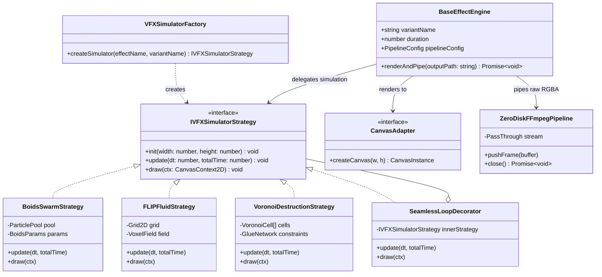

# Systematic VFX Overlay Architecture, Procedural Synthesis Analysis & Refactoring Plan

## Executive Summary

This document provides a technical explanation of the overlay effects implementation in `@acc/effect-engines/overlay-effects`, synthesizes the advanced concepts outlined in the procedural VFX research documents (`vfx_procedural_vfx_analysis.md`, `vfx01`, `vfx02`, `vfx03`), and details a refactoring and implementation plan.

The goal of this architecture is to achieve an isolated, extensible, high-performance, and regression-free overlay effects engine leveraging proven design patterns (Strategy, Factory, Registry, Composite, Pipeline, Adapter, Decorator, and Observer).

---

## 1. Analysis of Existing Implementation (`@acc/effect-engines/overlay-effects`)

### 1.1 Architecture & Pipeline Mechanics
The current overlay effects engine in `packages/effect-engines/src/overlay-effects` provides high-speed, zero-disk video loop generation via HTML5 Canvas and FFmpeg streaming.

```
┌─────────────────────────┐     ┌────────────────────────┐     ┌────────────────────────┐
│   CLI / API Layer       │     │ BaseEffectEngine       │     │ Canvas Adapter         │
│ (overlay-effects-cli)   │────>│ (Rain, Snow, Smoke...) │────>│ (@napi-rs/canvas)     │
└─────────────────────────┘     └────────────────────────┘     └────────────────────────┘
                                            │                               │
                                            ▼ (Raw RGBA Frame Buffer)       │
                                ┌────────────────────────┐                  │
                                │ EffectPipeline         │<─────────────────┘
                                │ (PassThrough Stream)   │
                                └────────────────────────┘
                                            │
                                            ▼ (Pipe to stdin)
                                ┌────────────────────────┐
                                │ FFmpeg Encoding Process│
                                │ (H.264 / VP9 Output)   │
                                └────────────────────────┘
```

1. **Zero-Disk Streaming Architecture (`EffectPipeline`)**:
   - Canvas frames are serialized to raw RGBA buffer objects (`toBuffer('raw')`).
   - Frames are pushed into a Node.js `PassThrough` stream connected to an FFmpeg stdin process (`-f rawvideo -pix_fmt rgba`).
   - Eliminates intermediate PNG/JPEG file I/O on disk, maximizing frame-rate throughput.

2. **Canvas Abstraction (`CanvasAdapter`)**:
   - `CanvasAdapter` decouples rendering algorithms from specific canvas library backends.
   - Currently implemented using `NapiRsCanvasAdapter` (`@napi-rs/canvas` compiled native Rust bindings).

3. **Dynamic Module Registry (`RegistryManager` & `engine.ts`)**:
   - `effects-registry.json` maintains metadata mapping for pipeline configs, effect categories, variants, and module file locations.
   - `renderEffectLayer` dynamically imports module engines using URL resolution (`pathToFileURL`), instantiates sub-classes of `BaseEffectEngine`, executes the loop, and auto-generates companion JSON metadata.

---

### 1.2 Mathematical Foundations & Blending Specifications (`OVERLAY_METHODS_SPEC.md`)

The engine enforces four standard color space pipeline strategies defined in `effects-registry.json`:

| Strategy | Pipeline Key | Target Container & Codec | Neutral Background | Blending Formula | Primary Applications |
| :--- | :--- | :--- | :--- | :--- | :--- |
| **Alpha Compositing** | `webm_alpha` | `.webm` (`libvpx-vp9`, `yuva420p`) | Transparent (`rgba(0,0,0,0)`) | $C_{\text{out}} = C_{\text{fg}} \cdot \alpha_{\text{fg}} + C_{\text{bg}} \cdot (1 - \alpha_{\text{fg}})$ | UI/HUD, Confetti, Leaves, Floating Hearts, Manga Speed Lines |
| **Luma Additive** | `mp4_luma` | `.mp4` (`libx264`, `yuv420p`) | Solid Black (`#000000`) | $C_{\text{out}} = 1 - (1 - C_{\text{bg}})(1 - C_{\text{fg}})$ | Fire, Lightning, Rain, Snow, Bokeh, Dust, Sparks, Lens Flare |
| **Multiply** | `mp4_multiply` | `.mp4` (`libx264`, `yuv420p`) | Solid White (`#FFFFFF`) | $C_{\text{out}} = C_{\text{bg}} \cdot C_{\text{fg}}$ | Ink drops, Dark smoke, Stains, Shadows |
| **Overlay / Contrast** | `mp4_overlay` | `.mp4` (`libx264`, `yuv420p`) | Neutral 50% Gray (`#808080`) | $C_{\text{out}} = \begin{cases} 2 C_{\text{bg}} C_{\text{fg}} & C_{\text{bg}} < 0.5 \\ 1 - 2(1-C_{\text{bg}})(1-C_{\text{fg}}) & C_{\text{bg}} \ge 0.5 \end{cases}$ | Film scratches, Film grain, Halftone textures, Paper folds |

---

### 1.3 Companion Metadata Specification
For every generated video artifact (e.g., `rain_storm_5s.mp4`), a companion JSON metadata file (`rain_storm_5s.json`) is generated containing:
- `overlay_method`: `screen` | `alpha` | `multiply` | `overlay`
- `recommended_blend_mode`: `screen` | `normal` | `multiply` | `overlay`
- `ffmpeg_filter_snippet`: Pre-computed filter string for downstream composition (e.g., `blend=all_mode=screen:all_opacity=1:shortest=1`).
- `ffmpeg_input_options`: Required decoding parameters (e.g. `["-c:v", "libvpx-vp9"]` for VP9 alpha preservation).

---

### 1.4 Looping Mechanics
1. **Polyrhythmic Looping**: Combining overlay layers rendered with coprime durations (e.g., 3s, 5s, 7s) creates non-repeating, organic multi-layer visual combinations over long timelines.
2. **Seamless Mathematical Wrapping**: Position modulo math (`(pos + velocity * t) % dimension`) and continuous periodic phase functions ($\sin(\omega t)$) ensure frame $N-1$ connects smoothly to frame $0$.

---

## 2. In-Depth Analysis of Procedural VFX Foundations

By analyzing `vfx_procedural_vfx_analysis.md` and the deep-dive documents (`vfx01`, `vfx02`, `vfx03`), we extract four core procedural paradigms that must be integrated systematically into the overlay generator framework:

```
┌────────────────────────────────────────────────────────────────────────┐
│                        Procedural VFX Engine                           │
├───────────────────┬───────────────────┬────────────────┬───────────────┤
│ 1. Kinematics     │ 2. Volumetrics    │ 3. Destruction │ 4. Noise      │
│   & Swarm Logic   │   & Fluid Solvers │   & Rigid Body │   Fields      │
├───────────────────┼───────────────────┼────────────────┼───────────────┤
│ - Particle Pool   │ - 2D Eulerian Grid│ - Voronoi      │ - Perlin 2D/3D│
│ - Boids Rules     │ - FLIP Solver     │   Fracturing   │ - Simplex     │
│   (Sep/Align/Coh) │ - Navier-Stokes   │ - Impulse      │ - Fractal Brownian│
│ - Verlet/Euler    │   Advection       │   Response     │   Motion (fBm)│
│   Integration     │ - Raymarching     │ - Constraint / │ - Curl Noise  │
│                   │   VDB Density     │   Glue Networks│   Vector Field│
└───────────────────┴───────────────────┴────────────────┴───────────────┘
```

### 2.1 Particle Systems & Swarm Kinematics (`vfx01`)
- **Lifecycle Pipeline**: Emission $\rightarrow$ Force Accumulation $\rightarrow$ Numerical Integration $\rightarrow$ Render $\rightarrow$ Death / Recycle.
- **Integration Scheme**: Semi-Implicit Euler Integration:
  $$v_{t+dt} = v_t + \left(\frac{F}{m}\right) \cdot dt$$
  $$x_{t+dt} = x_t + v_{t+dt} \cdot dt$$
- **Boids Flocking Algorithm**:
  1. *Separation*: $F_{\text{sep}} = \sum_{j \neq i} \frac{x_i - x_j}{\|x_i - x_j\|^2}$
  2. *Alignment*: $F_{\text{align}} = \left( \frac{1}{N} \sum_{j} v_j \right) - v_i$
  3. *Cohesion*: $F_{\text{coh}} = \left( \frac{1}{N} \sum_{j} x_j \right) - x_i$
- **Application to Overlays**: Leaves (`leaves.ts`), Confetti (`confetti.ts`), Embers (`embers.ts`), Bubbles (`bubbles.ts`), Floating Hearts (`floating_hearts.ts`), Dust (`dust.ts`), Starfield (`starfield.ts`).

---

### 2.2 Volumetrics & Fluid Dynamics (`vfx02`)
- **Navier-Stokes Equations**:
  $$\frac{\partial \vec{u}}{\partial t} + (\vec{u} \cdot \nabla)\vec{u} = -\frac{1}{\rho}\nabla p + \nu \nabla^2 \vec{u} + \vec{g}$$
  $$\nabla \cdot \vec{u} = 0 \quad \text{(Incompressibility Constraint)}$$
- **Eulerian Voxel Grid / FLIP Solvers**:
  - Grid velocity projection $\rightarrow$ Pressure Poisson Solver $\rightarrow$ Advection.
- **Volumetric Raymarching**:
  - Accumulating density along camera ray: $T = \exp\left(-\int \sigma_a(s) ds\right)$.
- **Application to Overlays**: Smoke (`smoke.ts`), Fog/Mist (`fog.ts`), Fire (`fire.ts`), God Rays (`god_rays.ts`), Light Leaks (`light_leak.ts`).

---

### 2.3 Destruction & Rigid Body Dynamics (`vfx03`)
- **Rigid Body Physics (RBD)**: Mass, Moment of Inertia, Coefficients of Friction and Restitution.
- **Voronoi Fracture**:
  - Given seed set $S = \{p_1, p_2, \dots, p_n\}$, cell $V_i = \{x \mid \|x - p_i\| \le \|x - p_j\| \;\forall j \neq i\}$.
- **Constraint Glue Networks**:
  - Elastic spring links between adjacent shards with breaking thresholds $F_{\text{break}}$.
- **Application to Overlays**: Film Damage / Dirt (`film_damage.ts`), Glass Shatter / Rain on Glass (`rain_on_glass.ts`), Digital Glitch / Datamosh (`digital_glitch.ts`).

---

### 2.4 Noise & Procedural Motion Fields
- **Fractal Brownian Motion (fBm)**: $fBm(x) = \sum_{k=0}^{O-1} \gamma^k N(2^k x)$.
- **Curl Noise**: Divergence-free vector field generated by taking the curl of a 2D/3D scalar noise potential field $\vec{v} = \nabla \times \vec{\Psi}$. Guarantees incompressible, turbulence motion without particle clustering.
- **Application to Overlays**: Bokeh motion, VHS tracking wobble, Audio spectrum noise synthesis, Anime speed lines.

---

## 3. Design Patterns & Refactored Architecture

To make the codebase modular, testable, and regression-free, we adopt 8 software design patterns:

```
┌─────────────────────────────────────────────────────────────────────────────────────────┐
│                             Design Patterns Architecture                                │
├─────────────────────────┬──────────────────────────────┬────────────────────────────────┤
│ Pattern                 │ Core Class / Interface       │ System Responsibility           │
├─────────────────────────┼──────────────────────────────┼────────────────────────────────┤
│ 1. Strategy             │ IVFXSimulatorStrategy        │ Physics algorithms (FLIP, Boids│
│                         │                              │ Voronoi, Curl Noise)           │
│ 2. Factory              │ VFXSimulatorFactory          │ Instantiate solver strategies  │
│ 3. Registry             │ VFXRegistryManager           │ Effect & pipeline catalog      │
│ 4. Composite            │ VFXCompositeStack            │ Multi-layer polyrhythmic stacks│
│ 5. Pipeline / Dataflow  │ ZeroDiskFFmpegPipeline       │ Frame buffer streaming to FFmpeg│
│ 6. Adapter              │ CanvasAdapter                │ Canvas 2D / WebGL / GPU        │
│ 7. Decorator            │ SeamlessLoopDecorator        │ Temporal wrapping & Seamless   │
│                         │ MotionBlurDecorator          │ Accumulation buffer blur       │
│ 8. Observer             │ VFXRenderEventEmitter        │ Render events & progress CLI   │
└─────────────────────────┴──────────────────────────────┴────────────────────────────────┘
```

### 3.1 Class Hierarchy & Component Interdependencies



---

## 4. Implementation Plan & Refactoring Roadmap

### Step 1: Core Physics & Simulation Modules Abstraction
Create shared, reusable physics and mathematical utilities under `packages/effect-engines/src/overlay-effects/simulators/`:

1. `simulators/particles/particle-pool.ts`: High-performance object pool for particle memory allocation zero-GC during render loops.
2. `simulators/particles/boids-solver.ts`: Optimized 2D Boids flocking algorithm implementation.
3. `simulators/noise/curl-noise.ts`: Divergence-free 2D/3D Curl noise implementation built on Simplex noise.
4. `simulators/fluids/grid2d-solver.ts`: Lightweight 2D Eulerian velocity field & density advection solver.
5. `simulators/destruction/voronoi-fracture.ts`: 2D Voronoi cell generation and glue-constraint solver.

---

### Step 2: Strategy Decorators & Seamless Looping Wrapper
Implement `decorators/seamless-loop.ts` and `decorators/motion-blur.ts`:
- **Seamless Loop Decorator**: Wraps any `IVFXSimulatorStrategy`, managing two phase-shifted simulation instances or applying periodic time-warp curves ($t' = \frac{T}{2\pi} \sin(\frac{2\pi t}{T})$) to guarantee zero jump cuts between frame $N-1$ and frame $0$.
- **Motion Blur Decorator**: Maintains an RGBA frame accumulation buffer, blending previous sub-steps for high-speed particles (rain drops, lightning branches, speed lines).

---

### Step 3: Generator Standardization & Refactoring Matrix
Refactor all 28 existing overlay generators to utilize the strategy & simulator library:

| Generator File | Category | Applied Strategy / Simulator | Refactoring Target |
| :--- | :--- | :--- | :--- |
| `rain.ts` | Weather | `ParticlePool` + `MotionBlurDecorator` | Replace raw array with pooled particles & sub-frame motion blur |
| `snow.ts` | Weather | `CurlNoise` + Sine wave drifting | Smooth turbulent swirling via Curl noise field |
| `dust.ts` | Atmosphere | `BoidsSwarmStrategy` (Cohesion min, Separation low) | Micro-flocking ambient dust motes |
| `fog.ts` | Atmosphere | `Grid2DSolver` (Eulerian Density) | Real fluid advection mist field |
| `smoke.ts` | Action | `Grid2DSolver` + Thermal Buoyancy | Buoyant fluid smoke simulation |
| `fire.ts` | Action | `Grid2DSolver` + `CurlNoise` | Flame tongue distortion via vector noise |
| `embers.ts` | Action | `ParticlePool` + `CurlNoise` | Buoyant sparks with turbulence |
| `leaves.ts` | Organic | `BoidsSwarmStrategy` + 3D Pendulum Rotation | Rigid body fluttering leaf simulation |
| `bubbles.ts` | Organic | `Grid2DSolver` + Buoyancy | Rising bubbles interacting with fluid velocity |
| `confetti.ts` | Celebration | 3D Rigid Body Rotation + Gravity | Flapping paper aerodynamics |
| `floating_hearts.ts`| Celebration | Bezier Curve Path + Pulsing Decorator | Path follower particle system |
| `film_damage.ts` | Retro | `VoronoiFracture` + Hairline Noise | Procedural film scratches and dirt cells |
| `rain_on_glass.ts` | Grunge | Surface Tension Drops + Sliding Physics | Droplet merging & sliding dynamics |
| `digital_glitch.ts` | Cyberpunk | Block Datamosh + RGB Split Buffer | Glitch slicing decorator |
| `starfield.ts` | Cosmic | 3D Perspective Projection + Warp Vector | Hyper-drive velocity vectors |

---

### Step 4: Stacking Engine Enhancement (`stacker.ts`)
Refactor `stacker.ts` using the **Composite Pattern**:
- Build complex FFmpeg filter graphs (`filter_complex`) dynamically for overlaying multiple composite layers.
- Automatically calculate polyrhythmic phase alignment for composite stacks (`haunted_forest`, `cyberpunk_alley`, `romantic_spring`, etc.).

```
┌────────────────────────────────────────────────────────────────────────┐
│                        Composite Stacker Engine                        │
├───────────────────┬───────────────────┬────────────────────────────────┤
│ Input 0 (Layer 1) │ Input 1 (Layer 2) │ Input 2 (Layer 3)              │
│ Fog (7s loop)     │ Dust (5s loop)    │ Film Damage (3s loop)          │
└─────────┬─────────┴─────────┬─────────┴──────────────┬─────────────────┘
          │                   │                        │
          ▼                   ▼                        ▼
┌────────────────────────────────────────────────────────────────────────┐
│ FFmpeg Complex Filter Graph:                                           │
│ [0:v][1:v] blend=all_mode=screen [tmp1];                               │
│ [tmp1][2:v] blend=all_mode=overlay [outv]                              │
└────────────────────────────────────────────────────────────────────────┘
```

---

### Step 5: Verification & Regression Testing
1. **Unit Testing**: Test individual simulators (Boids, Curl noise, Grid2D) in isolation under `autogenerated-tests/` or `packages/effect-engines/src/overlay-effects/__tests__/`.
2. **Visual Verification**: Generate output video loops for all 28 effects across both `mp4_luma` and `webm_alpha` pipelines.
3. **Metadata Validation**: Ensure JSON metadata conforms strictly to `OVERLAY_METHODS_SPEC.md`.

---

## 5. Summary & Key Directives

1. **Isolation**: Every simulation strategy lives in a self-contained class with no global state.
2. **Zero Disk Overhead**: Raw RGBA pixel streaming directly to FFmpeg stdin is preserved and optimized.
3. **Deterministic & Seamless**: All effects adhere to seamless loop constraints using time-based mathematical functions and noise phase wrapping.
4. **Maintainability**: Adding new overlay effects requires only implementing `IVFXSimulatorStrategy` and registering it in `effects-registry.json`.
