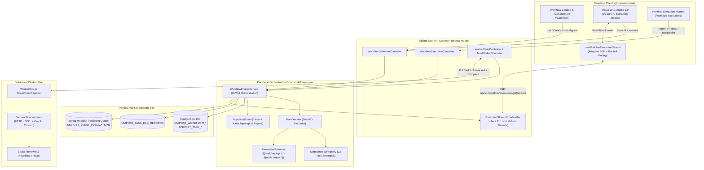
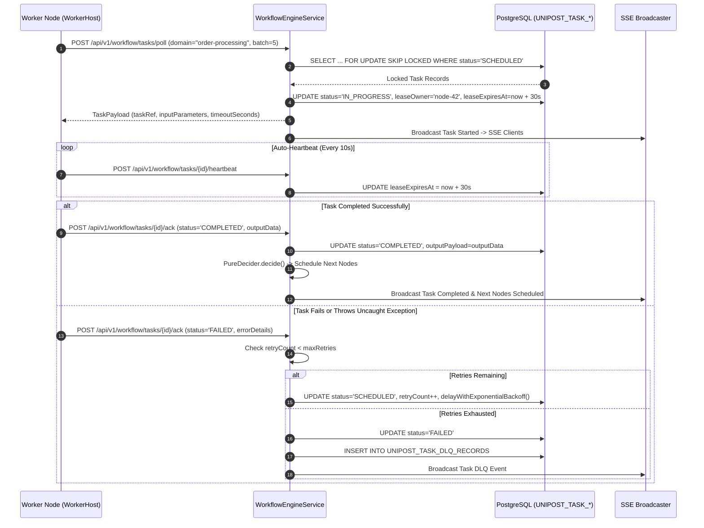

# Unipost Workflow Orchestration Engine: Architectural Blueprint & Master Specification

**Document Version:** 1.0.0  
**Status:** Authoritative Single Source of Truth (SSOT)  
**Lead Systems Architect:** Principal Polyglot Architect & Full-Stack Systems Engineer  
**Target Systems:**  
- `@unipost/backend` (`apps/backend/workflow-engine`, `apps/backend/unipost-ms-aio`)  
- `@unipost/console` (`apps/console/src/features/workflows`, `apps/console/src/features/workflow-executions`)  
- `@unipost/ui` (`packages/ui`)  
**Compliance Standards:** Java 21 LTS, Spring Modulith, React 19, `@xyflow/react`, WCAG 2.2 AA, Liquid Glass Optical Tokens, Zero-Stub Sandbox Parity  

---

## 1. Executive Summary & Core Architectural Directives

The **Unipost Workflow Orchestration Engine** is an enterprise-grade, distributed Directed Acyclic Graph (DAG) state machine designed for high-throughput, low-latency, resilient task orchestration. It unifies complex business workflows across multi-tenant data boundaries, external worker fleets, human-in-the-loop approvals, and AI agent tool invocations.

```
====================================================================================================
                              UNIPOST WORKFLOW ORCHESTRATION ENGINE                                 
====================================================================================================
  1. PURE DETERMINISTIC CORE    |    2. DISTRIBUTED WORKER FLEET    |   3. OPERATOR STUDIO & RUNTIME
  Zero-I/O Decider, Strategy     | Lease-based polling, auto-        | Dual-mode visual DAG canvas,  
  Registry, topological acyclic  | heartbeat, error classification,  | live SSE streaming, time-     
  guard, parameter resolution.   | DLQ & persistent outbox events.   | travel scrubbing & flamegraph.
====================================================================================================
```

### The Three Inviolable Architectural Invariants

1. **100% Pure Deterministic State Machine (`PureDecider`)**:
   - The decider core executes **zero network calls, zero JDBC transactions, and zero thread operations**.
   - Signature: `(WorkflowDefinition, WorkflowSnapshot, nowEpochMs) -> DecisionResult`.
   - Given the identical input tuple, `PureDecider` produces bit-for-bit identical `EngineCommand` directives every single execution.
2. **Strict Topological & Control Flow Integrity**:
   - Workflows must be strict Directed Acyclic Graphs verified by Tarjan/Kahn topological algorithms.
   - Divergence and convergence are strictly governed: **`FORK_JOIN` branches must converge on `JOIN` or `EXCLUSIVE_JOIN`**; tasks maintain single-input/single-output paths.
3. **Dual-Mode Visual Ergonomics & Zero-Stub Unified Sandbox Parity**:
   - The same DAG schema and execution stream contract powers production live runtime inspection, offline local-first design, and multi-branch simulation in the **Unified Sandbox Platform**. No synthetic mocks or stubs leak into production.

---

## 2. End-to-End System Topology & Interaction Flow



---

## 3. Pure Decider Core & 23-Node Strategy Matrix

### 3.1 The Pure Decider Pattern
The decider delegates state transitions to an open/closed `NodeStrategyRegistry`:
- **Interface**: `NodeEvaluatorStrategy`
  - Method: `NodeEvaluationResult evaluate(TaskDefinition taskDef, WorkflowSnapshot snapshot, long nowEpochMs, ParameterResolver resolver)`
  - Returns: `nodeStatus` (`TaskStatus`), `commands` (`List<EngineCommand>`), and task output data.

### 3.2 Strategy Matrix (23 Node Types)

| Category | Node Type (`TaskType`) | Decider Semantics & Execution Lifecycle |
| :--- | :--- | :--- |
| **Control Flow (11)** | `SIMPLE` | Queues task for leased worker execution. |
| | `SWITCH` | Evaluates dynamic condition expression, activates matching branch, marks alternate branches as skipped. |
| | `FORK_JOIN` | Spawns multiple parallel execution branches simultaneously. |
| | `JOIN` | Barrier synchronization: waits for all incoming branches to reach terminal completion. |
| | `EXCLUSIVE_JOIN`| Convergence for `SWITCH` branches: completes as soon as the active branch completes. |
| | `DYNAMIC_FORK` | Dynamically evaluates input list and spawns *N* parallel sub-tasks at runtime. |
| | `WAIT` | Suspends execution until explicit epoch time or external webhook callback. |
| | `DO_WHILE` | Post-iteration loop construct re-scheduling child nodes until condition evaluates to false. |
| | `TERMINATE` | Immediately forces workflow to terminal status (`COMPLETED` or `FAILED`). |
| | `SUB_WORKFLOW` | Triggers child workflow and yields until child workflow reaches terminal completion. |
| | `START_WORKFLOW`| Pure conventional boundary node dedicated strictly to input payload schema validation. |
| **Data & Transform (3)** | `JSON_JQ_TRANSFORM` | In-memory RFC-based JSON transformation without network roundtrip. |
| | `INLINE` | Evaluates safe Groovy/MVEL/JavaScript expression in sandboxed context. |
| | `SET_VARIABLE` | Writes ephemeral key-value variables into `workflow.variables.*` scope. |
| **System I/O (5)** | `HTTP` | Declarative outbound REST call with configurable retry, backoff, and status code assertion. |
| | `JDBC` | Executes parameterized SQL query/mutation against configured tenant datasource. |
| | `KAFKA_PUBLISH` | Publishes structured event message to Apache Kafka topic with idempotency key. |
| | `EVENT` | Suspends node until an external Kafka or webhook event arrives matching correlation key. |
| | `NOOP` | Passthrough connector node for graph structure alignment. |
| **Human Governance (1)**| `HUMAN` | Halts execution, generates approval task in `ApprovalsInbox`, awaits user sign-off. |
| **AI & Emerging (3)** | `LLM_CHAT_COMPLETE` | Invokes streaming LLM prompt with temperature, model selection, and token telemetry. |
| | `CALL_MCP_TOOL` | Standard Model Context Protocol invocation for dynamic external tool calling. |
| | `DYNAMIC` | Dynamic runtime task type resolved via worker registration discovery. |

---

## 4. Parameter Resolution & Variable Scoping Hierarchy

Task inputs resolve variables using a deterministic, acyclic cascading scope:

```
  ┌────────────────────────────────────────────────────────┐
  │ 1. Workflow Input: ${workflow.input.<field>}           │
  ├────────────────────────────────────────────────────────┤
  │ 2. Workflow Variables: ${workflow.variables.<key>}     │
  ├────────────────────────────────────────────────────────┤
  │ 3. Task Upstream Output: ${<taskReferenceName>.output.<path>}
  ├────────────────────────────────────────────────────────┤
  │ 4. System Context: ${system.tenantId}, ${system.now}   │
  └────────────────────────────────────────────────────────┘
```

- **Compile-Time Validation**: The frontend IR validator and backend `AcyclicityGuard` detect and reject circular references before persistence.
- **Null-Safety**: Unresolved optional variables fallback to specified defaults or trigger fast-fail validation.

---

## 5. Distributed Worker Fleet Architecture & Lease Protocol

Workers communicate with the engine using an atomic lease reservation model:



### Worker Middleware Pipeline
Each worker processes tasks through an extensible middleware pipeline:
1. `SchemaValidationMiddleware`: Asserts incoming payload conforms to task JSON Schema.
2. `AutoHeartbeatMiddleware`: Spawns daemon thread renewing lease every 10s.
3. `ErrorClassificationMiddleware`: Distinguishes between retryable transient network errors vs fatal business errors.

---

## 6. Frontend Visual DAG Studio Architecture (`@unipost/console`)

```
apps/console/src/features/workflows/
├── api/                     # TanStack Query hooks & REST API bindings
├── approvals/               # Human-in-the-loop Approvals Inbox view
├── components/
│   ├── catalog/             # Definitions table, KPI bar, create & hot-migrate dialogs
│   ├── execution/           # Execution run drawer, logs terminal, terminal tabs
│   ├── migration/           # Hot migration modal & version comparison
│   ├── studio/              # Visual DAG Studio 2.0 Monolith & Sub-Modules
│   │   ├── canvas/          # Custom ReactFlow Node (`DagWorkflowNodeComponent`) & Edges
│   │   ├── hooks/           # `useDagStudioState`, `useDagExecutionSync`, `useDagFollowLive`
│   │   ├── inspectors/      # `DagPropertyInspector`, `TaskTelemetryInspector`
│   │   ├── modals/          # JSON Editor, Edge Condition, Dry-Run, Simulation Modals
│   │   ├── palette/         # Segmented 23-node categorized collapsible palette
│   │   ├── timeline/        # Time-Travel Scrubber & Execution Flamegraph
│   │   └── toolbar/         # Segmented floating command bar, debugger sub-pill, validation banner
│   └── __tests__/           # Comprehensive Vitest component & hook test suites
├── hooks/                   # `useWorkflowExecutionStream` (SSE + adaptive polling)
└── sandbox/                 # Unified Sandbox route handlers & multi-branch simulation presets
```

### 6.1 Dual Operational Modes
1. **Designer Mode (`mode="designer"` / `mode="full"`)**:
   - Palette drag-and-drop, marquee box multi-node selection, edge quick-insert split buttons, topological layout auto-formatting, live acyclicity and binding syntax validation.
2. **Execution / Inspector Mode (`mode="execution"`)**:
   - Palette hidden, canvas locked into read-only layout.
   - Nodes display animated progress rings, live execution elapsed timers (100ms precision), and state badges (`PENDING`, `IN_PROGRESS`, `COMPLETED`, `FAILED`, `PAUSED_AT_BREAKPOINT`).
   - Time-Travel scrubber with flamegraph sync allows scrubbed historical state replay with zero mutation to active HEAD.
   - Follow-Live auto-pans canvas following active node execution centroid.

### 6.2 Real-Time SSE Streaming Pipeline
- **Endpoint**: `GET /api/v1/workflow/executions/{id}/stream`
- **Broadcaster**: Backed by Java 21 Loom virtual threads with 15-second heartbeat pings.
- **Client Resilience**: `useWorkflowExecutionStream` transitions through `CONNECTING` -> `OPEN` -> `RECONNECTING` (exponential backoff) -> `POLLING_FALLBACK` (adaptive HTTP polling).

---

## 7. Operational Resilience, DLQ & Hot Fleet Migration

### 7.1 Dead-Letter Queue (DLQ) Recovery Flow
When a task fails permanently:
1. Engine captures input payload, stack trace, and execution context into `UNIPOST_TASK_DLQ_RECORDS`.
2. Operators inspect failed tasks via `/system/dlq` or the execution drawer console.
3. Operators can modify task input parameters inline and trigger an idempotent **Partial Replay** without restarting the entire workflow.

### 7.2 Fleet Hot Migration Protocol
When a new workflow version ($V_{n+1}$) is published:
- In-flight executions can be migrated using one of three strategies:
  1. **Strict Drain**: Existing executions finish on $V_n$; new executions start on $V_{n+1}$.
  2. **Safe Fast-Forward**: If unstarted nodes in $V_{n+1}$ have identical input signatures, executions switch versions mid-flight.
  3. **Forced Remap**: Explicit mapping of old task reference names to new task reference names with schema transformation.

---

## 8. Unified Sandbox Parity & Zero-Stub Compliance

All workflow features maintain complete offline functional parity in the Unified Sandbox:
- Handlers registered in `apps/console/src/core/sandbox/index.ts` intercept workflow definition queries and execution requests.
- Multi-branch order fulfillment pipeline (`MULTI_BRANCH_ORDER_NODES`, `MULTI_BRANCH_ORDER_EDGES`) generates realistic dispatches, branch splits, timer intervals, and terminal states.
- Mock `EventSource` simulates real-time SSE stream events with zero network latency.
- Stateful mock repositories implement `reset()` wired to the master `SandboxDock` reset event.

---

## 9. System Roadmap & Evolution Tracks

```mermaid
timeline
    title Unipost Workflow Orchestration Engine Roadmap
    section Track 1: Master Foundations (Current)
        SSOT Architectural Blueprint : Authoritative Reference Document
        Telemetry Strips : KPI metrics on /workflows & /workflow-executions
        Visual Studio 2.0 : Dual-modes, Follow-Live, Time-Travel
    section Track 2: Advanced Connectors
        Kafka Event Dispatcher : Idempotent pub/sub messaging
        MCP Tool Invoker : Model Context Protocol integrations
        Dynamic Fork Runtime : Dynamic list task expansion
    section Track 3: Canvas Ergonomics
        Auto-DAG Layout : ElkJS / Dagre layout engine
        Multi-Node Grouping : Box select & mass repositioning
        Edge Routing Polish : High-density orthogonal bundling
    section Track 4: Enterprise Operations
        Interactive DLQ Replay : Inline parameter edit & replay
        Full Hot Migration Studio : Visual side-by-side node remapping
        Audit Log Diff Replay : RFC-6902 JSON Patch state rollbacks
```
